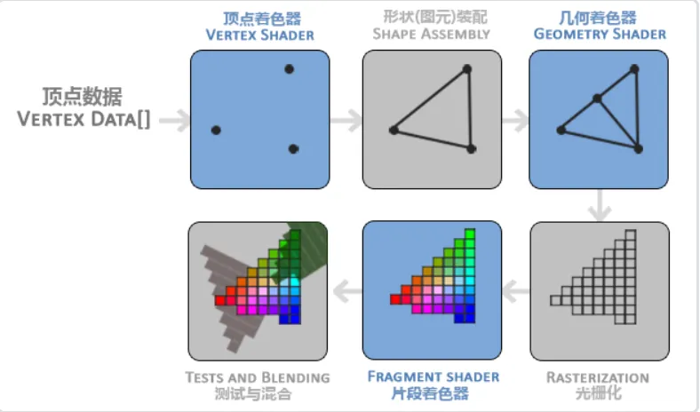

# OpenGL 学习笔记

### 配套使用的库

**GLAD** **(OpenGL Extension Wrangler)**：一个用于加载 OpenGL 扩展的库,管理OpenGL的指针和上下文

**GLFW(Graphics Library Framework)**：是一个用于创建窗口和处理用户输入的库

<!-- more -->


## 基础渲染窗口流程

1. 初始化GLFW窗口配置，比如使用GL的版本和模式
2. 使用GLFW创建窗口，设置窗口尺寸
3. 使用GLFW设置窗口环境，和编写窗口改变的回调函数(optional)
4. 使用GLAD加载所有GL的函数指针
5. 在窗口渲染循环中，编写渲染逻辑：比如交换帧缓冲区，监听输入


## 渲染三角形

### 关键词

* 顶点数组对象：Vertex Array Object，VAO
* 顶点缓冲对象：Vertex Buffer Object，VBO
* 元素缓冲对象：Element Buffer Object，EBO 或 索引缓冲对象 Index Buffer Object，IBO

图形渲染管线：3D坐标转为2D坐标的处理过程，第一部分把你的3D坐标转换为2D坐标，第二部分是把2D坐标转变为实际的有颜色的像素。

着色器：GPU上有很多个核心，每个核心上都有渲染管线的程序，程序就叫着色器。OpenGL着色器是用OpenGL着色器语言(OpenGL Shading Language, **GLSL**)写成的。

顶点着色器(Vertex Shader):它把一个单独的顶点作为输入。顶点着色器主要的目的是把3D坐标转为另一种3D坐标，同时顶点着色器允许我们对顶点属性（颜色）进行一些基本处理

图元(Primitive)：决定顶点数据渲染的类型，可以是点，线，三角形。e.g:GL_POINTS、GL_TRIANGLES、GL_LINE_STRIP。

几何着色器(Geometry Shader):几何着色器把图元形式的一系列顶点的集合作为输入，它可以通过产生新顶点构造出新的（或是其它的）图元来生成其他形状。例子中，它生成了另一个三角形。

光栅化阶段(Rasterization Stage):这里它会把图元映射为最终屏幕上相应的像素，生成供片段着色器(Fragment Shader)使用的片段(Fragment)。在片段着色器运行之前会执行裁切(Clipping)。裁切会丢弃超出你的视图以外的所有像素，用来提升执行效率。

片段着色器:主要目的是计算一个像素的最终颜色，这也是所有OpenGL高级效果产生的地方。通常，片段着色器包含3D场景的数据（比如光照、阴影、光的颜色等等），这些数据可以被用来计算最终像素的颜色。

Alpha测试和混合(Blending):这个阶段检测片段的对应的深度（和模板(Stencil)）值（后面会讲），用它们来判断这个像素是其它物体的前面还是后面，决定是否应该丢弃。这个阶段也会检查alpha值（alpha值定义了一个物体的透明度）并对物体进行混合(Blend)。所以，即使在片段着色器中计算出来了一个像素输出的颜色，在渲染多个三角形的时候最后的像素颜色也可能完全不同。

### 渲染管线流程




对于大多数场合，我们只需要配置**顶点和片段着色器**就行了。**几何着色器**是可选的，通常使用它默认的着色器就行了。（图中蓝色的部分是可以人为修改的）

**标准化设备坐标(Normalized Device Coordinates, NDC)**:顶点坐标已经在顶点着色器中处理过，它们就应该是**标准化设备坐标**了。OpenGL仅当3D坐标在3个轴（x、y和z）上-1.0到1.0的范围内时才处理它。(0, 0)坐标是这个图像的中心，而不是左上角

### 正式开始渲染

假设我们现在要渲染一个物体在屏幕中，首先必须要有物体的顶点坐标。然后至少要有一个顶点shader程序和一个片段shader程序。在顶点着色器中，**只需要关注输入的数据处理**，顶点坐标是输入，需要对输入的顶点向量处理和解释。在片段着色器中，**不需要关注输入，只需要关注输出**：光栅化后的像素最后应该是什么颜色（光照和反射导致颜色变化）。

### 准备数据

在渲染前，还有一个工作：将顶点数据发送给显卡，缓存在显存中。这个步骤涉及到VBO（顶点缓冲对象，类似一个3D模型的顶点组成的顶点数组对象）

```c++
unsigned int VBO = glGenBuffers(1, &VBO);
```

以上代码表示生成一个VBO并赋予一个独一无二的ID，此时并没有数据。

```c++
glBindBuffer(GL_ARRAY_BUFFER, VBO);  
```

以上代码将VBO绑定到GL_ARRAY_BUFFER类型的缓冲区，每种缓冲区只能绑定一个缓冲对象，OpenGL中有多种类型的缓冲区，每种类型的缓冲区都有特定的用途。**GL_ARRAY_BUFFER类型的缓冲区用于存储顶点属性数据，如顶点坐标、法线、颜色等**。**GL_ELEMENT_ARRAY_BUFFER**用于存储图元索引数据，比如绘制三角形、四边形等的顶点索引。还有纹理缓冲区等等。

接下来就是将顶点数据**拷贝到绑定的缓冲区**，通过以下函数实现：

```c++
glBufferData(GL_ARRAY_BUFFER, sizeof(vertices), vertices, GL_STATIC_DRAW);
```

如果要更换绑定的缓冲对象，就需要调用以下函数实现解绑的效果：

```c++
glBindBuffer(GL_ARRAY_BUFFER, 0);  
```

现在我们已经把顶点数据储存在显卡的内存中，用VBO这个顶点缓冲对象管理。

从以上代码来看啊，每次绘制一个物体都需要绑定缓冲区，然后解释顶点数据。不同对象的解释方法不同，为了简便操作，出现了VAO。 

VAO并不是必须的，VBO可以独立使用，VBO缓存了数据，而数据的使用 方式（glVertexAttribPointer 指定的数据宽度等信息）并没有缓存，VBO将顶点信息放到GPU中，GPU在渲染时去缓存中取数据，二者中间的桥梁是GL-Context。GL-Context整个程序一般只有一个，所以如果一个渲染流程里有两份不同的绘制代码，当切换VBO时（有多个VBO时，通过glBindBuffer切换 ），**数据使用方式信息就丢失了**。而GL-context就负责在他们之间进行切换。这也是为什么要在渲染过程中，在每份绘制代码之中会有glBindbuffer、glEnableVertexAttribArray、glVertexAttribPointer。VAO记录该次绘制所需要的所有VBO所需信息，把它保存到VBO特定位置，绘制的时候直接在这个位置取信息绘制。　

 VAO为我们解决了这个大麻烦，当配置顶点属性数据的时候，只需要将配置函数调用执行一次，随后再绘制该物体的时候就只需要绑定相应的VAO即可，这样，我们就可以通过绑定不同的VAO（提醒，与VBO一样，同一时刻只能绑定一个VAO），使得在不同的顶点数据和属性配置切换变得非常简单。VAO记录的是一次绘制中所需要的信息，这包括“数据在哪里glBindBuffer”、“数据的格式是怎么样的glVertexAttribPointer”、shader-attribute的location的启用glEnableVertexAttribArray。

### 顶点着色器

着色器根据渲染端的不同使用不同的语言，openGL使用GLSL语言，比较接近C语言。下面给出顶点着色器的代码，可以用字符串表示，也可以用文件存放并加载。

```glsl
#version 330 core layout (location = 0) in vec3 aPos; 
void main() 
{    gl_Position = vec4(aPos.x, aPos.y, aPos.z, 1.0); }
```


【1】https://blog.csdn.net/p942005405/article/details/103770259

【2】https://learnopengl-cn.github.io/01%20Getting%20started/04%20Hello%20Triangle/
