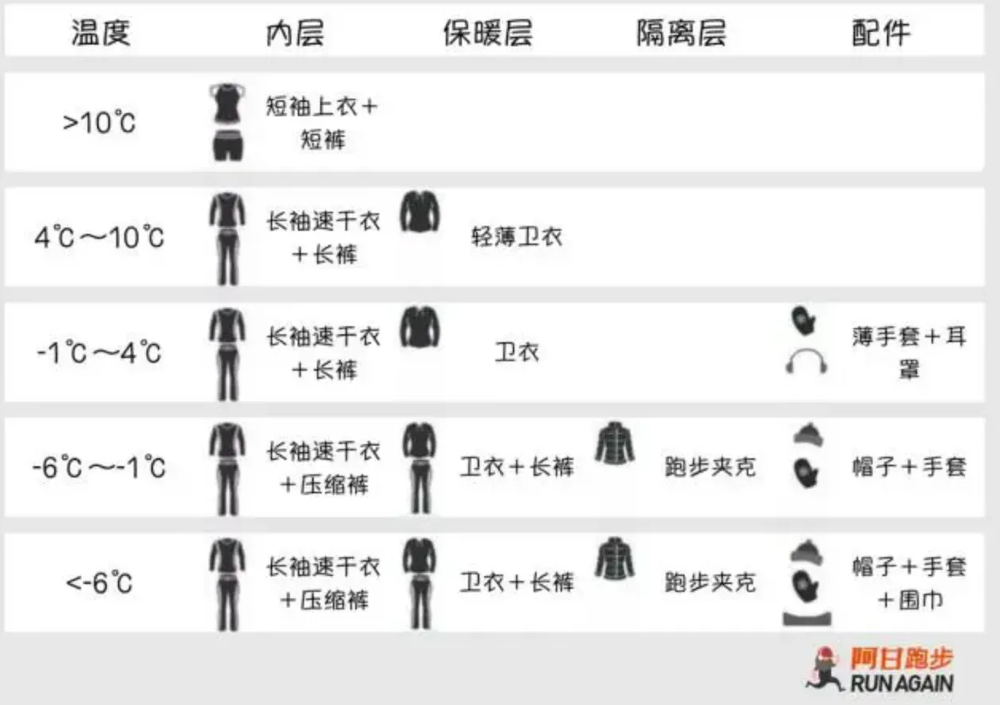

青岛只有夏季和冬季 --不知道谁说的

随着日历翻到10月，天气逐渐转凉，我也开始增添衣物。往年都是自己被冻到发抖的时候才想起买点厚衣服，不知道怎么穿，不知道怎么买，导致我在青岛冬天的幸福指数始终不高。因为经常被低温和大风折磨。每年买的厚衣服基本上穿一次就不想穿了，经常季抛。今年决定好好生活，改变一下往年的穿衣搭配，讲究一个科学御寒，本文将尽可能详细的描述秋冬季穿搭，包括冬季跑步的穿搭。

<!-- more -->

冬季穿衣主打一个**多层次**， 多层的衣服中间存在一个空气层，可以有效的保温和隔离寒冷。与之相反的穿法就是一件厚厚的羽绒服+一件薄薄长袖衫，这样虽然方便，室内可以脱掉羽绒服，室外穿上，但是实际的保温效果其实一般般，尤其是青岛的大风天气。

于我而言，希望冬天也可以跑跑步，为了避免跑完步后出汗带来的失温风险，多层搭配需要一定的讲究。运动型多层次穿衣主要分为3层：
1. 速干层
2. 保暖层
3. 额外保暖层（可选）
4. 隔离层

速干层的主要特点是：轻薄，吸汗，非棉。目的是运动后能够迅速排走湿气，蒸发汗液。
保暖层则一般是卫衣，不过最好买运动型卫衣，避免棉材质的卫衣，因为这一层的保暖卫衣也要承担一定的汗水蒸发功能
额外保暖层则是在非常低的温度下或者大风天气补充的保暖，可以选择羽绒马甲或者棉服。
隔离层则是对抗青岛大风的主要手段，一般选择运动夹克，具备防风和防水。不过透气比较差，因为防风和透气难以兼得，考虑到青岛海边的气候，尽量还是选择防风较好的夹克才可以更好的保暖。

对于下半身来说相对简单，穿一条速干打底裤+运动裤即可。如果不运动的话也可以穿保暖内裤+运动裤。

此外根据温度和风级选择一定的“配件”，比如手套和帽子，这样可以有效的减少皮肤裸露层度，降低身体与环境的热量交换。

最后附上一张跑步穿搭指示图：

