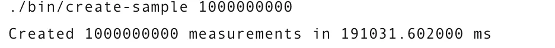
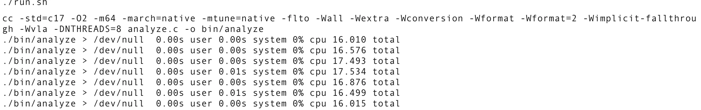
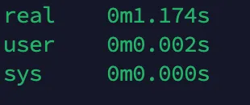

在python随着AI爆火的时期，人们更加偏向于使用弱类型的脚本语言去编写程序。尤其是编写深度学习相关的代码，使用C和C++代码的程序员更多是深耕于嵌入式领域的。

然而在交通领域和遥感领域处理TB级别的数据并不少见，所以使用粒度更细，性能更优秀的C++和C语言可以带来更加高效的数据处理，有时候将测试的python代码经过优化转化成C++代码，再用上一些“黑魔法”：SIMD，CUDA，处理器缓存优化，分支预测技术。可以让代码的运行效率优化多达10^1 ~ 10^7倍，通常是指数级别的优化。

本文带来一个优化案例：快速处理10亿级别的数据，[原挑战来源于1BRC](https://github.com/gunnarmorling/1brc)，


<!-- more -->
这是一个编写java程序处理10亿行文本数据，统计各个站点的温度的最小值，平均值和最大值。最后根据格式输出。比赛的数据提前加载在内存中，只需要从内存中读取处理即可，即使如此最快也需要1.5s左右的时间。

下面首先简单分析一下处理如此大量数据的优化思路：

1. 通常我们最优先考虑的应该是算法本身的时间复杂度，这个无关语言无关代码调试，但是应该最重视的，对于大数据处理而言即使从O(n^2) 提升到 O(n)的提升也是巨大的。这里设计大量相同的站点读取数据，所以用哈希是最好不过了，读取可以接近O(1）的效率
2. 对于大数据处理最容易想到的就是并行，采用多线程或者多进程，**对于IO密集型使用多线程，对于计算密集型采用多进程**。将大数据分块处理，最后合并
3. 分析样图的数据案例，可以得得知站点温度数据只有一个小数点，可以将浮点转换为整数处理
4. 大量数据涉及到大量IO，可以考虑使用mmap将文件直接映射到虚拟内存
5. 尽量用空间换时间，对于一些数据的处理尽可能提前分配好空间，然后通过索引访问，避免使用动态扩展的数据结构减少系统分配的时间
6. 除了线程和进程级别的并行，进一步使用处理器指令级别的并行，现代处理器采用流水线架构，可以尝试使用SIMD，单条指令处理多条数据，或者更加激进了多指令多数据（复杂度也会非常高）
7. 将算法中出现的的循环操作优化成矩阵操作，使用GPU进行加速，尤其是利用CUDA
8. 优化处理器的分支预测，手动告诉编译器可能的分支预测情况


除此之外多利用C++或者C语言的一些trick,一些小技巧也是很重要的，比如：
1. 编写一些小的函数，参数尽量避免拷贝操作，直接传如引用，对于不需要修改的参数用const 修饰
2. 对于大量的数据循环求和，可以先排序再求和，有助于处理器的分支预测
3. 减少除法和模运算，对于模运算可以用一个2的指数数据求&操作得到模运算的结果，会更快

首先附上最终优化结果：


运行环境：Intel(R) Xeon(R) Silver 4210R CPU @ 2.40GHz

内存128G

40 Cores

下面给出用c语言处理1b温度数据的代码，代码的分析在注释中，这是一份中规中矩的优化

```c
#include <fcntl.h>
#include <pthread.h>
#include <stdatomic.h>
#include <stdio.h>
#include <stdlib.h>
#include <string.h>
#include <sys/mman.h>
#include <sys/stat.h>
#include <sys/time.h>
#include <sys/types.h>
#include <unistd.h>

#define MAX_DISTINCT_GROUPS 10000
#define MAX_GROUPBY_KEY_LENGTH 100

// Capacity of our hashmap
// Needs to be a power of 2
// so we can bit-and instead of modulo

//for 10k key cases. For 413 key cases, 16384 is enough.
#define HASHMAP_CAPACITY 16384
#define HASHMAP_INDEX(h) (h & (HASHMAP_CAPACITY - 1))
/*
这个表达式通常用于确保计算结果在有效索引范围内，实际上和取模运算效果一致
2的指数减去1，除了最高位全是1，与一个数进行&运算只会保留全是1的部分，最后
的结果就是最小小不过0，最大大不过那个二进制全为1的数，
等同于 h%HASHMAP_CAPACITY
之所以不用取模是因为现代处理器在取模运算和除法运算上比较慢
但是要利用&运算替代%运算的一个前提是哈希表容量需要时2的指数，所以通常
哈希表容量是预计数据的1.34倍且是2的指数
more info ref. to https://juejin.cn/post/7182597553110646821
*/

#ifndef NTHREADS
#define NTHREADS 16
#endif

#define BUFSIZE ((1<<10)*16)
// 此处bufsieze = 1024*16

static size_t chunk_count;
static size_t chunk_size;
static atomic_uint chunk_selector;
// size_t 表示无符号整数，，大小取决于平台，32位平台=4字节 ，64位平台=8字节
// 此处使用了atomic_unit，减少对互斥锁的需求从而提高程序的性能，且是线程安全的

struct Group {
  unsigned int count;
  int min;
  int max;
  long sum;
  char key[MAX_GROUPBY_KEY_LENGTH];
};
// 一个group存储一个站点的温度数据 最后输出的时候，对于温度的平均值只需要用 sum/count
// MAX_GROUPBY_KEY_LENGTH  = 100

struct Result {
  unsigned int n;
  unsigned int map[HASHMAP_CAPACITY];
  //map是存储哈希的索引，通过hashcode计算字符串在map中的位置，读取map中存储的索引index，再从groups[index]
  //读取key对应的站点数据  
  struct Group groups[MAX_DISTINCT_GROUPS];  //结构体数组存储站点结构体
};
// MAX_DISTINCT_GROUPS = 10000
// HASHMAP_CAPACITY = 16384 = 2^14


// parses a floating point number as an integer
// this is only possible because we know our data file has only a single decimal
// 此处static的作用：1.其他文件无法访问该函数，限制作用域 2.利于编译器优化性能
// 此处inline的作用：1.编译器会尝试将该函数的代码嵌入到每个调用该函数的位置，避免了调用和返回的开销，减少了栈帧的创建和销毁，从而可以提高性能
// 此处const的作用：1. 对于修饰函数返回值的作用是保护返回的数据，不能通过返回的指针修改数据 2. 对于修饰输入参数，在函数执行期间不会修改，保护输入的
// 原始数据 3. 对于char指针而言，函数参数可以同时处理常量和非常量字符串。
static inline const char *parse_number(int *dest, const char *s) {
  // parse sign
  // 最后返回的是指向这行数据的尾部指针
  int mod = 1;
  if (*s == '-') {
    mod = -1;
    s++;
  }

  if (s[1] == '.') {
    *dest = ((s[0] * 10) + s[2] - ('0' * 11)) * mod;
    return s + 4;
  }

  *dest = (s[0] * 100 + s[1] * 10 + s[3] - ('0' * 111)) * mod;
  // e.g  12.3  = 49 * 100 + 50 * 10 + 51 - (48 * 111)  = 123
  return s + 5;
}
// 函数分析：输入的数据只有小数点后一位，温度范围-100～100 (应该没有天气温度达到100)，所以数据应该是 xy.z , x.y或者 -xy.z , -x.y格式
// 数据解析分析：查找ascii 码表 0-9的数字是 ：48-57
// 根据ascii 分析可以推算出计算公式  e.g 针对xy.z型 ， dest = (x-48)*100 + (y-48)*10 + (z-48) 化简后就是代码的写法

/* 
Note
const修饰指针变量：
根据在*号位置决定功能，“左定值，右定向”
e.g：const int *p = 8; 在左边，指针指向内容不可变
int a = 8;
int* const p = &a; 在右边，指针本身不可修改

const对于函数参数的优势：
1. 函数可以接受常量变量和非常量对象，比如f(const int x); 调用时可以写f(5); 或者 x= 5, f(x);
2. 当使用引用或指针作为参数时，减少拷贝
3. 避免传入的数据被修改，对于只需要访问其值的数据，减少被修改的可能

*/


static inline int min(int a, int b) { return a < b ? a : b; }
static inline int max(int a, int b) { return a > b ? a : b; }

// qsort callback
// 此处函数的作用是比较group结构体中key的字符串大小
static inline int cmp(const void *ptr_a, const void *ptr_b) {
  return strcmp(((struct Group *)ptr_a)->key, ((struct Group *)ptr_b)->key);
}

// strcmp 根据字符串ascii逐个比较,返回值小于0，表示str1 < str2, 返回值等于0 ，str1=str2

// returns a pointer to the slot in our hashmap
// for storing the index in our results array
// 返回指向哈希表中适当位置的指针, 可以解释为哈希表索引的指针
// 先根据哈希函数算出索引，再通过索引去访问数组元素
static inline unsigned int *hashmap_entry(struct Result *result,
                                          const char *key) {
  unsigned int h = 0;  
  unsigned int len = 0; //同时计算key的长度
  for (; key[len] != '\0'; len++) {
    h = (h * 31) + (unsigned char)key[len];
  }
  // 哈希计算方法 ： 每个字符ascii值*31 + 字符ascii值 ， 注意acii的值范围是0-127，char的范围-128-127

  unsigned int *c = &result->map[HASHMAP_INDEX(h)];
  while (*c > 0 && memcmp(result->groups[*c].key, key, len) != 0) {
    h++;
    c = &result->map[HASHMAP_INDEX(h)];
  }
  // int memcmp(const void *str1, const void *str2, size_t n)) 把存储区 str1 和存储区 str2 的前 n 个字节进行比较。 
  // *c > 0 检测哈希表中的位置是否被使用
  // memcmp(result->groups[*c].key, key, len) != 0的作用是判断被占用的是否是同一个key
  // 被占用(哈希冲突)且不是同一个key,就使用线性探测下一个位置

  return c;
}

/*
Note：
此处哈希函数设计应该是参考java的hashcode实现的，选择了乘以31是因为性能优化和哈希分布的原因
乘以 31 可以通过左移和减法来实现。具体而言，乘以 31 可以表示为 h * 32 - h，其中 h * 32 通过左移 5 位（相当于乘以 32）实现
并且31是一个奇素数，它只能被自己和1整除，所以选择乘以这个可以尽量减少哈希冲突
*/

static void *process_chunk(void *_data) {
  char *data = (char *)_data;  //将void指针强制转化为char 指针

  // initialize result
  struct Result *result = malloc(sizeof(*result));
  if (!result) {
    perror("malloc error");
    exit(EXIT_FAILURE);
  }
  result->n = 0; // 初始站点数量为0

  //由于这两个在内存中是连续的，我们可以使用一次对 memset 的调用来实现这一点，
  //但这段代码只被调用 NTHREADS 次，因此这样做实际上并不值得。
  //memset用于将一段内存区域设置为指定的值，此处将哈希表和站点数据内存全部置0
  memset(result->map, 0, HASHMAP_CAPACITY * sizeof(*result->map));
  memset(result->groups, 0, MAX_DISTINCT_GROUPS * sizeof(*result->groups));

  // keep grabbing chunks until done
  // 这里有个非常巧妙的操作，设定了一个全局变量 chunk_selector，但是使用了
  // automic_uint 类型，所以是线程安全的，无须锁，保证每个线程的处理的块是唯一的
  while (1) {
    const unsigned int chunk = chunk_selector++;
    if (chunk >= chunk_count) {
      break; // 当前抢到的块已经超过划分的范围，处理完毕直接退出循环
    }
    size_t chunk_start = chunk * chunk_size;
    size_t chunk_end = chunk_start + chunk_size;
    // 计算处理的块的起始和结束

    // skip forward to next newline in chunk
    // 这一行代码的作用是把指针指向chunk中最先出现的数据，跳过块前面被之前线程处理掉的残余数据
    const char *s = chunk_start > 0
                  ? (char *)memchr(&data[chunk_start], '\n', chunk_size) + 1
                  : &data[chunk_start];

    // this assumes the file ends in a newline...
    // 从块的尾部搜索残余的数据
    const char *end = (char *)memchr(&data[chunk_end], '\n', chunk_size) + 1;

    // 这两行代码真正确定了线程要处理的数据范围，而块的开始只是确定了大致的位置，由于字符长短不一，所以
    // 切块无法做到刚好就是一行数据的最尾部的'\n'换行符，还需要手动搜索一下

    // flaming hot loop
    while (s != end) {
      const char *linestart = s;

      // find position of ;
      // while simulatenuously hashing everything up to that point
      unsigned int len = 0;
      unsigned int h = 0;
      while (s[len] != ';') {
        h = (h * 31) + (unsigned char)s[len];
        len += 1;
      }
      // 计算字符串的hash值，此处并未取模， 同时计算了字符串的长度

      // parse decimal number as int
      int temperature;
      s = parse_number(&temperature, linestart + len + 1);  // 此时s已经指向了下一行数据的起始

      // probe map until free spot or match
      unsigned int *c = &result->map[HASHMAP_INDEX(h)];   //获得第一次哈希结果的哈希表的地址
      while (*c > 0 && memcmp(result->groups[*c].key, linestart, len) != 0) {
        h += 1;
        c = &result->map[HASHMAP_INDEX(h)];
      }

      // new hashmap entry
      if (*c == 0) {
        *c = result->n;
        memcpy(result->groups[*c].key, linestart, len);  //将站点名字拷贝结果中
        result->n++;
      }

      // existing entry
      result->groups[*c].count += 1;
      result->groups[*c].min = min(result->groups[*c].min, temperature);
      result->groups[*c].max = max(result->groups[*c].max, temperature);
      result->groups[*c].sum += temperature;
    }
  }

  return (void *)result;
}

static void result_to_str(char *dest, const struct Result *result) {
  *dest++ = '{';  // 先赋值后移动指针

  // sprintf的作用是发送格式化输出到 str 所指向的字符串，如果成功，则返回写入的字符总数
  for (unsigned int i = 0; i < result->n; i++) {
    size_t n = (size_t)sprintf(
    dest, "%s=%.1f/%.1f/%.1f%s", result->groups[i].key,
    (float)result->groups[i].min / 10.0,
    ((float)result->groups[i].sum / (float)result->groups[i].count) / 10.0,
    (float)result->groups[i].max / 10.0, i < (result->n - 1) ? ", " : "");

    dest += n;
  }

  *dest++ = '}';
  *dest++ = '\n';
  *dest = '\0';
}

int main(int argc, char **argv) {
  // set-up pipes for communication
  // then fork into child process which does the actual work
  // this allows us to skip the time the system spends doing munmap
  int pipefd[2];
  // pipefd[0]：读取端，用于接收数据。
  // pipefd[1]：写入端，用于发送数据。
  // 管道通过 pipe() 系统调用创建，返回一个包含两个文件描述符的数组
  if (pipe(pipefd) != 0) {
    perror("pipe error");
    exit(EXIT_FAILURE);
  }
  pid_t pid;
  pid = fork();

  // 如果 pid 大于 0，表示在父进程中；如果 pid 等于 0，表示在子进程中。
  if (pid > 0) {
    // close write pipe ,父进程只需要读取数据
    close(pipefd[1]);
    char buf[BUFSIZE];
    if (-1 == read(pipefd[0], &buf, BUFSIZE)) {
      perror("read error");
    }
    printf("%s", buf);
    close(pipefd[0]);
    exit(EXIT_FAILURE);
  }

  // close unused read pipe ,下面代码是子进程，关闭读取端
  close(pipefd[0]);

  char *file = "measurements.txt";
  if (argc > 1) {
    file = argv[1];
  }

  int fd = open(file, O_RDONLY);
  if (!fd) {
    perror("error opening file");
    exit(EXIT_FAILURE);
  }
  //struct stat 是 C 语言中的一个结构体，定义在 <sys/stat.h> 头文件中，
  //用于存储文件的状态信息。你可以使用 stat 系统调用（或 fstat 和 lstat）获取指定文件或目录的各种信息。
  struct stat sb;
  if (fstat(fd, &sb) == -1) {
    perror("error getting file size");
    exit(EXIT_FAILURE);
  }

  // mmap entire file into memory
  // 它可以把文件映射到进程的虚拟内存空间。通过对这段内存的读取和修改，可以实现对文件的读取和修改，而不需要用read和write函数。
  size_t sz = (size_t)sb.st_size;   // sz 表示size 文件的大小
  char *data = mmap(NULL, sz, PROT_READ, MAP_SHARED, fd, 0);
  if (data == MAP_FAILED) {
    perror("error mmapping file");
    exit(EXIT_FAILURE);
  }
  /*
  Note:
  void *mmap(void *addr, size_t length, int prot, int flags, int fd, off_t offset);
  NULL：第一个参数是 addr，表示映射的起始地址。如果为 NULL，表示让操作系统选择映射地址。
  sz：第二个参数是 length，表示映射区域的大小。在此，我们将 sz（文件的大小）传给它，表示映射整个文件的内容到内存。
  PROT_READ：第三个参数是 prot，指定内存映射的访问权限。PROT_READ 表示映射区域是可读的，但不可写或执行。
  MAP_SHARED：第四个参数是 flags，表示映射的类型。MAP_SHARED：表示多个进程可以共享该内存区域的内容。如果文件内容在内存中被修改，这些修改会被写回文件
  fd：第五个参数是 fd，表示打开的文件描述符。它指向要映射的文件，
  0：最后一个参数是 offset，表示映射的起始偏移量。
  mmap 返回一个 void * 类型的指针，表示映射区域的起始地址。如果映射成功，data 将指向该区域。

  比起使用传统的读写文件，使用mmap的性能优势：
  1.当使用常规的文件 I/O 操作（如 read 和 write）时，操作系统需要将文件数据从磁盘读取到内核缓冲区，
  然后再从内核缓冲区复制到用户进程的内存中。这种过程中会有两次数据复制（从磁盘到内核，从内核到用户空间），
  而 mmap 直接将文件映射到进程的虚拟内存中，避免了这个多余的拷贝过程。

  2.零拷贝 I/O： 在使用 mmap 映射文件后，程序可以直接在内存中操作文件内容，而不需要通过系统调用进行频繁的读写操作。
  
  */


  // distribute work among N worker threads
  // 默认chunk_size=file_size/32 ,如果是1b的数据，一个chunk_size大概有380多MB的数据
  // 默认分成32个块，但是只用16个线程处理
  chunk_size = (sz / (2 * NTHREADS));
  chunk_count = (sz / chunk_size - 1) + 1;
  pthread_t workers[NTHREADS];
  for (unsigned int i = 0; i < NTHREADS; i++) {
    pthread_create(&workers[i], NULL, process_chunk, data);
  }

  // wait for all threads to finish
  struct Result *results[NTHREADS];
  for (unsigned int i = 0; i < NTHREADS; i++) {
    pthread_join(workers[i], (void *)&results[i]);
  }

  // merge results
  struct Result *result = results[0];  //把最终的所有结果都汇总到第一个result
  for (unsigned int i = 1; i < NTHREADS; i++) {
    // 内循环是处理一个result中站点, result[i]->n表示站点数量
    for (unsigned int j = 0; j < results[i]->n; j++) {
      struct Group *b = &results[i]->groups[j];  //按照存入顺序访问站点结构体
      unsigned int *hm_entry = hashmap_entry(result, b->key);  //计算这一个站点key在result中的哈希指针
      unsigned int c = *hm_entry;
      if (c == 0) { //result中没有该站点的数据的情况，需要拷贝站点名称过去
        c = result->n++;
        *hm_entry = c;
        strcpy(result->groups[c].key, b->key);
      }
      // result存在该站点信息了，直接访问哈希计算出的数组位置，补充站点信息
      result->groups[c].count += b->count;
      result->groups[c].sum += b->sum;
      result->groups[c].min = min(result->groups[c].min, b->min);
      result->groups[c].max = max(result->groups[c].max, b->max);
    }
  }

  // sort results alphabetically
  qsort(result->groups, (size_t)result->n, sizeof(*result->groups), cmp);
  /*
  Note：
  void qsort(void *base, size_t nitems, size_t size, int (*compar)(const void *, const void *));
  参数解释：
  base：指向待排序数组的指针。它是一个 void* 类型，因此可以指向任何类型的数据。
  nitems：待排序数组中的元素个数，类型为 size_t。
  size：每个元素的大小，以字节为单位，类型为 size_t。
  compar：指向比较函数的指针。比较函数用于确定两个元素的顺序，应该返回一个整数值：负值表示第一个元素小于第二个元素，正值表示第一个元素大于第二个元素，零表示两者相等。
  */

  // prepare output string
  char buf[(1 << 10) * 16];
  result_to_str(buf, result);
  if (-1 == write(pipefd[1], buf, strlen(buf))) {
    perror("write error");
  }

  // close write pipe
  close(pipefd[1]);

  // clean-up
  munmap((void *)data, sz);
  close(fd);
  for (unsigned int i = 0; i < NTHREADS; i++) {
    free(results[i]);
  }
  return EXIT_SUCCESS;
}

```

下面简单测试一下程序，先利用官方给出的数据生成代码生成10亿的数据


查看了一下大小，13G，可以说是非常大了
下面运行10次观测，我使用的是苹果的m1处理器，内存为8G（丐中丐版hhhh）



实际运行时间大概16-17s，我没有仔细分析，但是大概率瓶颈在内存和硬盘，和官方的不同，自己的程序处理的数据需要从硬盘映射到内存。苹果的内存和硬盘性能一般般，但是给的处理器很强，但是运行的时候发现并没有跑满，不知道这个是不是由于操作系统调度的问题导致的。

虽然测试电脑性能羸弱，但是对于10亿行数据，在20s内能够处理完全也是非常优秀的了。

用服务器测试了一下，服务器采用的是Intel(R) Xeon(R) Silver 4210R CPU @ 2.40GHz，内存128G，一共40核心数，运算结果非常接近1s了，如果换成比较新的AMD的CPU和更好的内存和固态配置，1s肯定没问题。



处理大量的数据很多时候是在做科研，论文数据处理，但是这种性能的提升，对于做科研，其实并不需要如此苛刻，因为对于研究而言程序运行1s和运行10min的影响并不大，无非是多等待片刻。**对于科研人员而言，工具更多是服务研究的，如何有利于研究便利更重要，这种优化对于绝大多非计算机专业的科研人员来说是比较困难的。所以选择更合理的工具，避免在优化上浪费时间更加重要。**

这里给出一份别人写的用python在m1 macbook上处理10亿数据的代码，大概就50行不到，运行时间大约半分钟，这种方式可以节省大量的开发时间。

```python
from dask.distributed import Client
import dask_expr as dd

client = Client()

df = dd.read_csv(
    "measurements.txt",
    sep=";",
    header=None,
    names=["station", "measure"],
    engine='pyarrow',
    dtype_backend='pyarrow'
)
df = df.groupby("station").agg(["min", "max", "mean"])
df.columns = df.columns.droplevel()
df = df.sort_values("station").compute()
```


对于工业领域而言，性能就相对十分重要了，尤其是实际落地的应用，
下面带来的是SIMD版本的代码，真正的极致优化，考虑了编译器的处理和处理分支预测，还有指令级别的并行处理：


```c++
#include "my_timer.h"
#include <fcntl.h>
#include <sys/mman.h>
#include <sys/stat.h>
#include <unistd.h>
#include <stdlib.h>
#include <iostream>
#include <fstream>
#include <string>
#include <vector>
#include <algorithm>
#include <cmath>
#include <iomanip>
#include <immintrin.h>
#include <thread>
#include <new>
#include <unordered_map>
#include <cstring>
#include <atomic>
#include <malloc.h>
#include <sys/types.h>
#include <sys/wait.h>
using namespace std;

#define likely(x)       __builtin_expect(!!(x), 1)
#define unlikely(x)     __builtin_expect(!!(x), 0)

constexpr uint32_t SMALL = 749449;
constexpr uint32_t SHL_CONST = 18;
constexpr int MAX_KEY_LENGTH = 100;
constexpr uint32_t NUM_BINS = 16384 * 8; // for 10k key cases. For 413 key cases, 16384 is enough.

#ifndef N_THREADS_PARAM
constexpr int MAX_N_THREADS = 8; // to match evaluation server
#else
constexpr int MAX_N_THREADS = N_THREADS_PARAM;
#endif

#ifndef N_CORES_PARAM
constexpr int N_CORES = MAX_N_THREADS;
#else
constexpr int N_CORES = N_CORES_PARAM;
#endif

constexpr bool DEBUG = 0;


struct Stats {
    int64_t sum;
    int cnt;
    int max;
    int min;

    Stats() {
        cnt = 0;
        sum = 0;
        max = -1024;
        min = 1024;
    }

    bool operator < (const Stats& other) const {
        return min < other.min;
    }
};

struct HashBin {
    uint8_t key_short[32]; // std::string Short String Optimization, pogchamp
    int64_t sum;
    int cnt;
    int max;
    int min;
    int len;
    uint8_t* key_long;

    HashBin() {
      // C++ zero-initialize global variable by default
      len = 0;
      memset(key_short, 0, sizeof(key_short));
      key_long = nullptr;
    }
};
static_assert(sizeof(HashBin) == 64); // faster array indexing if struct is power of 2

std::unordered_map<string, Stats> partial_stats[MAX_N_THREADS];
std::unordered_map<string, Stats> final_recorded_stats;

HashBin* global_hmaps;
alignas(4096) HashBin* hmaps[MAX_N_THREADS];

alignas(4096) uint8_t strcmp_mask32[64] = {
  255, 255, 255, 255, 255, 255, 255, 255,
  255, 255, 255, 255, 255, 255, 255, 255,
  255, 255, 255, 255, 255, 255, 255, 255,
  255, 255, 255, 255, 255, 255, 255, 255,
  0, 0, 0, 0, 0, 0, 0, 0,
  0, 0, 0, 0, 0, 0, 0, 0,
  0, 0, 0, 0, 0, 0, 0, 0,
  0, 0, 0, 0, 0, 0, 0, 0,
};

inline int __attribute__((always_inline)) mm128i_equal(__m128i a, __m128i b)
{
  __m128i neq = _mm_xor_si128(a, b);
  return _mm_test_all_zeros(neq, neq);
}

inline int __attribute__((always_inline)) mm256i_equal(__m256i a, __m256i b)
{
  __m256i neq = _mm256_xor_si256(a, b);
  return _mm256_testz_si256(neq, neq);
}

inline void __attribute__((always_inline)) handle_line_slow(const uint8_t* data, HashBin* hmap, size_t &data_idx)
{
  uint32_t pos = 16;
  uint32_t myhash;

  __m128i chars = _mm_loadu_si128((__m128i*)data);
  __m128i index = _mm_setr_epi8(0, 1, 2, 3, 4, 5, 6, 7, 8, 9, 10, 11, 12, 13, 14, 15);
  __m128i separators = _mm_set1_epi8(';');
  __m128i compared = _mm_cmpeq_epi8(chars, separators);
  uint32_t separator_mask = _mm_movemask_epi8(compared);

  if (likely(separator_mask)) pos = __builtin_ctz(separator_mask);

  // sum the 2 halves of 16 characters together, then hash the resulting 8 characters
  // this save 1 _mm256_mullo_epi32 instruction, improving performance by ~3%
  //__m128i mask = _mm_loadu_si128((__m128i*)(strcmp_mask + 16 - pos));
  __m128i mask = _mm_cmplt_epi8(index, _mm_set1_epi8(pos));
  __m128i key_chars = _mm_and_si128(chars, mask);
  __m128i sumchars = _mm_add_epi8(key_chars, _mm_unpackhi_epi64(key_chars, key_chars)); // 0.7% faster total program time compared to srli

  // okay so it was actually technically illegal. Am I stupid?
  myhash = (uint64_t(_mm_cvtsi128_si64(sumchars)) * SMALL) >> SHL_CONST;

  if (unlikely(data[pos] != ';')) {
    __m256i chars32_1 = _mm256_loadu_si256((__m256i*)(data + 17));
    __m256i chars32_2 = _mm256_loadu_si256((__m256i*)(data + 17 + 32));
    __m256i separators32 = _mm256_set1_epi8(';');

    __m256i compared32_1 = _mm256_cmpeq_epi8(chars32_1, separators32);
    __m256i compared32_2 = _mm256_cmpeq_epi8(chars32_2, separators32);

    uint64_t separator_mask64 = uint64_t(_mm256_movemask_epi8(compared32_1)) | (uint64_t(_mm256_movemask_epi8(compared32_2)) << 32);
    if (likely(separator_mask64)) pos = 17 + __builtin_ctzll(separator_mask64);
    else {
      __m256i chars32_3 = _mm256_loadu_si256((__m256i*)(data + 81));
      __m256i compared32_3 = _mm256_cmpeq_epi8(chars32_3, separators32);
      uint32_t separator_mask_final = _mm256_movemask_epi8(compared32_3);
      pos = 81 + __builtin_ctz(separator_mask_final);
    }
  }

  PARSE_VALUE:
  // DO NOT MOVE HASH TABLE PROBE TO BEFORE VALUE PARSING
  // IT'S LIKE 5% SLOWER
  // data[pos] = ';'.
  // There are 4 cases: ;9.1, ;92.1, ;-9.1, ;-92.1
  int len = pos;
  pos += (data[pos + 1] == '-'); // after this, data[pos] = position right before first digit
  int sign = (data[pos] == '-') ? -1 : 1;
  myhash %= NUM_BINS; // let pos be computed first beacause it's needed earlier

  // PhD code from curiouscoding.nl. Must use uint32_t else undefined behavior
  uint32_t uvalue;
  memcpy(&uvalue, data + pos + 1, 4);
  uvalue <<= 8 * (data[pos + 2] == '.');
  constexpr uint64_t C = 1 + (10 << 16) + (100 << 24); // holy hell
  uvalue &= 0x0f000f0f; // new mask just dropped
  uvalue = ((uvalue * C) >> 24) & ((1 << 10) - 1); // actual branchless
  int value = int(uvalue) * sign;

  // intentionally move index updating before hmap_insert
  // to improve register dependency chain
  data_idx += pos + 5 + (data[pos + 3] == '.');

  if (likely(len <= 16)) {
    // loading everything and calculate twice is consistently 1% faster than just
    // using old result (comment all 4 lines)
    // Keep all these 4 lines is faster than commenting any of them, even though
    // all 4 variables were already calculated before. HUH???
    __m128i chars = _mm_loadu_si128((__m128i*)data);
    __m128i index = _mm_setr_epi8(0, 1, 2, 3, 4, 5, 6, 7, 8, 9, 10, 11, 12, 13, 14, 15);
    __m128i mask = _mm_cmplt_epi8(index, _mm_set1_epi8(len));
    __m128i key_chars = _mm_and_si128(chars, mask);

    __m128i bin_chars = _mm_load_si128((__m128i*)hmap[myhash].key_short);
    __m128i neq = _mm_xor_si128(bin_chars, key_chars);
    if (likely(_mm_test_all_zeros(neq, neq) || hmap[myhash].len == 0)) {
      // consistent 2.5% improvement in `user` time by testing first bin before loop
    }
    else {
      myhash = (myhash + 1) % NUM_BINS; // previous one failed
      while (hmap[myhash].len > 0) {
        // SIMD string comparison
        __m128i bin_chars = _mm_load_si128((__m128i*)hmap[myhash].key_short);
        if (likely(mm128i_equal(key_chars, bin_chars))) break;
        myhash = (myhash + 1) % NUM_BINS;
      }
    }
  }
  else if (likely(len <= 32 && hmap[myhash].len != 0)) {
    __m256i chars = _mm256_loadu_si256((__m256i*)data);
    __m256i mask = _mm256_loadu_si256((__m256i*)(strcmp_mask32 + 32 - len));
    __m256i key_chars = _mm256_and_si256(chars, mask);

    __m256i bin_chars = _mm256_load_si256((__m256i*)hmap[myhash].key_short);
    if (likely(mm256i_equal(key_chars, bin_chars))) {}
    else {
      myhash = (myhash + 1) % NUM_BINS;
      while (hmap[myhash].len > 0) {
        // SIMD string comparison
        __m256i bin_chars = _mm256_load_si256((__m256i*)hmap[myhash].key_short);
        if (likely(mm256i_equal(key_chars, bin_chars))) break;
        myhash = (myhash + 1) % NUM_BINS;
      }
    }
  }
  else {
    while (hmap[myhash].len > 0) {
      // check if this slot is mine
      if (likely(hmap[myhash].len == len)) {
        int idx = 0;
        while (idx + 32 < len) {
          __m256i chars = _mm256_loadu_si256((__m256i*)(data + idx));
          __m256i bin_chars = _mm256_loadu_si256((__m256i*)(hmap[myhash].key_long + idx));
          if (unlikely(!mm256i_equal(chars, bin_chars))) goto NEXT_LOOP;
          idx += 32;
        }

        if (likely(idx <= 64)) {
          __m256i mask = _mm256_loadu_si256((__m256i*)(strcmp_mask32 + 32 - (len - idx)));
          __m256i chars = _mm256_loadu_si256((__m256i*)(data + idx));
          __m256i key_chars = _mm256_and_si256(chars, mask);
          __m256i bin_chars = _mm256_loadu_si256((__m256i*)(hmap[myhash].key_long + idx));
          if (likely(mm256i_equal(key_chars, bin_chars))) break;
        } else {
          // len must be >= 97
          bool equal = true;
          for (int i = idx; i < len; i++) if (data[i] != hmap[myhash].key_long[i]) {
              equal = false;
              break;
          }
          if (likely(equal)) break;
        }
      }
      NEXT_LOOP:
      myhash = (myhash + 1) % NUM_BINS;
    }
  }

  hmap[myhash].cnt++;
  hmap[myhash].sum += value;
  if (unlikely(hmap[myhash].max < value)) hmap[myhash].max = value;
  if (unlikely(hmap[myhash].min > value)) hmap[myhash].min = value;

  // each key will only be free 1 first time, so it's unlikely
  if (unlikely(hmap[myhash].len == 0)) {
      hmap[myhash].len = len;
      hmap[myhash].sum = value;
      hmap[myhash].cnt = 1;
      hmap[myhash].max = value;
      hmap[myhash].min = value;
      if (len <= 32) {
        memcpy(hmap[myhash].key_short, data, len);
        memset(hmap[myhash].key_short + len, 0, 32 - len);
      } else {
        hmap[myhash].key_long = new uint8_t[MAX_KEY_LENGTH];
        memcpy(hmap[myhash].key_long, data, len);
        memset(hmap[myhash].key_long + len, 0, MAX_KEY_LENGTH - len);
      }
  }
}

inline uint64_t __attribute__((always_inline)) get_mask64(__m128i a, __m128i b) {
  return uint64_t(_mm_movemask_epi8(a)) | (uint64_t(_mm_movemask_epi8(b)) << 32ULL);
}

inline uint64_t __attribute__((always_inline)) get_mask64(__m256i a, __m256i b) {
  return uint64_t(uint32_t(_mm256_movemask_epi8(a))) | (uint64_t(uint32_t(_mm256_movemask_epi8(b))) << 32ULL);
}

inline void __attribute__((always_inline)) handle_line_packed(const uint8_t* start, const uint8_t* end, HashBin* hmap, size_t &data_idx)
{
  const uint8_t* data = start;
  size_t offset = 0;
  int line_start = 0;
  while (likely(data < end)) {
    __m256i bytes32_0 = _mm256_loadu_si256((__m256i*)(start + offset));
    __m256i bytes32_1 = _mm256_loadu_si256((__m256i*)(start + offset + 32));
    __m256i semicolons32 = _mm256_set1_epi8(';');
    __m256i compare_semicolon_0 = _mm256_cmpeq_epi8(bytes32_0, semicolons32);
    __m256i compare_semicolon_1 = _mm256_cmpeq_epi8(bytes32_1, semicolons32);
    uint64_t semicolons_mask = get_mask64(compare_semicolon_0, compare_semicolon_1);
    __m128i index = _mm_setr_epi8(0, 1, 2, 3, 4, 5, 6, 7, 8, 9, 10, 11, 12, 13, 14, 15);
    int pos = (start + offset + _tzcnt_u64(semicolons_mask)) - data;

    while (likely(semicolons_mask)) {
      const int len = pos;

      __m128i chars = _mm_loadu_si128((__m128i*)(data));
      __m128i mask = _mm_cmplt_epi8(index, _mm_set1_epi8(pos));
      __m128i key_chars = _mm_and_si128(chars, mask);
      __m128i sumchars = _mm_add_epi8(key_chars, _mm_unpackhi_epi64(key_chars, key_chars));

      uint32_t myhash = (uint64_t(_mm_cvtsi128_si64(sumchars)) * SMALL) >> SHL_CONST;

      pos += (data[pos + 1] == '-'); // after this, data[pos] = position right before first digit
      int sign = (data[pos] == '-') ? -1 : 1;
      myhash %= NUM_BINS; // let pos be computed first beacause it's needed earlier

      // PhD code from curiouscoding.nl. Must use uint32_t else undefined behavior
      uint32_t uvalue;
      memcpy(&uvalue, data + pos + 1, 4);
      uvalue <<= 8 * (data[pos + 2] == '.');
      constexpr uint64_t C = 1 + (10 << 16) + (100 << 24); // holy hell
      uvalue &= 0x0f000f0f; // new mask just dropped
      uvalue = ((uvalue * C) >> 24) & ((1 << 10) - 1); // actual branchless
      int value = int(uvalue) * sign;

      semicolons_mask &= semicolons_mask - 1;
      auto cur_data = data;
      data += pos + 5 + (data[pos + 3] == '.');
      pos = (start + offset + _tzcnt_u64(semicolons_mask)) - data;

      if (likely(len <= 16)) {
        //if (tzcnt == 0 && len == 9) cout << "AAA" << std::endl;
        // loading everything and calculate twice is consistently 1% faster than just
        // using old result (comment all 4 lines)
        // Keep all these 4 lines is faster than commenting any of them, even though
        // all 4 variables were already calculated before. HUH???
        __m128i chars = _mm_loadu_si128((__m128i*)cur_data);
        __m128i index = _mm_setr_epi8(0, 1, 2, 3, 4, 5, 6, 7, 8, 9, 10, 11, 12, 13, 14, 15);
        __m128i mask = _mm_cmplt_epi8(index, _mm_set1_epi8(len));
        __m128i key_chars = _mm_and_si128(chars, mask);

        __m128i bin_chars = _mm_load_si128((__m128i*)hmap[myhash].key_short);
        __m128i neq = _mm_xor_si128(bin_chars, key_chars);
        if (likely(_mm_test_all_zeros(neq, neq) || hmap[myhash].len == 0)) {
          // consistent 2.5% improvement in `user` time by testing first bin before loop
        }
        else {
          //if (tzcnt == 0 && len == 9) cout << "AAA 2" << std::endl;
          myhash = (myhash + 1) % NUM_BINS; // previous one failed
          while (hmap[myhash].len > 0) {
            //if (tzcnt == 0 && len == 9) cout << "AAA 3" << std::endl;
            //if (tzcnt == 0 && len == 9) cout << "myhash = " << myhash << " " << hmap[myhash].len << std::endl;
            // SIMD string comparison
            __m128i bin_chars = _mm_load_si128((__m128i*)hmap[myhash].key_short);
            if (likely(mm128i_equal(key_chars, bin_chars))) break;
            myhash = (myhash + 1) % NUM_BINS;
          }
        }
      }
      else if (likely(len <= 32 && hmap[myhash].len != 0)) {
        //if (tzcnt == 0 && len == 9) cout << "BBB" << std::endl;
        __m256i chars = _mm256_loadu_si256((__m256i*)cur_data);
        __m256i mask = _mm256_loadu_si256((__m256i*)(strcmp_mask32 + 32 - len));
        __m256i key_chars = _mm256_and_si256(chars, mask);

        __m256i bin_chars = _mm256_load_si256((__m256i*)hmap[myhash].key_short);
        if (likely(mm256i_equal(key_chars, bin_chars))) {}
        else {
          myhash = (myhash + 1) % NUM_BINS;
          while (hmap[myhash].len > 0) {
            // SIMD string comparison
            __m256i bin_chars = _mm256_load_si256((__m256i*)hmap[myhash].key_short);
            if (likely(mm256i_equal(key_chars, bin_chars))) break;
            myhash = (myhash + 1) % NUM_BINS;
          }
        }
      }
      else {
        //if (tzcnt == 0 && len == 9) cout << "CCC" << std::endl;
        while (hmap[myhash].len > 0) {
          // check if this slot is mine
          if (likely(hmap[myhash].len == len)) {
            int idx = 0;
            while (idx + 32 < len) {
              __m256i chars = _mm256_loadu_si256((__m256i*)(cur_data + idx));
              __m256i bin_chars = _mm256_loadu_si256((__m256i*)(hmap[myhash].key_long + idx));
              if (unlikely(!mm256i_equal(chars, bin_chars))) goto NEXT_LOOP;
              idx += 32;
            }

            if (likely(idx <= 64)) {
              __m256i mask = _mm256_loadu_si256((__m256i*)(strcmp_mask32 + 32 - (len - idx)));
              __m256i chars = _mm256_loadu_si256((__m256i*)(cur_data + idx));
              __m256i key_chars = _mm256_and_si256(chars, mask);
              __m256i bin_chars = _mm256_loadu_si256((__m256i*)(hmap[myhash].key_long + idx));
              if (likely(mm256i_equal(key_chars, bin_chars))) break;
            } else {
              // len must be >= 97
              bool equal = true;
              for (int i = idx; i < len; i++) if (cur_data[i] != hmap[myhash].key_long[i]) {
                  equal = false;
                  break;
              }
              if (likely(equal)) break;
            }
          }
          NEXT_LOOP:
          myhash = (myhash + 1) % NUM_BINS;
        }
      }

      hmap[myhash].cnt++;
      hmap[myhash].sum += value;
      if (unlikely(hmap[myhash].max < value)) hmap[myhash].max = value;
      if (unlikely(hmap[myhash].min > value)) hmap[myhash].min = value;

      // each key will only be free 1 first time, so it's unlikely
      if (unlikely(hmap[myhash].len == 0)) {
          hmap[myhash].len = len;
          hmap[myhash].sum = value;
          hmap[myhash].cnt = 1;
          hmap[myhash].max = value;
          hmap[myhash].min = value;
          if (len <= 32) {
            memcpy(hmap[myhash].key_short, cur_data, len);
            memset(hmap[myhash].key_short + len, 0, 32 - len);
          } else {
            hmap[myhash].key_long = new uint8_t[MAX_KEY_LENGTH];
            memcpy(hmap[myhash].key_long, cur_data, len);
            memset(hmap[myhash].key_long + len, 0, MAX_KEY_LENGTH - len);
          }
      }

    }

    offset += 64;
  }

  data_idx += uint64_t(data - start);
}

void find_next_line_start(const uint8_t* data, size_t N, size_t &idx)
{
  if (idx == 0) return;
  while (idx < N && data[idx - 1] != '\n') idx++;
}

size_t handle_line_raw(int tid, const uint8_t* data, size_t from_byte, size_t to_byte, size_t file_size, bool inited)
{
  if (!inited) {
    hmaps[tid] = global_hmaps + tid * NUM_BINS;
    // use malloc because we don't need to fill key with 0
    for (int i = 0; i < NUM_BINS; i++) hmaps[tid][i].len = 0;
  }

  size_t start_idx = from_byte;
  find_next_line_start(data, to_byte, start_idx);

  constexpr size_t ILP_LEVEL = 2;
  size_t BYTES_PER_THREAD = (to_byte - start_idx) / ILP_LEVEL;
  size_t idx0 = start_idx;
  size_t idx1 = start_idx + BYTES_PER_THREAD * 1;

  find_next_line_start(data, to_byte, idx1);

  size_t end_idx0 = idx1 - 1;
  size_t end_idx1 = to_byte;
  size_t end_idx0_pre = end_idx0 - 2 * MAX_KEY_LENGTH;
  size_t end_idx1_pre = end_idx1 - 2 * MAX_KEY_LENGTH;

  handle_line_packed(data + idx0, data + end_idx0_pre, hmaps[tid], idx0);
  handle_line_packed(data + idx1, data + end_idx1_pre, hmaps[tid], idx1);

  while (idx0 < end_idx0) {
    handle_line_slow(data + idx0, hmaps[tid], idx0);
  }
  while (idx1 < end_idx1) {
    handle_line_slow(data + idx1, hmaps[tid], idx1);
  }

  return idx1; // return the beginning of the first line of the next block
}

void parallel_aggregate(int tid, int n_threads, int n_aggregate)
{
  for (int idx = tid; idx < n_threads; idx += n_aggregate) {
    for (int h = 0; h < NUM_BINS; h++) if (hmaps[idx][h].len > 0) {
      auto& bin = hmaps[idx][h];
      string key;
      if (bin.len <= 32) key = string(bin.key_short, bin.key_short + bin.len);
      else key = string(bin.key_long, bin.key_long + bin.len);
      auto& stats = partial_stats[tid][key];
      stats.cnt += bin.cnt;
      stats.sum += bin.sum;
      stats.max = max(stats.max, bin.max);
      stats.min = min(stats.min, bin.min);
    }
  }
}

void parallel_aggregate_lv2(int tid, int n_aggregate, int n_aggregate_lv2)
{
  for (int idx = n_aggregate_lv2 + tid; idx < n_aggregate; idx += n_aggregate_lv2) {
    for (auto& [key, value] : partial_stats[idx]) {
      auto& stats = partial_stats[tid][key];
      stats.cnt += value.cnt;
      stats.sum += value.sum;
      stats.max = max(stats.max, value.max);
      stats.min = min(stats.min, value.min);
    }
  }
}

float roundTo1Decimal(float number) {
    return std::round(number * 10.0) / 10.0;
}

int do_everything(int argc, char* argv[])
{
  if constexpr(DEBUG) cout << "Using " << MAX_N_THREADS << " threads\n";
  if constexpr(DEBUG) cout << "PC has " << N_CORES << " physical cores\n";
  MyTimer timer, timer2;
  timer.startCounter();

  // doing this is faster than letting each thread malloc once
  timer2.startCounter();
  global_hmaps = (HashBin*)memalign(sizeof(HashBin), (size_t)MAX_N_THREADS * NUM_BINS * sizeof(HashBin));
  if constexpr(DEBUG) cout << "Malloc cost = " << timer2.getCounterMsPrecise() << "\n";

  timer2.startCounter();
  string file_path = "measurements.txt";
  if (argc > 1) file_path = string(argv[1]);

  int fd = open(file_path.c_str(), O_RDONLY);
  struct stat file_stat;
  fstat(fd, &file_stat);
  size_t file_size = file_stat.st_size;

  void* mapped_data_void = mmap(nullptr, file_size + 128, PROT_READ, MAP_SHARED, fd, 0);

  const uint8_t* data = reinterpret_cast<uint8_t*>(mapped_data_void);
  if constexpr(DEBUG) cout << "init mmap file cost = " << timer2.getCounterMsPrecise() << "ms\n";

  //----------------------
  timer2.startCounter();
  size_t idx = 0;

  bool tid0_inited = false;
  int n_threads = MAX_N_THREADS;
  if (file_size > 100'000'000 && MAX_N_THREADS > N_CORES) {
    // when there are too many hash collision, hyper threading will make the program slower
    // due to L3 cache problem.
    // So, we use the first 1MB to gather statistics about the file.
    // If num_unique_keys >= X then use hyper threading (MAX_N_THREADS)
    // Else, use physical cores only (N_CORES)
    // The program still works on all inputs. But this check let it works faster for hard inputs
    tid0_inited = true;
    size_t to_byte = 50'000;
    idx = handle_line_raw(0, data, 0, to_byte, file_size, false);

    int unique_key_cnt = 0;
    for (int h = 0; h < NUM_BINS; h++) if (hmaps[0][h].len > 0) unique_key_cnt++;
    if (unique_key_cnt > 500) n_threads = N_CORES;
  }

  if constexpr(DEBUG) cout << "n_threads = " << n_threads << "\n";
  if constexpr(DEBUG) cout << "Gather key stats cost = " << timer2.getCounterMsPrecise() << "\n";

  timer2.startCounter();
  size_t remaining_bytes = file_size - idx;
  if (remaining_bytes / n_threads < 4 * MAX_KEY_LENGTH) n_threads = 1;
  size_t bytes_per_thread = remaining_bytes / n_threads + 1;
  vector<size_t> tstart, tend;
  vector<std::thread> threads;
  for (int64_t tid = n_threads - 1; tid >= 0; tid--) {
      size_t starter = idx + tid * bytes_per_thread;
      size_t ender = idx + (tid + 1) * bytes_per_thread;
      if (ender > file_size) ender = file_size;
      if (tid) {
        threads.emplace_back([tid, data, starter, ender, file_size]() {
          handle_line_raw(tid, data, starter, ender, file_size, false);
        });
      } else handle_line_raw(0, data, starter, ender, file_size, tid0_inited);
  }

  for (auto& thread : threads) thread.join();
  if constexpr(DEBUG) cout << "Parallel process file cost = " << timer2.getCounterMsPrecise() << "ms\n";

  //----------------------
  timer2.startCounter();
  const int N_AGGREGATE = (n_threads >= 16 && n_threads % 4 == 0) ? (n_threads >> 2) : 1;
  const int N_AGGREGATE_LV2 = (N_AGGREGATE >= 32 && N_AGGREGATE % 4 == 0) ? (N_AGGREGATE >> 2) : 1;

  if (N_AGGREGATE > 1) {
    threads.clear();
    for (int tid = 1; tid < N_AGGREGATE; tid++) {
      threads.emplace_back([tid, n_threads, N_AGGREGATE]() {
        parallel_aggregate(tid, n_threads, N_AGGREGATE);
      });
    }
    parallel_aggregate(0, n_threads, N_AGGREGATE);
    for (auto& thread : threads) thread.join();

    //----- parallel reduction again
    threads.clear();
    for (int tid = 1; tid < N_AGGREGATE_LV2; tid++) {
      threads.emplace_back([tid, N_AGGREGATE, N_AGGREGATE_LV2]() {
        parallel_aggregate_lv2(tid, N_AGGREGATE, N_AGGREGATE_LV2);
      });
    }
    parallel_aggregate_lv2(0, N_AGGREGATE, N_AGGREGATE_LV2);
    for (auto& thread : threads) thread.join();
    // now, the stats are aggregated into partial_stats[0 : N_AGGREGATE_LV2]

    for (int tid = 0; tid < N_AGGREGATE_LV2; tid++) {
      for (auto& [key, value] : partial_stats[tid]) {
        auto& stats = final_recorded_stats[key];
        stats.cnt += value.cnt;
        stats.sum += value.sum;
        stats.max = max(stats.max, value.max);
        stats.min = min(stats.min, value.min);
      }
    }
  } else {
    for (int tid = 0; tid < n_threads; tid++) {
      for (int h = 0; h < NUM_BINS; h++) if (hmaps[tid][h].len > 0) {
          auto& bin = hmaps[tid][h];
          string key;
          if (bin.len <= 32) key = string(bin.key_short, bin.key_short + bin.len);
          else key = string(bin.key_long, bin.key_long + bin.len);
          auto& stats = final_recorded_stats[key];
          stats.cnt += bin.cnt;
          stats.sum += bin.sum;
          stats.max = max(stats.max, bin.max);
          stats.min = min(stats.min, bin.min);
      }
    }
  }
  if constexpr(DEBUG) cout << "Aggregate stats cost = " << timer2.getCounterMsPrecise() << "ms\n";

  timer2.startCounter();
  vector<pair<string, Stats>> results;
  for (auto& [key, value] : final_recorded_stats) {
      results.emplace_back(key, value);
  }
  sort(results.begin(), results.end());

  // {Abha=-37.5/18.0/69.9, Abidjan=-30.0/26.0/78.1,
  ofstream fo("result.txt");
  fo << fixed << setprecision(1);
  fo << "{";
  for (size_t i = 0; i < results.size(); i++) {
      const auto& result = results[i];
      const auto& station_name = result.first;
      const auto& stats = result.second;
      float avg = roundTo1Decimal((double)stats.sum / 10.0 / stats.cnt);
      float mymax = roundTo1Decimal(stats.max / 10.0);
      float mymin = roundTo1Decimal(stats.min / 10.0);

      //if (station_name == "Bac") cout << stats.sum << " " << stats.cnt << " " << stats.max << " " << stats.min << "\n";

      fo << station_name << "=" << mymin << "/" << avg << "/" << mymax;
      if (i < results.size() - 1) fo << ", ";
  }
  fo << "}\n";
  fo.close();
  if constexpr(DEBUG) cout << "Output stats cost = " << timer2.getCounterMsPrecise() << "ms\n";
  if constexpr(DEBUG) cout << "Runtime inside main = " << timer.getCounterMsPrecise() << "ms\n";
  kill(getppid(), SIGUSR1);

  // timer.startCounter();
  // munmap(mapped_data_void, file_size);
  // if constexpr(DEBUG) cout << "Time to munmap = " << timer.getCounterMsPrecise() << "\n";

  // timer.startCounter();
  // free(global_hmaps);
  // if constexpr(DEBUG) cout << "Time to free memory = " << timer.getCounterMsPrecise() << "\n";
  return 0;
}


void handleSignal(int signum) {
    if (signum == SIGUSR1) {
        //printf("Received SIGUSR1 signal. Exiting.\n");
        exit(0);
    }
}

int main(int argc, char* argv[])
{
  signal(SIGUSR1, handleSignal);

  int pid = fork();
  int status;
  if (pid == 0) {
    do_everything(argc, argv);
  } else {
    waitpid(pid, &status, 0);
  }
}

// Fix wrong ILP implementation which caused huge potential performance loss.
// Also made me thought mm256 separator parsing doesn't give much performance boost,
// turns out it speedup things by a huge amount, especially at low thread count.
// Other tiny changes

```
