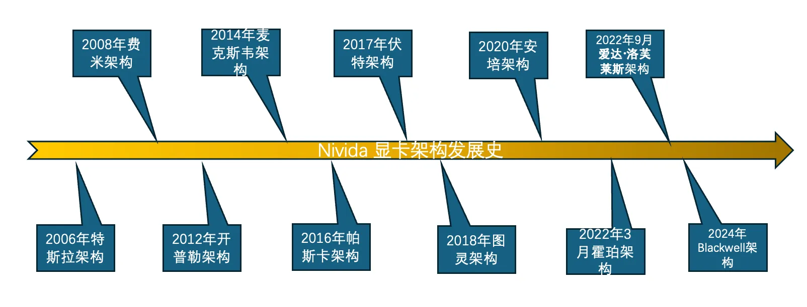

本文是一篇综合性的文章，旨在分析和对比英伟达显卡的规格参数，探讨显卡不同架构技术对于深度学习训练和推理所带来的影响。文章的主要结构为：1.显卡架构发展和简要特点 2.显卡参数指标背后的含义 3.消费级显卡与计算卡参数的比较

## 显卡架构发展

<!-- more -->
### 1. Fermi (费米) 架构

  发布年份：2008年
  
代表系列：GeForce GTX 400、GTX 500 系列

特点：
首次引入 CUDA 核心概念，使得显卡具备更强的计算能力，尤其是并行计算。
采用 40nm 工艺，提供更高的核心密度和能效。
支持 DirectX 11，让显卡可以支持更多现代图形效果。

### 2. Kepler (开普勒) 架构

发布年份：2012年

代表系列：GeForce GTX 600、GTX 700 系列

特点：
采用 28nm 制程工艺，相比上一代功耗更低，效率更高。
增加了显存带宽，提升了图形渲染能力。
引入 GPU Boost 技术，可以根据工作负载动态提升核心频率。

### 3. Maxwell (麦克斯韦) 架构

发布年份：2014年

代表系列：GeForce GTX 900 系列

特点：
进一步提升了能效，在相同的功耗下可以提供更高的性能。
引入了第二代 GPU Boost 技术，使显卡频率调控更为精确。
支持动态超级分辨率 (DSR) 技术，可以提升游戏画质。

### 4. Pascal (帕斯卡) 架构

发布年份：2016年

代表系列：GeForce GTX 10 系列

特点：
采用 16nm 制程工艺，进一步提升了性能与能效。
引入了 NVLink 技术，用于多 GPU 连接。
支持更高的显存频率和带宽，尤其在高分辨率下表现更出色。
大幅提升了 VR 性能，是当时的首选 VR 游戏显卡。

### 5. Turing (图灵) 架构

发布年份：2018年

代表系列：GeForce RTX 20 系列

特点：
引入 RT 核心，支持实时光线追踪，这在图形渲染和电影级画质中有重大突破。
引入 Tensor 核心，用于 AI 计算和深度学习任务，使得显卡在 AI 推理方面表现出色。
支持 DLSS (深度学习超级采样) 技术，可以在保证画质的前提下降低渲染负载。
改进了 VR 性能和图形渲染的速度与质量。

### 6. Ampere (安培) 架构

发布年份：2020年

代表系列：GeForce RTX 30 系列

特点：
采用 8nm 工艺，进一步提升了性能和能效比。
RT 核心和 Tensor 核心的第二代升级，增强了光线追踪和 AI 运算的效率。
支持 DLSS 2.0，使得图像质量和性能之间的平衡更好。
在多任务处理和并行计算中表现出色，适合高性能计算和数据科学等应用。

### 7. Ada Lovelace (爱达·洛芙莱斯) 架构

发布年份：2022年

代表系列：GeForce RTX 40 系列

特点：
采用 TSMC 4nm 工艺，是目前工艺最先进的 GPU 架构，具备更高的晶体管密度和更低的功耗。
引入第三代 RT 核心和第四代 Tensor 核心，进一步提升了光线追踪和 AI 计算性能。
支持 DLSS 3.0，可以生成中间帧，进一步提升游戏帧率，减少性能损失。
显存带宽和频率进一步提升，使得显卡在高分辨率和高负载下表现更出色。
更好的能效管理技术，使显卡在高性能表现的同时兼顾了功耗。

### 8. Hopper (霍珀) 架构

发布年份：2022年，主要应用于数据中心和 AI 领域

代表产品：NVIDIA H100

特点：
采用 TSMC 4nm 制程，专注于高性能计算和深度学习任务。
包含 Transformer Engine，优化了大型 AI 模型（如 GPT 系列）的计算效率。
使用第四代 NVLink 技术，用于更快的多 GPU 通信。
集成 MIG (Multi-Instance GPU) 技术，允许 GPU 被分割成多个独立的实例以供多任务处理。

## 显卡参数指标
### fp32与fp64有什么区别？
FP64单元（Floating Point 64-bit unit）是指支持64位浮点运算的硬件单元。FP64是浮点数的一种表示形式，同理FP32是另一种支持32位浮点运算的硬件单元。  

FP64比32位浮点（FP32）具有更高的精度，能表示更大的数值范围。它特别适用于需要非常高精度计算的应用，如科学计算、物理仿真和工程建模。但是现代GPU的主要作用是用于图形渲染和神经网络训练与推理，并不需要特别多的FP64单元，一些GPU的FP64单元在计算能力上通常比FP32单元弱，因为许多现代GPU优化了FP32性能，针对游戏图形、深度学习等领域的需求。然而，对于需要高精度的领域（如天气模拟、大规模科学计算等），FP64单元依然是必不可少的。 

在神经网络训练中，常见的浮点精度通常是 FP32（32位浮点数）。具体来说，大多数现代深度学习框架（如 TensorFlow 和 PyTorch）在默认情况下使用 FP32 进行前向传播、反向传播和梯度更新。FP32 提供了足够的精度和较高的计算效率，适合大多数神经网络训练任务。

对于浮点运算性能的量化，通常采用万亿/s的单位，一般用T表示。假如该GPU每秒可以执行4万亿次数的浮点运算，我们就说4TFLOP算力。注意有时候会更加精确的说4TFLOPS fp32或者 fp64，这两种并不一致，如同前文提到的GPU在两种运算单元上分配的硬件并不对等。
举个例子：RTX 4090 在单精度（FP32）模式下的理论峰值性能为48.6 TFLOPS，在混合精度（FP16）模式下，性能可以达到190 TFLOPS。 而在(FP64)模式下性能仅有1,457 GFLOPS。（备注：**1 TFLOPS = 1000 GFLOPS**。）

### 混合精度fp16

混合精度 FP16（Mixed Precision FP16）是一种在神经网络训练中使用的技术，它结合了 16位浮点数（FP16） 和 32位浮点数（FP32） 的计算方式，以提高训练效率和减少内存消耗，同时保持足够的精度来确保训练稳定性。  

其主要思想就是利用模型不同阶段对于精度要求不同，采用不同的运算单元。通过将大部分计算任务（例如**前向传播、反向传播、梯度更新）转换为 FP16**（半精度浮点数），而在关键的计算步骤（如**梯度累加和权重更新）中仍然使用 FP32（单精度浮点数**），以保证训练过程中不会丢失重要的数值信息。

这样可以达到一个计算用fp16速度快，存储用fp32足够准确的效果。同时最新几代GPU硬件上对混合精度有一定的优化，可以更快完成训练。
