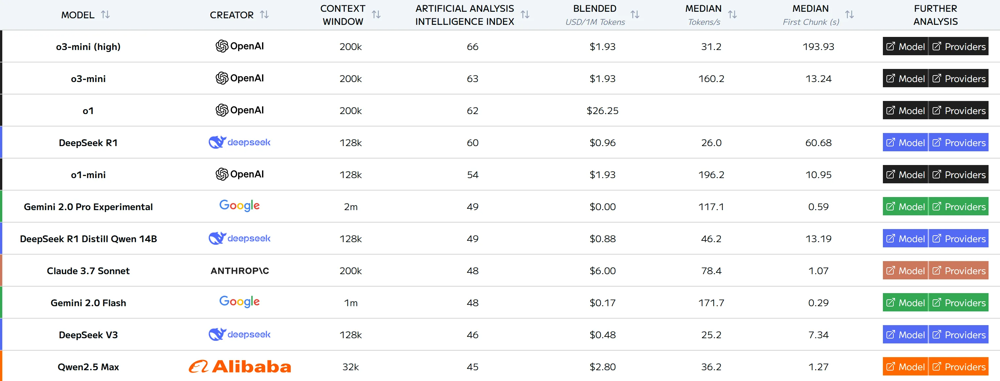
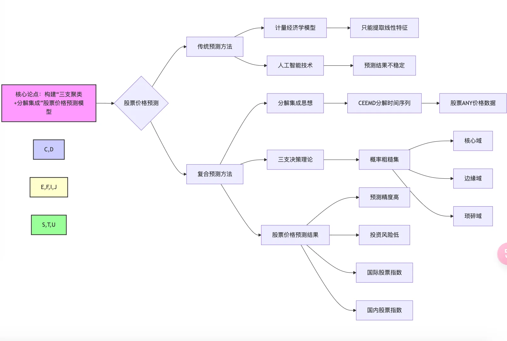
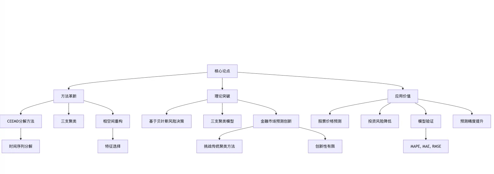
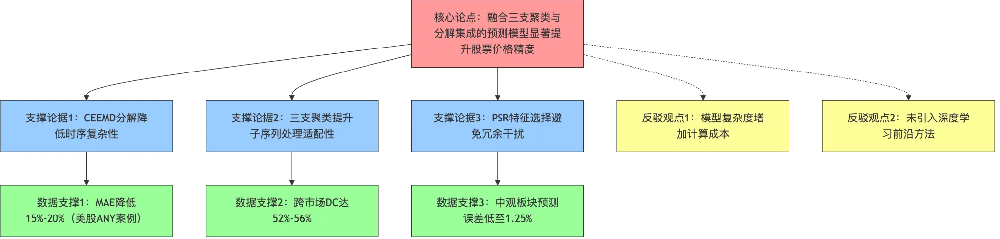
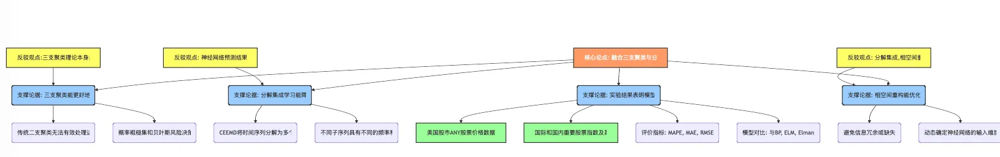
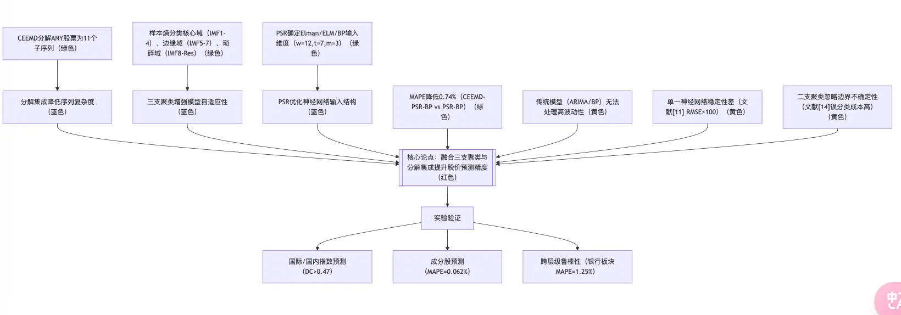

随着DeepSeek-R1大模型的开源，中国国内掀起了新的AI风潮，各行各业纷纷基于开源模型优化自己的服务。腾讯基于自己公众号的海量数据接入deepseek，并迅速抓住机遇开发了腾讯元宝软件以占领市场，知乎也基于自己平台高质量中文问答接入了deepseek。作为科研工作者，也需要抓住机遇合理的利用AI辅助自己的研究，本文将主要从AI平台，论文写作和文献搜寻展开。

<!-- more -->
### AI大模型和平台
以下是目前主流的AI大模型根据智力分析得到的排名，目前openAI的o3-mini(high)的综合水平最高，deepseek-r1在推理和中文上具备一定的优势，claude 3.7在编程上具备优势,谷歌家的gemini在上下文和生成速度上遥遥领先。




对于研究而言，**编程问题**优先推荐claude，工具推荐cursor. cursor是一个基于vscode开发的ide，内部集成了AI，可以自动关联上下文，熟悉vscode的工作者使用cursor可以更加顺手。而**文献查找问题**，可以使用谷歌的gemini，因为谷歌学术平台的数据库肯定被用来训练了，里面大量的文献元数据有利于gemini查找文献相关的问题：比如推荐某个领域的前沿研究。但是要注意，AI依旧可能生成虚假的文献信息，必须要仔细查证。

### 文献解析
利用AI解析文献是本文的重点，通常将pdf文件上传，然后输入提示词解析，下面是常用的提示词

=== 基础信息提取模板 ===

```
1. 请提取论文的核心研究问题、理论框架及学科定位，用不超过300字概括其学术坐标
2. 分析作者在采用的研究方法，按照①实验设计 ②数据来源 ③分析工具 ④验证方式的结构列表呈现

```
=== 深度内容挖掘提示 ===


```
对比该文献领域近三年顶刊论文，从以下维度识别创新性：
理论突破（权重30%）
方法革新（权重40%）
应用价值（权重30%） 给出量化评分及依据,
并将全文论证逻辑可视化为思维导图，要求包含：
核心论点（红色节点）
支撑论据（蓝色节点）
反驳观点（黄色节点）
数据支撑（绿色节点） 输出Markdown格式流程图
```


下面我将做一个简单的benchmark,上传一篇论文的pdf，然后根据输入以上提示词得到最后的思维导图

#### gemini 2.0 flash（chat）



#### gpt-4o （chat）



#### deepseek-r1（api）



#### gemini 2.0 pro（chat）



#### deepseek-r1官方(chat)



简单对比了这几个常用的模型生成的思维导图，完全符合要求的只有deepseek-r1的api，其他几家各有问题。目前而言，在一众免费可用的模型中，还是deepseek-r1比较强，其他几家更优秀的模型我并未对比，因为成本相对过于高昂。此外使用api控制好tp值，设置在较低的情况下，对于论文分析的生成效果会更好。调用api是通过chatbox本地解析，不排除解析pdf对于生成效果的影响，有可能优秀的pdf解析会考虑到多模态。
