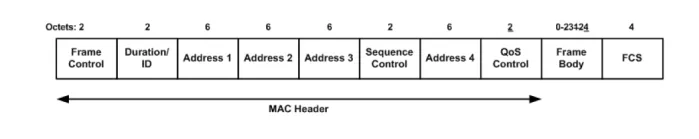
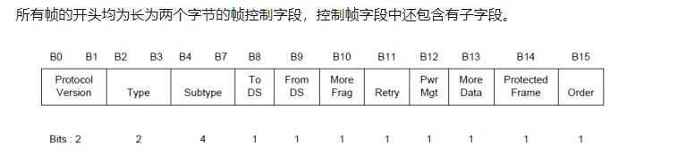
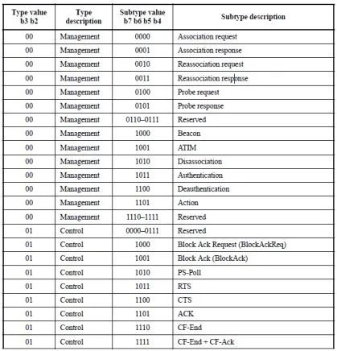
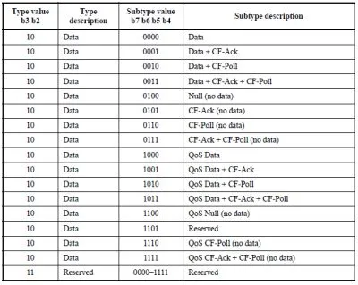
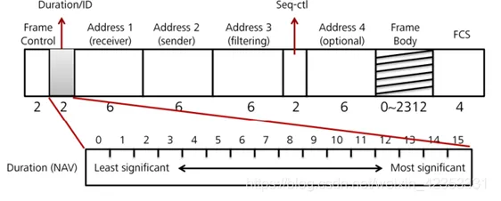
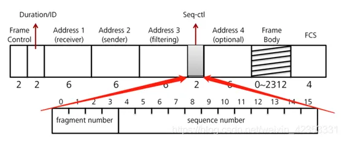
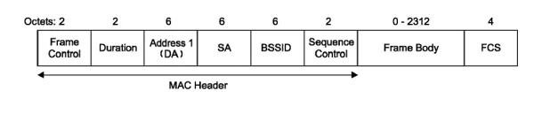

# 802.11协议与控制帧介绍

一些缩写：

- IBSS（Independent Basic Service Set）独立基本服务集
- BSSID（Basic Service Set Identifier）基本服务集标识符（为AP的MAC地址）
- DA（Destination Address）目的地址
- SA（Sender Address）源地址
- RA（Receiver Address）接收端地址
- TA（Transmission Address）发送端地址
- WDS（Wireless Distribution System）无线分布式系统

通用帧格式



<!-- more -->


其中 address1 是接收端 48bit mac地址， address2 是发送端。

最重要的就是头部的帧控制序列

## 帧开头字段










在图中我们接下来要用到的就是deauth攻击，其中发送的帧的控制序列当中 类型和子类型对应便是00 1100

在网络攻击当中，我们不需要关心MAC帧当中的数据帧，而是MAC Header.

一般可以将MAC帧划分为控制帧，管理帧和数据帧。

**Type（类型）**：用以区分帧类型

- 管理帧的Type值为00
- 控制帧的Type值为01
- 数据帧的Type值为10

**To DS 与From DS** ：分别表示无线链路向无线工作站（如AP）发送的帧和无线工作站向无线链路发送的帧。这两位用于表示来源或目的地是否为分布式系统（distribution system，DS），地址字段也会受到这两个位的影响。

**Retry（重试）**：有时候可能需要重传帧。任何重传的帧会将此bit 设定为1，以协助接收端剔除重复的帧。

**Power Management（电源管理）**：此bit 用来指示、完成当前的帧交换过程后，发送端的电源管理状态。
为1表示STA处于Power_save模式，为0表示STA处于active模式。

**More Data（尚有数据）**：More Data bit 只用于管理数据帧，在控制帧中此bit 必然为0。

**Protected Frame（受保护帧）**：为1表示帧体部分包含加密处理过的数据，为0则表示没有进行加密处理。

**Order（次序）**：帧与帧片段可依序传送，不过发送端与接收端的MAC必须付出额外的代价，对帧片段进行严格编号。一旦进行“严格依序”传送，此bit被设定为1。

## 帧剩余部分分析

**Duration（持续时间）**： 位用来记载网络分配矢量NAV得值。访问介质时间限制是由NAV所指定。当第15 个bit被设定为0时，Duration/ID位就会被用来设定NAV。此数值代表目前所进行的传输预计使用介质多少微秒。工作站必须监视所收到的任何帧头，并据以更新NAV。





**Seq-Ctl（顺序控制位）**： 此位占16bit位，用来重组帧片段以及丢弃重复帧。它由4个bit的fragment number（片段编码）位以及12个bit的sequence number（顺序编号）位所组成。

​	**fragment number**（片段编号）在上层封包被切割处理时使用，第一个片段的编号为0。其后每个片段依序累加1，方便帧进行重组。所有帧片段都会具有相同的顺序编号，如果是重传帧，则顺序编号不会有任何改变。

​	**sequence number**（顺序编号）位的作用，相当于已传帧的计数器取4096 的模（modulo）。此计数器由0 起算，MAC 每处理一个上层封包就会累加1。




**管理帧**是网络攻击的核心，其主要服务于扫描、认证和连接的过程。Beacon(信标)帧也属于管理帧。管理帧如下图所示：





管理帧的类型：

```
Association Request(关联请求)
Association Response (关联响应)
Reassociation Request(重关联请求)
Reassociation Response(重关联响应)
Probe Request(探测请求)
Probe Response(探测响应)
Beacon(信标帧)
ATIM(通知传输指示信息)
Disassociation(解除关联)
Authentication(身份验证)
Deauthentication(解除身份验证)
```


## 常见的一些无线网络攻击工具：

aircrack-ng、fluxion、wifiphisher、driftnet、ettercap、mitmf

注意一下 ：信息系统安全三要素CIA（完整性、保密性、可用性）

### 攻击方式：

**Deauth（认证攻击）**：向选中的wifi接入点的客户端发送认证帧和解离帧，通过deauth的方式指定wifi中断，如果第一个扫描网络那里没有勾选客户端的话，在攻击这里，deauth发送的报文将作为广播的形式发送。

**beacon（洪水攻击）apfake**：克隆出的垃圾wifi接入点具有与所选的wifi接入点相似SSID的信标帧，上面wifi中断后，克隆出大量相似的信标帧

**radom**：列出与列表中所有的SSID相似的垃圾信标帧

**probe-request**：对隐藏wifi请求洪水攻击。如果某AP的SSID是隐藏的，通常手机发送的普通的probe request包是无法获取到隐藏的SSID，就像上面，有些SSID手机根本就探测不到，esp8266就能
