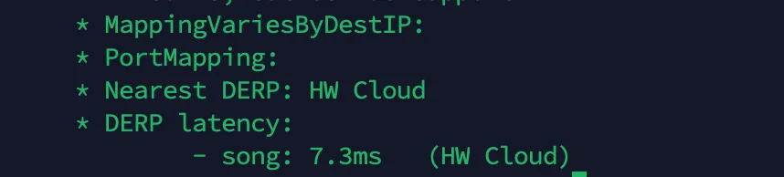

如果你是 Tailscale 的忠实用户，你一定爱上了它“零配置、安全可靠”的组网体验。它能轻松地将你散落在各地的设备（笔记本、服务器、手机）连接成一个安全的虚拟局域网。

但在某些特殊网络环境下，例如在严格的 NAT 或企业防火墙后，设备之间无法建立直接的点对点（P2P）连接。这时，Tailscale 会优雅地切换到中继模式，通过其官方的 DERP (Detoured Encrypted Routing Protocol) 服务器来转发流量。

<!-- more -->


### 一、什么是 DERP？为什么需要它？

DERP 的全称是 Detoured Encrypted Routing Protocol（绕道加密路由协议）。你可以把它想象成一个智能的“快递中转站”。

当你的两台设备（比如家里的电脑和公司的笔记本）想要通信时，Tailscale 会首先尝试各种 NAT 穿透技术，建立一条直接的 P2P 连接。这是最理想的情况，延迟最低，速度最快。

然而，当 NAT 类型过于复杂（如对称型 NAT 或运营商级的 CG-NAT）导致 P2P 连接失败时，DERP 就派上用场了。流量会被加密后发送到最近的 DERP 中转站，再由中转站转发给目标设备。

虽然这增加了一次转发，导致延迟略有上升，但它保证了在任何网络条件下，你的设备都能可靠地连接。

### 二、为什么要自建DERP服务器
官方的DERP服务器大多在海外，实际体验下来延迟最低通常在200ms，而且带宽不到1MB，为了更好的体验低延迟的服务。尤其是家用NAS服务，我非常推荐搭建属于你自己的私有 DERP 中继服务器，购买一个本地的云服务器甚至可以将延迟降低到20ms，非常夸张啊。

### 三、开始前的准备工作
1. 一台最好是本地具有公网ip的服务器
2. 自己注册一个tailscale的账号，将需要穿透的终端入网【开启tailscale】
以上的准备工作是根据大量的文章参考简化，不需要域名，不需要证书

### 四、搭建DERP服务器

1. 安装go语言环境


```
sudo apt update

sudo apt install -y wget git openssl curl

```

打开go语言官方的网站
https://go.dev/doc/install

下载压缩包后执行相应的命令

```
rm -rf /usr/local/go && tar -C /usr/local -xzf go1.25.1.linux-amd64.tar.gz

```

2. 将go添加到环境变量


```
sudo vim /etc/profile
# 将export PATH=$PATH:/usr/local/go/bin 写入最后一行
```

3. 给go换源


```
go env -w GO111MODULE=on
go env -w GOPROXY=https://goproxy.cn,direct
```

4. 安装DERP服务器


```
go install tailscale.com/cmd/derper@latest
 sudo cp ~/go/bin/derper /usr/bin/
```

到目前为止DERP已经安装完毕，接下来就是配置证书

### 五、配置DERP服务器
将DERP_IP的地址换成自己服务器的公网IP，除此之外记得关闭服务器的防火墙，或者需要打开TCP的80、443端口，UDP的3478端口
```
DERP_IP="x.x.x.x"
```

```
openssl req -x509 -newkey rsa:4096 -sha256 -days 3650 -nodes \
  -keyout ${DERP_IP}.key \
  -out ${DERP_IP}.crt \
  -subj "/CN=${DERP_IP}" \
  -addext "subjectAltName = IP:${DERP_IP}"
```

### 六、运行DERP服务器

```
sudo derper --hostname="x.x.x.x" -certmode manual -certdir ./
```

### 七、配置TailScale
打开tailscale的官网并登陆
将以下内容添加到访问控制的json中

```
"derpMap": {
		"OmitDefaultRegions": true, //加入这个会只用自己的节点
		"Regions": {
			"901": {
				"RegionID":   901,
				"RegionCode": "song",
				"RegionName": "HW Cloud",
				"Nodes": [
					{
						"Name":             "901a",
						"RegionID":         901,
						"HostName":         "eksoft", //这个随便写
						"IPv4":             "x.x.x.x", //改成自己的IP
						"InsecureForTests": true,
					},
				],
			},
		},
	},
```

完成后，便可以找一台连接上tailscale的电脑测试，输入：

```
tailscale netcheck
```
可以看到延迟非常低，近乎于本地


