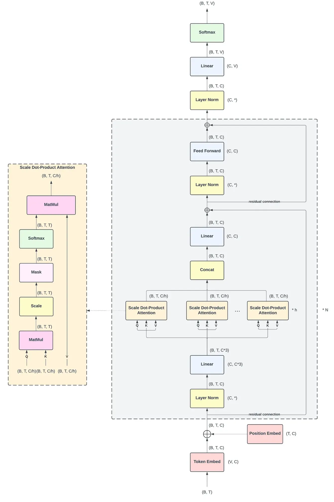
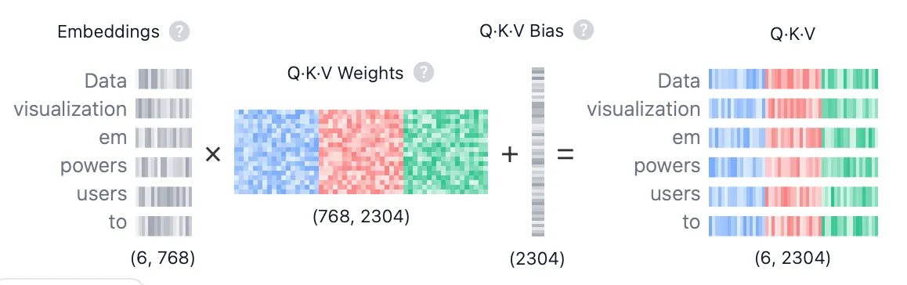

# 深入浅出：解密GPT-2，从模型结构到源码实现

在人工智能的星辰大海中，GPT-2（Generative Pre-trained Transformer 2）无疑是一座耀眼的灯塔。它的出现，标志着自然语言生成技术的一次重大飞跃，也为我们今天所熟知的ChatGPT等大型语言模型奠定了坚实的基础。

尽管GPT2推出的时间在2019年，截止目前已经过去了6年了。但是其对于理解transformer和大语言模型具备一定意义。本文将详细的讲解GPT2的模型结构和代码实现，尽管GPT2与现代大模型的结构存在很大差异，但是作为初学者的一个学习样本依旧足够。

<!-- more -->


## 预备工作
在开始讲解GPT2之前，需要掌握transformer的结构和原理，尤其是多头注意力机制。除此之外，要理解GPT2的源码，还需要对pytorch具备一定的熟悉程度。俗话说：**“授人以鱼不如授人以渔”**
下面是我在学习过程中发现的一些优秀资源：
1. B站李宏毅详解transformer的视频
2. https://poloclub.github.io/transformer-explainer/ 一个GPT2可视化的网站【具备一定交互】
3. B站up 3blue1brown的视频 https://www.bilibili.com/video/BV1qM4m1d7is
4. GPT2 pytorch的实现 https://github.com/karpathy/nanoGPT


## GPT2结构的预备知识
下面我将一边展示源码，一边展示原理，将GPT2的模型进行切块讲解，最后再汇总从宏观的层次上讲解. 首先让我们看GPT2的全貌：



可以看到整体架构中有非常多个小的模块，下面我将一个一个模块的讲解。


#### Tokenizer 分词器
在将内容输入给大模型之前还需要分词器做预处理，Tokenizer（分词器/标记器） 是一个程序，它的核心任务是将一段原始文本（比如一个句子或一篇文章）分解成一个个更小的、有意义的单元。这些单元被称为 “词元”或“标记”（Token）。这个过程，就叫做 Tokenization（分词或标记化）。下面将简单介绍一下常见的分词方法：

**1.基于词 (Word-based)**

通常按照空格或标点符号来切分，方法很简单。对于英文来说，可以根据标点和空格切分，对于中文无法很好的适配。并且如果模型在训练时没见过某个词（比如 "tokenization"），在预测时就无法处理它，会将其视为未知词（<UNK>）。英语中有名词单复数、动词时态变化（如 run, runs, running），它们都会被当作不同的 Token，导致词表非常大。
    
e.g:
文本: "I have a new cat."
Tokens: ["I", "have", "a", "new", "cat", "."]

**2.基于字符(Character-based)**

将文本切分成最基本的单元——字符，中英都适配。并且没有没有 OOV （Out-of-Vocabulary）问题: 任何词都可以由有限的字符组成，词表非常小。但是会丢失语义信息: 单个字母 c a t 本身没有 “猫” 的完整含义。
并且导致序列过长: 一个句子会被切成非常长的序列，增加了模型的计算负担。
    
e.g:文本: "cat" Tokens: ["c", "a", "t"]

**3.基于子词 (Subword-based)**

基于子词是本文tokenizer的核心，也是目前主流大模型（GPT, Gemini等）使用的分词方法。这种方法将常见词保持为完整的 Token，不常见的词则被拆分成更小的、有意义的子词片段。可以有效解决 OOV 问题: 即使遇到新词，也可以通过已知的子词组合来表示它。例如，即使没见过 “swimmingly”，也可以拆分成 [“swimm”, “##ingly”]。能够处理词形变化: run 和 running 共享了 run 这个子词，模型能更好地理解它们之间的关系。这种方法平衡了效率和精度。
    
e.g: 常见词 "this is a cat" -> ["this","is","a","cat"],  不常见词 "tokenization" -> ["token", "ization"]

下面我将介绍GPT2使用的分词算法：**BPE (Byte-Pair Encoding)**
从一个由单个字符组成的初始词表开始，通过迭代地、贪婪地合并最常出现的相邻“词元对”（Token Pair），来构建一个最终的词表和一套合并规则。

可以把它想象成一个“乐高”游戏：

- 初始状态：你有一大堆最基础的乐高积木（单个字符）。
- 游戏规则：找出你最常拼在一起的两种积木（最频繁的相邻字符对），把它们粘成一个新积木块，并给这个新积木块起个名字。
- 重复游戏：不断重复这个过程，用现有的积木块（包括新粘合的）去拼出更复杂的积木块。
- 游戏结束：直到你的积木库（词表）达到了预设的大小，或者没有可以再合并的了。
最终，你就得到了一套从基础到复杂的“乐高积木”（词表），以及一套如何用它们拼装的“说明书”（合并规则）。
    
假设我们的 训练语料库 是一个词频词典（为了简化，通常会对原始文本进行预分词，并统计词频）：
    
```
{
    "low": 5,
    "lower": 2,
    "newest": 6,
    "wider": 3
}
```
将每个词拆分成字符序列，并在词尾添加一个特殊的结束符< /w>以区分词的边界。这非常重要，因为它能让模型区分 st（在 stop 中）和 st< /w>（在 fast 中）。
    
```
5 "l o w < /w>"
2 "l o w e r < /w>"
6 "n e w e s t < /w>"
3 "w i d e r < /w>"
```
创建初始词表 (Vocabulary)：词表就是语料中出现的所有单个字符。
    
```
    初始词表: {'<', '/', '>', 'd', 'e', 'i', 'l', 'n', 'o', 'r', 's', 't', 'w'}
```
    
现在，我们开始循环，每次找出频率最高的相邻词元对进行合并。假设我们的目标是执行 8次 合并操作。
    
 迭代 1:

计算频率：计算所有相邻词元对的出现频率。
    
(l, o): 5 (from "low") + 2 (from "lower") = 7
    
(o, w): 5 (from "low") + 2 (from "lower") = 7
    
(e, s): 6 (from "newest")
    
(s, t): 6 (from "newest")
... 其他频率较低的组合
    
选择合并：假设我们选择 (l, o) 进行合并（当频率相同时，选择任意一个）。
执行合并：将语料中所有的 l o 替换为 lo。
合并规则 1: (l, o) -> lo
更新语料:
    
```
5 "lo w < /w>"
2 "lo w e r < /w>"
6 "n e w e s t < /w>"
3 "w i d e r < /w>"
```
更新我们的词表：词表 += {'lo'}
    
迭代 2:

计算频率：
    
(lo, w): 5 + 2 = 7
    
(e, s): 6
    
(s, t): 6
...
    
选择合并：(lo, w) 频率最高。
执行合并:
合并规则 2: (lo, w) -> low
更新语料:
    
```
5 "low < /w>"
2 "low e r < /w>"
6 "n e w e s t < /w>"
3 "w i d e r < /w>"
```
    
更新词表: 词表 += {'low'}
... 以此类推 ...

我们继续这个过程，直到达到预设的词表大小或合并次数。最终，我们可能会学到如下的合并规则（按优先级排序）：

1. (l, o) -> lo
2. (lo, w) -> low
3. (e, s) -> es
4. (s, t) -> st (假设在另一次迭代中被选择)
5. (es, t) -> est
6. (n, e) -> ne
7. (ne, w) -> new
8. (new, est) -> newest
...等等。

训练产出：

- 最终词表 (Final Vocabulary)：包含初始字符和所有合并生成的新子词。
    
- 合并规则 (Merge Rules)：一个按优先级排序的合并操作列表。
    
根据词表和合并规则，现在我们可以开始分词了：
例如，我们要对单词 "lowest" 进行分词。

初始拆分：先将单词拆分为字符序列，并加上结束符。
l o w e s t < /w>
    
应用规则：按照学习到的合并规则的优先级，从高到低（或从学习顺序）依次在序列中查找并执行合并。
    
找最高优先级的合并：在 l o w e s t < /w> 中，查找我们学到的规则。
    
假设我们学到的规则中有 (l, o) -> lo。
    
应用后变为：lo w e s t < /w>
    
再查找下一个最高优先级的规则，比如 (lo, w) -> low。
    
应用后变为：low e s t < /w>
    
再查找，假设我们没有学过 (low, e)，但学过 (s, t) -> st。
    
应用后变为：low e st < /w>
    
再查找，假设我们没有学过 (e, st)，也没有学过 (st, < /w>)。
    
结束：没有更多可应用的合并规则了。
    
最终结果：单词 "lowest" 被分词为：
["low", "e", "st", "< /w>"] （通常在实际使用中会去掉 < /w>）
 
⚠️ 像 ChatGPT 这样的模型，其 Tokenizer（名为 cl100k_base），不会将字符作为基本单位了，而是使用的BPE算法的变体，而是把 字节 (Byte) 作为基本单位。一个 Unicode 字符可能由 1 到 4 个字节组成。
    
BPE算法实际上也是需要预料库进行训练的，不过幸运的是已经有训练好的模型可以直接用了，下面是简单的一个案例：

```
import tiktoken
import torch

input_str = "帮我编写一个读取txt的python程序"
enc = tiktoken.get_encoding("gpt2") # 初始化gpt2的tokenizer
train_ids = enc.encode_ordinary(input_str) # 编码
print(train_ids)

print(f"输入的字符串长度为{len(input_str)}")
print(f"编码后的长度为{len(train_ids)}")
```
输出结果：
    
```
[30585, 106, 22755, 239, 163, 120, 244, 37863, 247, 31660, 10310, 103, 46237, 119, 20998, 244, 14116, 21410, 29412, 163, 101, 233, 41753, 237]
输入的字符串长度为20
编码后的长度为24
```
    
可以看到每个token被转化为了一个token ID， **最大 Token ID = 词汇表大小 (Vocabulary Size) - 1** 。
 
此时，我们只是将字符串转化为了由 Token ID 构成的列表，由于GPT2模型的预训练是无监督训练，仅让模型学习人类语言的规则，没有学习遵循人类指令。所以输入模型的每一个字符串都是block_size = 1024的长度，一本书的内容，会被从不同位置给切出一个1024长度的Token 序列。因此，**大模型的最原始输入应该是一个 [batch_size, block_size]形状的张量。**
    
肯定有人好奇，为什么有时候与AI聊天的时候可以随便输入长度不超过最大限制的字符串，因为简单来说，你输入的内容 ≠ 模型最终处理的内容。模型最大长度是1024个Token，“你好”可能只有2个Token。系统会用一个特殊的、无意义的\<pad>符号【通常对应一个特殊的token id, 一般叫做】把剩下的4094个位置填满，然后送给模型。模型被训练过，知道要忽略这些填充符号。下面是一些常见的特殊的Token。
    
- [UNK] (Unknown): 代表词汇表中没有的词。
- [CLS] (Classification): 在BERT等模型中，通常放在序列开头，其对应的输出向量用于分类任务。
- [SEP] (Separator): 用于分隔两个不同的句子。
- [BOS] (Beginning of Sequence/Sentence): 标记序列的开始。
- [EOS] (End of Sequence): 标记序列的结束。
- [PAD] (Padding): 用于将序列填充到固定长度。
    
### 1.Token Embed 层
这一个层的作用是将自然语言转化为计算机可以理解的语言，也就是向量(**每个token对应一个固定维度的向量**)。我们给模型的最原始输入通常是一串文字，然后我们会将文字切割，每个独立的单元叫做token，所谓的大模型根据token计费就是根据输入模型的独立单元的数量计费。利用Token Embed 可以将每个token转化为一个向量。每个token的向量维度都是一致的，token的语义越接近，token的向量欧式距离就越近。

现在我们来看源码实现：

```
 wte = nn.Embedding(config.vocab_size, config.n_embd) # vocab_size 表示词表大小
```
 利用了pytorch封装好的模块，只需要一行代码即可实现Token Embed层，下面将举个例子看看什么是Embedding层，如何转化token id为向量的:
    

```
import torch.nn as nn
batch_size = 24 
block_size = 1024
vocab_size = 50304 # gpt2的词表大小
n_embd = 768 # gpt2的词嵌入维度
# Generate a 2D tensor of random integers
input_tensor = torch.randint(0, vocab_size, (batch_size, block_size)) # 假设这是经过分词器处理后的24个句子
print(input_tensor.shape)

wte = nn.Embedding(vocab_size, n_embd)
token_embeddings = wte(input_tensor)
print(token_embeddings.shape)
print(wte.weight.shape) # 可以看出内部就是一个权重矩阵，矩阵尺寸由vocab_size, n_embd决定
```
输出：
    
```
torch.Size([24, 1024])
torch.Size([24, 1024, 768])
torch.Size([50304, 768])
```
可以看到，输入的24个token长度等于1024的句子，每个token都被转化为了一个768维的向量。我们打印出token embedding层的权重形状，可以看到内部就是一个矩阵，token id 的最大值对应这个矩阵的最大行数-1，有了输入的token ID（标量）和嵌入矩阵，转换过程就非常简单了：直接去矩阵里“查”对应的行。

**这本质上是一个索引操作。** 输入token ID 1 ("我")，就去嵌入矩阵中取出第1行的向量 [0.91, 0.33, -0.24, -0.56, 0.78]。
    
### 2 位置嵌入层 (Position Embding)
实现代码：

```
pos = torch.arange(0, block_size, dtype=torch.long, device=device) # 形状为 (block_size)
    
wpe = nn.Embedding(config.block_size, config.n_embd),

pos_emb = wpe(pos) # 位置嵌入，形状为 (b,t, n_embd)

```

### 3.归一化层（LN）
归一化层的作用是对单个样本的所有特征进行归一化，能够加速模型收敛，提高训练稳定性，减少对初始化的依赖。除此之外LN在一定程度上限制了模型的表达能力，有助于防止过拟合。 **相比较于BN层，对于小样本更加友好**【因为显存的原因，有时候batch_size比较小】,因为BN层是对一个批次的所有样本在单个特征上进行归一化，强依赖于批次大小，批次太小会导致统计量不准。

LN的数学模型：
假设一个神经网络的某一层有 H 个神经元，其激活值（输入）构成一个向量：$
X = ( x_{1}, x_{2}, \dots, x_{H} )
$;层归一化的计算过程如下:
$$
{\bf y}=\gamma\odot\frac{{\bf x}-\mu} {\sqrt{\sigma^{2}+\epsilon}}+\beta
$$
其中，⊙ 表示逐元素相乘，$\mu$表示$X$向量的均值，其中，ϵ (epsilon) 是一个非常小的正数（例如 10 
e−5 ），其作用是为了防止分母为零，增加数值稳定性。

单纯的归一化可能会限制模型的表达能力，因为强制将每层的输入都变成了标准正态分布。为了恢复模型的表达能力，LN引入了两个可学习的参数：增益（gain）$\gamma$ 和 偏置（bias） β。这两个参数和权重 W 一样，都是通过反向传播学习得到的。⚠️：$\gamma$ 与 $\beta$ 都是与词嵌入相同维度的向量。

σ表示均方差，计算方式如下：
$$
\sigma^{2}=\frac{1} {H} \sum_{i=1}^{H} ( x_{i}-\mu)^{2}
$$


实现源码：

```
from torch.nn import functional as F

class LayerNorm(nn.Module):
    """层归一化模块，支持可选的偏置参数。PyTorch原生LayerNorm不直接支持关闭偏置，此实现解决了该问题。"""
    
    def __init__(self, ndim, bias):
        """
        初始化层归一化模块。

        参数:
        ndim (int): 归一化的维度，通常为输入特征的维度。
        bias (bool): 是否使用偏置参数。True 表示使用，False 表示不使用。
        """
        super().__init__()
        # 初始化可训练的权重参数，形状为 (ndim,)，初始值全为 1。该权重用于对归一化后的输入进行缩放。
        self.weight = nn.Parameter(torch.ones(ndim))
        # 根据 bias 参数决定是否初始化可训练的偏置参数。
        # 若 bias 为 True，则初始化形状为 (ndim,) 且初始值全为 0 的偏置参数；
        # 若 bias 为 False，则不初始化偏置参数，将其设为 None。
        self.bias = nn.Parameter(torch.zeros(ndim)) if bias else None

    def forward(self, input):
        """
        前向传播方法，对输入进行层归一化操作。

        参数:
        input (torch.Tensor): 输入张量，需要进行层归一化的输入数据。
        返回:
        torch.Tensor: 经过层归一化处理后的张量。
        """
        # 使用 PyTorch 的 layer_norm 函数进行层归一化操作
        # input: 输入张量，即需要进行归一化处理的数据
        # self.weight.shape: 归一化的形状，使用权重的形状作为归一化的维度
        # self.weight: 可学习的权重参数，用于对归一化后的输入进行缩放
        # self.bias: 可学习的偏置参数，若初始化时未启用则为 None
        # 1e-5: 数值稳定性的小常数，防止分母为零
        return F.layer_norm(input, self.weight.shape, self.weight, self.bias, 1e-5)

layer_norm_model = LayerNorm(n_embd, bias=False)
layer_norm_output = layer_norm_model(token_embeddings)
print("输入张量形状:", token_embeddings.shape)
print("输出张量形状:", layer_norm_output.shape)

# 对比第一个样本的均值和方差变化

print("第一个样本原始的均值", token_embeddings[0, 0, :].mean())
print("第一个样本原始的方差", token_embeddings[0, 0, :].std())

print("第一个样本经过LN后的均值:", layer_norm_output[0, 0, :].mean()) # 接近0
print("第一个样本经过LN的方差:", layer_norm_output[0, 0, :].std()) # 接近1

```
    
输出：

```
输入张量形状: torch.Size([24, 1024, 768])
输出张量形状: torch.Size([24, 1024, 768])
第一个样本原始的均值 tensor(0.0453, grad_fn=<MeanBackward0>)
第一个样本原始的方差 tensor(0.9664, grad_fn=<StdBackward0>)
第一个样本经过LN后的均值: tensor(0., grad_fn=<MeanBackward0>)
第一个样本经过LN的方差: tensor(1.0006, grad_fn=<StdBackward0>)  

```
    
### 四、注意力机制
理解多头之前，必须先掌握它的基本单元：缩放点积注意力（Scaled Dot-Product Attention）。

这是 Transformer 中使用的标准注意力形式。它的输入是三个向量：查询（Query, Q）、键（Key, K） 和 值（Value, V）。

Q, K, V 是什么？
它们都是由同一个输入序列（比如一句话的词向量序列）通过不同的线性变换（乘以不同的权重矩阵）得到的。

Query (Q): 代表当前正在处理的词，它要去“查询”与其他词的关系。
Key (K): 代表序列中可以被查询的词，它与 Q 进行匹配，以计算相关性。
Value (V): 同样代表序列中的词，但它包含了词的实际信息。一旦计算出注意力权重，我们就用这些权重去加权求和 V。


            <center>图：6个token根据Q K V权重矩阵计算$q,k,v$向量</center>
    
