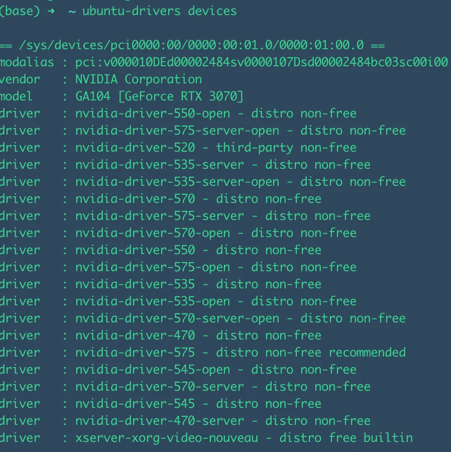
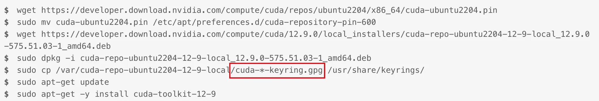
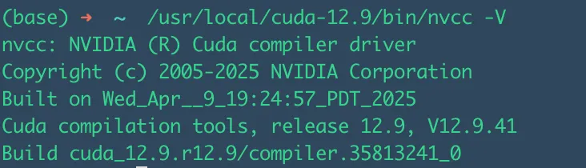

对于在Ubuntu系统上进行深度学习、科学计算或任何需要GPU加速的任务，正确安装NVIDIA显卡驱动、CUDA Toolkit和cuDNN是至关重要的第一步。本教程将为您提供一个详尽的、逐步的指南，在Ubuntu系统上顺利完成安装。

<!-- more -->

### 首先禁用原来的驱动Nouveau

```
sudo vim /etc/default/grub
将---> GRUB_CMDLINE_LINUX_DEFAULT="quiet splash"
替换为---> GRUB_CMDLINE_LINUX_DEFAULT="quiet splash modprobe.blacklist=nouveau"
保存后更新---> sudo update-grub
更新后重启系统---> sudo reboot

```

### 选择合适的驱动
首先更新软件包索引

```
sudo apt update
```

然后检测合适的驱动版本，这里选择recommended 的那一个驱动就行

```
ubuntu-drivers devices
```



开始安装【⚠️注意：一定要先把旧的驱动卸载掉，如果安装过就的N卡驱动】

卸载命令【没有旧版本就不需要执行卸载命令】：

```
sudo apt remove --purge '^nvidia-.*'
sudo apt autoremove --purge
sudo apt autoclean
```
再开始安装
```
sudo apt install nvidia-driver-575
```


### 安装cuda 
首先查看ubuntu的版本信息

```
lsb_release -a
```
输出

```
No LSB modules are available.
Distributor ID:	Ubuntu
Description:	Ubuntu 22.04.5 LTS
Release:	22.04
Codename:	jammy
```

再输入以下命令查看当前显卡驱动支持最高的cuda版本：

```
nvidia-smi
```
点开链接https://developer.nvidia.com/cuda-toolkit-archive 查看自己对应的版本然后根据官方的指令下载cuda

例如：
 


⚠️注意：标红的那一行命令要根据提示输入，一般执行完上一行命令会提示，不要直接输入带有*符号的这一行命令

最后检查安装和更新环境变量：

输入：

```
 /usr/local/cuda-12.9/bin/nvcc -V
```



根据上图可以看到安装成功了，但是需要引入环境变量：
在~/.bashrc 或者 ~/.zshrc 中的文件末尾添加以下内容：
```
export PATH="/usr/local/cuda-12.0/bin:$PATH" 
export LD_LIBRARY_PATH="/usr/local/cuda-12.0/lib64:$LD_LIBRARY_PATH" 

```
最后执行【取决于你用的什么shell】：

```
source ~/.zshrc
# 或者执行
source ~/.bashrc
```
### 安装cuDnn
安装CUDA之后，首先根据自己的显卡驱动和cuda版本查找对应的cudnn版本：https://docs.nvidia.com/deeplearning/cudnn/backend/latest/reference/support-matrix.html

然后进入搜索对应的CuDNN版本，选择合适的版本下载压缩包。

### 安装pytorch

```
pip3 install torch torchvision
```

### 测试安装是否成功


完成所有安装后，创建一个test_cudnn.py文件测试：

```python
#!/usr/bin/env python
# -*- coding: utf-8 -*-

"""
一个用于检测 CUDA 和 cuDNN 是否可用的 Python 脚本。
它会分别使用 PyTorch 和 TensorFlow 这两个主流框架进行测试。
"""

import sys
import platform

def print_separator(char='=', length=70):
    """打印一个分隔符，用于美化输出。"""
    print(char * length)

def test_pytorch():
    """
    使用 PyTorch 检测 CUDA 和 cuDNN。
    """
    print_separator()
    print(">>> 开始检测 PyTorch 的 CUDA 和 cuDNN 配置 <<<")
    print_separator()
    
    try:
        import torch
        print(f"PyTorch 版本: {torch.__version__}")

        # 1. 检查 CUDA 是否可用
        is_cuda_available = torch.cuda.is_available()
        print(f"CUDA 是否可用 (torch.cuda.is_available()): {'是 (Yes)' if is_cuda_available else '否 (No)'}")

        if not is_cuda_available:
            print("\n[警告] PyTorch 无法找到 CUDA。")
            print("可能的原因：")
            print("1. 未安装 NVIDIA 驱动。")
            print("2. 安装了 CPU 版本的 PyTorch。请访问 https://pytorch.org/get-started/locally/ 获取正确的安装命令。")
            print("3. CUDA Toolkit 版本与 PyTorch 不兼容。")
            return

        # 2. 获取 CUDA 设备信息
        print(f"可用的 GPU 数量: {torch.cuda.device_count()}")
        current_device_id = torch.cuda.current_device()
        print(f"当前 GPU 设备 ID: {current_device_id}")
        current_device_name = torch.cuda.get_device_name(current_device_id)
        print(f"当前 GPU 设备名称: {current_device_name}")

        # 3. 检查 PyTorch 编译时使用的 CUDA 版本
        # 注意：这不一定是您系统上安装的 CUDA 版本，而是 PyTorch 构建时所依赖的版本。
        print(f"PyTorch 编译所用的 CUDA 版本: {torch.version.cuda}")

        # 4. 检查 cuDNN 是否可用
        is_cudnn_available = torch.backends.cudnn.is_available()
        print(f"cuDNN 是否可用 (torch.backends.cudnn.is_available()): {'是 (Yes)' if is_cudnn_available else '否 (No)'}")
        
        if is_cudnn_available:
            # 打印 cuDNN 版本
            cudnn_version = torch.backends.cudnn.version()
            print(f"cuDNN 版本: {cudnn_version}")
        
        print("\n[结论] PyTorch 的 CUDA 和 cuDNN 环境配置正确。")

    except ImportError:
        print("\n[信息] 未安装 PyTorch (torch)。跳过 PyTorch 检测。")
        print("如需安装，请运行: pip install torch torchvision torchaudio --index-url https://download.pytorch.org/whl/cuXXX (请根据你的CUDA版本替换cuXXX)")
    except Exception as e:
        print(f"\n[错误] 检测过程中发生未知错误: {e}")

def test_tensorflow():
    """
    使用 TensorFlow 检测 CUDA 和 cuDNN。
    """
    print_separator()
    print(">>> 开始检测 TensorFlow 的 CUDA 和 cuDNN 配置 <<<")
    print_separator()

    try:
        import tensorflow as tf
        print(f"TensorFlow 版本: {tf.__version__}")

        # 1. 检查 GPU 设备
        gpu_devices = tf.config.list_physical_devices('GPU')
        print(f"找到的 GPU 设备: {len(gpu_devices)}")

        if not gpu_devices:
            print("\n[警告] TensorFlow 无法找到 GPU。")
            print("可能的原因：")
            print("1. 未安装 NVIDIA 驱动。")
            print("2. 未正确安装 CUDA Toolkit 和 cuDNN，或其路径未配置。")
            print("3. TensorFlow 版本与 CUDA/cuDNN 版本不兼容。")
            print("4. 安装了 CPU 版本的 TensorFlow (tensorflow-cpu)。")
            return

        # 2. 打印 GPU 详细信息
        for i, device in enumerate(gpu_devices):
            print(f"  - GPU {i}: {device.name}")
        
        # 3. TensorFlow 的 cuDNN 检测是隐式的。如果 GPU 可用且日志中没有 cuDNN 错误，则通常 cuDNN 也在工作。
        # 我们可以通过构建信息来查看 TensorFlow 是否是为 GPU 构建的。
        build_info = tf.sysconfig.get_build_info()
        is_cuda_build = build_info.get("is_cuda_build", False)
        print(f"TensorFlow 是否为 CUDA 构建: {'是 (Yes)' if is_cuda_build else '否 (No)'}")
        if 'cudnn_version' in build_info:
            print(f"TensorFlow 编译所用的 cuDNN 版本: {build_info['cudnn_version']}")
        if 'cuda_version' in build_info:
            print(f"TensorFlow 编译所用的 CUDA 版本: {build_info['cuda_version']}")

        # 4. 运行一个简单的矩阵运算来实际使用 GPU
        try:
            print("\n尝试在 GPU 上执行一个简单的矩阵乘法...")
            with tf.device('/GPU:0'):
                a = tf.constant([[1.0, 2.0], [3.0, 4.0]])
                b = tf.constant([[1.0, 1.0], [0.0, 1.0]])
                c = tf.matmul(a, b)
            print("GPU 运算成功！")
            # print("结果:\n", c.numpy())
        except Exception as e:
            print(f"[错误] 在 GPU 上执行运算时失败: {e}")

        print("\n[结论] TensorFlow 的 GPU 环境配置正确。")
        
    except ImportError:
        print("\n[信息] 未安装 TensorFlow。跳过 TensorFlow 检测。")
        print("如需安装 GPU 版本，请运行: pip install tensorflow")
    except Exception as e:
        print(f"\n[错误] 检测过程中发生未知错误: {e}")

def main():
    """
    主函数，执行所有检测。
    """
    print("CUDA/cuDNN 环境检测脚本")
    print(f"Python 版本: {sys.version}")
    print(f"操作系统: {platform.system()} {platform.release()}")
    
    test_pytorch()
    print("\n")
    test_tensorflow()
    
    print_separator(char='*')
    print("检测完成。")
    print_separator(char='*')

if __name__ == "__main__":
    main()
```

