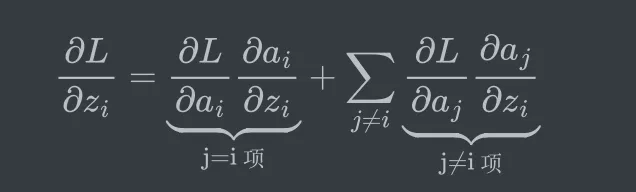

在机器学习，尤其是深度学习的分类任务中，交叉熵损失函数（Cross-Entropy Loss）是当之无愧的王者。无论是图像分类、自然语言处理还是其他任何分类场景，你几乎总能看到它的身影。我们都知道，模型通过反向传播（Backpropagation）来学习，而反向传播的核心就是计算损失函数对每个参数的梯度。

作为分类模型中最常用的损失函数，在实际应用过程中，大部分人仅关注如何构造损失函数，很少关注其梯度的计算方式和梯度数量级的问题。本文将详细推导该损失函数的梯度计算方式，之所以进行推导，是为了更好的理解某些时候构造损失函数为何要乘以一个超参数。

<!-- more -->

### 交叉熵损失函数梯度计算：

假设我们正在处理一个多分类问题，共有 `C` 个类别。

**模型输出（Logits）**: 神经网络最后一层（在激活函数之前）的输出。我们用一个向量 `z` 表示，
$$
z = [z₁, z₂, ..., z_C]
$$
 **Softmax 激活函数**: 将 Logits `z` 转换为概率分布 `a`。向量 `a`的第 `j` 个元素 `a_j` 代表模型预测样本属于类别 `j` 的概率。
公式为：
$$
a_j = \text{Softmax}(z_j) = \frac{e^{z_j}}{\sum_{k=1}^{C} e^{z_k}}
$$
**真实标签（Ground Truth）**: 我们使用 **One-Hot 编码** 来表示真实标签。如果一个样本的真实类别是 `i`，那么真实标签向量 `y` 就是一个第 `i` 位为 1，其余位都为 0 的向量。
例如，如果 `C=3`，真实类别是第 2 类，则 `y = [0, 1, 0]`。

**交叉熵损失函数（Cross-Entropy Loss）**: 用来衡量预测概率 `a` 和真实标签 `y` 之间的差距。公式为：
$$
L = - \sum_{k=1}^{C} y_k \log(a_k)
$$
我们的目标是计算损失函数 `L` 相对于模型 Logits $z_i$ 的偏导数 $∂L / ∂z_i$。

为什么是 `z_i`？因为 `z_i` 是由神经网络的权重和偏置直接计算得出的（例如 $z_i = W_i \cdot x + b_i$），求出 `∂L / ∂z_i` 后，我们就可以根据链式法则继续向前传播，计算 $∂L / ∂W_i$ 和 $∂L / ∂b_i$，从而更新模型的参数。

应用链式法则：

`L` 是 `a` 的函数，而 `a` 的每一个分量 `a_j` 都是 `z` 的所有分量 $z_k$ 的函数。这是一个关键点：**改变任何一个 $z_i$ 都会影响到所有的 $a_j$**。

根据链式法则，我们可以写出：
$$
\frac{\partial L}{\partial z_i} = \sum_{j=1}^{C} \frac{\partial L}{\partial a_j} \frac{\partial a_j}{\partial z_i}
$$
现在，我们将这个推导分解成两部分：
1.  计算 `∂L / ∂a_j`
2.  计算 `∂a_j / ∂z_i` （即 Softmax 函数的导数）

#### 第 1 部分：计算 `∂L / ∂a_j`

这部分比较简单。
$$
L = - \sum_{k=1}^{C} y_k \log(a_k)
$$
对 $a_j$ 求偏导，只有当 $k=j$ 时，$log(a_k)$ 项才与 $a_j$ 有关，其余项的导数都为 0。
$$
\frac{\partial L}{\partial a_j} = - \frac{y_j}{a_j}
$$

#### 第 2 部分：计算 $∂a_j / ∂z_i$ (Softmax 的导数)

*   **情况 1：`i = j`** (求 $a_i$ 对 $z_i$ 的偏导)
    $$
    a_i = \frac{e^{z_i}}{\sum_{k=1}^{C} e^{z_k}}
    $$
    我们使用商的求导法则 $(u/v)' = (u'v - uv') / v²$：
    
    代入公式：
    $$
    \begin{aligned}
    \frac{\partial a_i}{\partial z_i} &= \frac{e^{z_i} (\sum_{k=1}^{C} e^{z_k}) - e^{z_i} (e^{z_i})}{(\sum_{k=1}^{C} e^{z_k})^2} \\
    &= \frac{e^{z_i}}{\sum_{k=1}^{C} e^{z_k}} - \left(\frac{e^{z_i}}{\sum_{k=1}^{C} e^{z_k}}\right)^2 \\
    &= a_i - a_i^2 \\
    &= a_i(1 - a_i)
    \end{aligned}
    $$
    
*   **情况 2：`i ≠ j`** (求 $a_j$ 对 $z_i$ 的偏导)
    $$
    a_j = \frac{e^{z_j}}{\sum_{k=1}^{C} e^{z_k}}
    $$
    再次使用商的求导法则：
    *   $u = e^{z_j}$ => $∂u/∂z_i = 0$ (因为 $i ≠ j$，$e^{z_j}$ 相对于 $z_i$ 是常数)
    *   $v = \sum_{k=1}^{C} e^{z_k}$ => $∂v/∂z_i = e^{z_i}$

    代入公式：
    $$
    \begin{aligned}
    \frac{\partial a_j}{\partial z_i} &= \frac{0 \cdot (\sum_{k=1}^{C} e^{z_k}) - e^{z_j} (e^{z_i})}{(\sum_{k=1}^{C} e^{z_k})^2} \\
    &= - \frac{e^{z_j}}{\sum_{k=1}^{C} e^{z_k}} \cdot \frac{e^{z_i}}{\sum_{k=1}^{C} e^{z_k}} \\
    &= -a_j a_i
    \end{aligned}
    $$
    

### 4. 组合两部分，得出最终结果

现在我们把上面计算出的导数代回到最初的链式法则公式中：
$$
\frac{\partial L}{\partial z_i} = \sum_{j=1}^{C} \frac{\partial L}{\partial a_j} \frac{\partial a_j}{\partial z_i}
$$
我们将求和项拆分，把 `j = i` 的那一项单独拿出来：

现在代入我们计算好的结果：
*   **j=i 项**: $(-y_i / a_i) * (a_i(1 - a_i)) = -y_i(1 - a_i) = -y_i + y_i a_i$
*   **j≠i 项**: $(-y_j / a_j) * (-a_j a_i) = y_j a_i$

将它们组合起来：
$$
\begin{aligned}
\frac{\partial L}{\partial z_i} &= (-y_i + y_i a_i) + \sum_{j \neq i}^{} (y_j a_i) \\
&= -y_i + y_i a_i + a_i \sum_{j \neq i}^{} y_j \\
&= -y_i + a_i \left( y_i + \sum_{j \neq i}^{} y_j \right) \\
&= -y_i + a_i \left( \sum_{j=1}^{C} y_j \right)
\end{aligned}
$$
由于 `y` 是 one-hot 向量，所以 $Σ y_j = 1$。代入上式：
$$
\begin{aligned}
\frac{\partial L}{\partial z_i} &= -y_i + a_i(1) \\
&= a_i - y_i
\end{aligned}
$$

### 结论

我们得到了非常简洁和直观的最终结果：

$$
\frac{\partial L}{\partial z_i} = a_i - y_i
$$

这个公式的梯度向量形式为 $∇_z L = a - y$。

### 课后习题
推导带有温度T的softmax的损失函数梯度。
