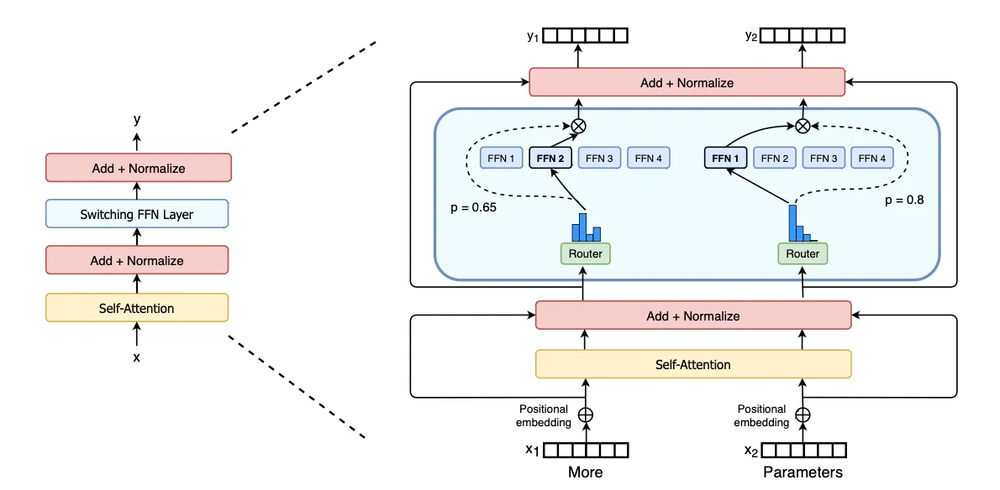

这篇论文由 Google 于 2021 年发表，它不仅是技术上的突破，更在很大程度上改变了业界对于如何构建超大规模语言模型的认知。

一句话总结：这篇论文通过一种简洁而高效的“专家混合”（Mixture of Experts, MoE）架构，成功地将模型参数量扩展到了万亿级别，同时将训练和推理的计算成本（FLOPs）维持在可控范围内，完美诠释了“用更少的计算，撬动更大的模型”这一核心思想。

<!-- more -->

### 论文核心思想
#### 1.“Switch”层与极致简化的 MoE 架构

MoE 的思想并不新鲜，早在 Hinton 等人的工作中就已提出。其核心是将一个大的神经网络（如前馈网络 FFN 层）替换为多个小的“专家”网络和一个“门控网络”（Gating Network）或称为“路由器”（Router）。路由器决定每个输入（token）应该由哪个专家来处理。

:::note{title="注"}
此处的'专家'并不是传统意义上的专家，比如根据输入的问题，就选择那个专家网络进行处理，而是token根据router选择FFN网络
:::

根据图像，可以看到MOE其实真正的工作是将原来的单个FFN层进行扩充为多个FFN层，由Route r决定选择那个FFN，之前的 MoE 模型通常采用 **"Top-k"**  路由，即每个 token 会被发送给得分最高的 k 个专家。而 Switch Transformer 做了一个大胆的简化：只使用 "Top-1" 路由。也就是说，每个 token 只被发送给唯一一个最合适的专家。这样做可以实现计算量不变的条件下，扩充模型的参数【知识体量】。

### 2.负载均衡损失 (Load Balancing Loss)
在 MoE 中，一个常见的问题是“马太效应”：路由器可能会倾向于将大部分 token 发送给少数几个“明星专家”，导致其他专家被闲置，模型容量被浪费。论文提出了一种简单而有效的辅助损失函数。这个损失函数的目标是鼓励路由器将 token 尽可能均匀地分配给所有专家。它通过惩罚那种“分配给某些专家的 token 数量”与“路由器认为这些专家重要的概率”之间不匹配的情况，来引导负载均衡。这部分的关键在于损失函数的设计：

$$
L_{total} =  L_{task} + L_{aux}
$$

### MOE路由计算
在讲解该论文的MOE架构之前，先看看hinton等人在2017年提出的MOE架构，核心一共2个公式：
$$
p_{i} ( x )=\cfrac{e^{h ( x )_{i}}} {\sum_{j}^{N} e^{h ( x )_{j}}} .
$$

**第一个公式：** 其中$h(x) = W_r  x $ ,$x$表示一个token的向量，$W_r$表示router的权重矩阵。 $h(x)$相当于计算router的logits【一共是N个logits】，公式中N表示专家的数量，$p_{i}$就是计算该token被分配到第$i$个专家的概率。

$$
y=\sum_{i \in\mathcal{T}} p_{i} ( x ) E_{i} ( x ) .
$$

**第二个公式**：其中$E_i(x)$表示第$i$个专家的ffn层计算结果,$\mathcal{T}$表示top-k的集合，就是采样的专家集合。
**这个公式的计算瓶颈**：它意味着为了计算最终的 `y`，**你必须计算所有 `N` 个专家的输出 `E_i(x)`**，然后再把它们加权组合。这违背了 MoE 节省计算量的初衷！虽然有些实现会只计算权重 `G(x)_i` 大于某个阈值的专家，但依然比只计算一个要复杂。

而Switch Transformer的改进就在于直接使用Top-1路由，只采样概率最高的那个路由结果，只计算一个ffn，具体如下：

$$
P = softmax(h(x))
$$
$$
i = argmax(P)
$$

*   `P` 是一个 N 维的概率向量。
*   `i` 是被选中的专家的索引。

最终的输出 `y` 只由被选中的专家 $E_i$ 产生，并乘以它被选中时的概率 $P_i$。

$$
y = P_i * E_i(x)
$$

### 辅助损失函数设计
为了避免某个‘专家’处理了大量的token，而其他‘专家’处理token太少，导致参数被浪费，没有存储知识。谷歌团队设计一个辅助损失函数以平衡各个‘专家’处理token。这部分一共3个核心公式：

$$
\mathrm{l o s s}=\alpha\cdot N \cdot\sum_{i=1}^{N} f_{i} \cdot P_{i}
$$

**第一个公式**：定义了辅助损失的计算方式，其中 $\alpha $是超参数用于控制辅助损失的重要性，经过超参数搜索发现$\alpha=1 0^{-2}$可以取得很好的效果。
$$
\begin{aligned} {f_{i}=\frac{1} {T} \sum_{x \in\mathcal{B}}  \{\mathrm{a r g m a x} \, p ( x )=i \}} \\ \end{aligned}
$$

**第二个公式**：其中$f_i$表示一个批次中第$i$个专家被分配到的token的比例，$T$表示Token数量， $\mathcal{B}$表示一个batch。$\sum_{x \in\mathcal{B}}  \{\mathrm{a r g m a x} \, p ( x )=i \}$表示第$i$个专家被分配到的token总数，然后再除以$T$得到$f_i$，其实就是token分配比例了。

$$
{P_{i}}=\frac{1} {T} \sum_{x \in\mathcal{B}} p_{i} ( x ) .
$$

**第三个公式**：首先理解$p_i(x)$表示$x$这个token特征向量被分配到第$i$个专家的概率【由softmax计算，具体往前看MOE结构部分】，$\sum_{x \in\mathcal{B}} p_{i} ( x )$就是表示一个batch中的所有token被分配到第$i$个专家的概率总和，最后除$T$表示该专家被分配到token的平均概率。

如果网络的辅助损失比较小，那个分配token数量和概率应该比较均匀，$f_i$和$P_i$都应该趋近于$1/N$.

