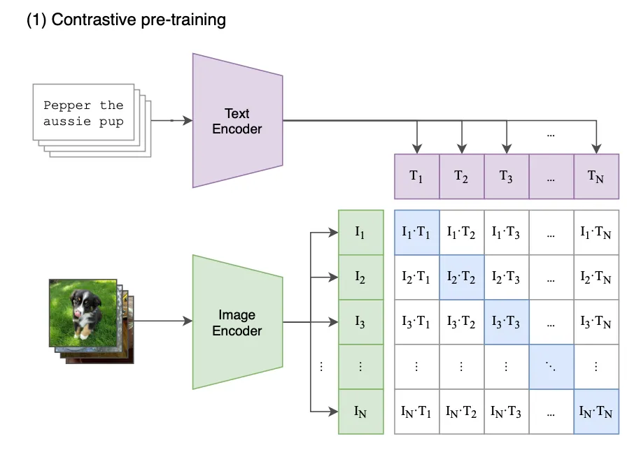
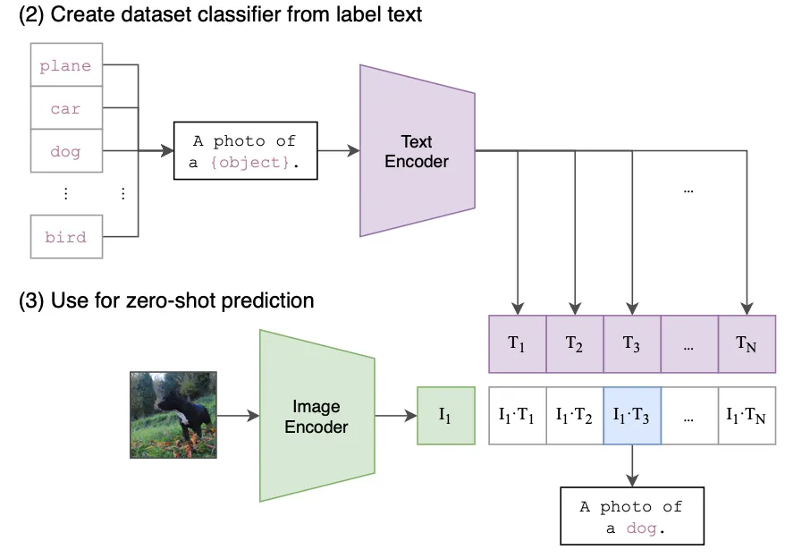

传统的视觉模型通常面临一个巨大的瓶颈：它们被束缚在预先定义好的、固定的类别标签上。例如，一个在ImageNet上训练的模型可以精准识别上千种物体，但如果你想让它识别一个“牛油果形状的椅子”，它便会束手无策。这种“专才”式的学习方式极大地限制了模型的通用性和灵活性。
2021年OpenAI发表的论文 **《Learning Transferable Visual Models From Natural Language Supervision》** （从自然语言监督中学习可迁移的视觉模型），提出了一种名为CLIP（Contrastive Language-Image Pre-training，对比语言-图像预训练） 的革命性模型。**CLIP的诞生，不仅在技术上实现了突破，更在思路上为计算机视觉的发展指明了一个全新的、充满想象力的方向——利用海量的、无处不在的互联网图文数据，直接从自然语言中学习视觉概念。**

<!-- more -->

### 论文核心思想
论文中最核心的思想就是**对比学习（Contrastive Learning）** 和**多模态对齐**。 简单解释就是：给模型看一张狗的图片，同时给它一句话：“一只金毛犬在草地上奔跑”。很显然，这张图片和这句话是“匹配”的。如果我们把文字换成“一只猫在沙发上睡觉”，那么图片和文字就是“不匹配”的。

CLIP的核心思想就是基于这个简单的直觉。它通过训练，让匹配的（图片，文字）对在特征空间中的距离尽可能近，而不匹配的（图片，文字）对的距离尽可能远。

CLIP 的核心思想革命性地简单：**与其让模型从“图像 -> 类别标签”中学习，不如让它从“图像 -> 描述这段图像的任意文本”中学习**。

核心部分：
- 图像编码器（Image Encoder）：可以是像ResNet或Vision Transformer（ViT）这样的标准视觉模型，负责将输入的图片转换成一个特征向量。

- 文本编码器（Text Encoder）：通常是一个Transformer模型，负责将输入的文本转换成一个特征向量。

将两者向量进行交叉对比计算损失函数，让文字可以匹配图像，图像可以匹配文字。这一步其实是一个预训练的模型，一个基础模型，并不能做下游任务。类似GPT2。



### 预训练的具体实现：

这一部分是理解预训练的核心，详细描述了如何实现对比学习。
```
# image_encoder - ResNet or Vision Transformer
# text_encoder - CBOW or Text Transformer
# I[n, h, w, c] - minibatch of aligned images
# T[n, l] - minibatch of aligned texts
# W_i[d_i, d_e] - learned proj of image to embed
# W_t[d_t, d_e] - learned proj of text to embed
# t - learned temperature parameter
# extract feature representations of each modality
I_f = image_encoder(I) #[n, d_i]
T_f = text_encoder(T) #[n, d_t]
# joint multimodal embedding [n, d_e]
I_e = l2_normalize(np.dot(I_f, W_i), axis=1)
T_e = l2_normalize(np.dot(T_f, W_t), axis=1)
# scaled pairwise cosine similarities [n, n]
logits = np.dot(I_e, T_e.T) * np.exp(t)
# symmetric loss function
labels = np.arange(n)
loss_i = cross_entropy_loss(logits, labels, axis=0)
loss_t = cross_entropy_loss(logits, labels, axis=1)
loss = (loss_i + loss_t)/2
```

这段代码的最终目标是：对于一个批次（mini-batch）的 N 个（图像，文本）配对，计算一个损失值（loss）。这个损失值会指导模型进行学习，让正确的（图像，文本）对在嵌入空间中更接近，让错误的对更疏远。

#### 先看模型定义与输入 (Definitions and Inputs)：

```
# image_encoder - ResNet or Vision Transformer
# text_encoder - CBOW or Text Transformer
# I[n, h, w, c] - minibatch of aligned images
# T[n, l] - minibatch of aligned texts
# W_i[d_i, d_e] - learned proj of image to embed
# W_t[d_t, d_e] - learned proj of text to embed
# t - learned temperature parameter
```

- image_encoder, text_encoder: 这是两个神经网络模型。image_encoder 负责处理图像，text_encoder 负责处理文本。

- I[n, h, w, c]: 这是输入的一批图像。n 是批次大小（batch size），也就是这个批次里有多少张图。h, w, c 分别是图像的高、宽和通道数。
 
- T[n, l]: 这是输入的一批文本。n 同样是批次大小，与图像一一对应。l 是文本序列的最大长度。I[0] 对应 T[0]，I[1] 对应 T[1]，以此类推。
 
- W_i, W_t: 这两个是可学习的投影矩阵（Projection Matrix）。这是非常关键的两个组件。
 
- image_encoder 的输出维度是 d_i，text_encoder 的输出维度是 d_t，这两个维度不一定相同。
 
- W_i 和 W_t 的作用就像“翻译官”，它们将不同来源的特征向量（图像和文本）都“翻译”到同一个维度 d_e 的共享嵌入空间中。只有在同一个空间里，我们才能比较它们的相似度。
 
- t: 这是一个可学习的温度参数，我们后面讲 logits 时会详细解释它的作用。

#### 特征提取与投影

```
I_f = image_encoder(I) #[n, d_i]
T_f = text_encoder(T) #[n, d_t]
I_e = l2_normalize(np.dot(I_f, W_i), axis=1)
T_e = l2_normalize(np.dot(T_f, W_t), axis=1)
```

- I_f 是编码后得到的图像特征，形状为 [n, d_i]，即 n 个 d_i 维的向量。
- T_f 是编码后得到的文本特征，形状为 [n, d_t]，即 n 个 d_t 维的向量。

此时两个特征纬度并不统一，需要通过权重矩阵投影到相同纬度，`np.dot(I_f, W_i)` 的作用就是转化特征纬度，`I_f ([n, d_i])` 乘以 `W_i ([d_i, d_e])`，得到一个形状为 `[n, d_e]` 的新矩阵。这就是投影操作，把图像特征从 `d_i` 维空间映射到了 `d_e` 维的共享空间。文本同理。

`l2_normalize`的目的是进行L2归一化，因为我们想用余弦相似度来衡量向量间的相似性。两个向量的余弦相似度等于它们的点积除以它们长度的乘积。当两个向量的长度都被归一化为 1 时，它们的点积就直接等于它们的余弦相似度( 因为$\| {\bf A} \| \| {\bf B} \| = 1$ )。这大大简化了计算。

余弦相似度计算公式：
$$
{\begin{array} {r c l} {\mathrm{S i m i l a r i t y} ( {\bf A} , {\bf B} )=\operatorname{c o s} ( \theta)=\frac{\bf A \cdot{\bf B}} {\| {\bf A} \| \| {\bf B} \|}=\frac{\sum_{i=1}^{n} A_{i} B_{i}} {\sqrt{\sum_{i=1}^{n} A_{i}^{2}} \sqrt{\sum_{i=1}^{n} B_{i}^{2}}}} \\ \end{array}}
$$

#### 计算相似度矩阵 (Calculating the Similarity Matrix)

```
logits = np.dot(I_e, T_e.T) * np.exp(t)
```
`np.dot(I_e, T_e.T)`: 这是整个算法的核心计算。
`I_e` 的形状是 `[n, d_e]`。
`T_e.T` 是 `T_e` 的转置，形状是 `[d_e, n]`。
两者相乘得到一个 `[n, n]` 的矩阵。
这个 `[n, n]` 矩阵的第 i 行、第 j 列的元素，就是第 i 张图像 `(I_e[i])` 和第 j 段文本 `(T_e[j])` 之间的余弦相似度。

`np.exp(t)`: 这是温度缩放 (Temperature Scaling)。
t 是一个可学习的参数。`np.exp(t)` 是一个缩放因子。
作用：它控制了 logits 的分布范围。在后续计算交叉熵损失时，会用到 Softmax 函数。如果 logits 的数值范围太小，Softmax 后的概率分布会很“平坦”（趋于均匀分布），模型学习信号弱；如果数值范围太大，Softmax 后的概率会过于“尖锐”（one-hot），导致模型过于自信，训练不稳定。
通过让 t 成为一个可学习的参数，模型可以在训练中自动找到一个最合适的缩放范围，来帮助稳定和优化训练过程。

#### 计算对称损失 (Calculating the Symmetric Loss)

```
labels = np.arange(n)
loss_i = cross_entropy_loss(logits, labels, axis=0)
loss_t = cross_entropy_loss(logits, labels, axis=1)
loss = (loss_i + loss_t)/2
```

`labels = np.arange(n)`: 这行代码创建了“正确答案”。labels 的值是 `[0, 1, 2, ..., n-1]`。
它的意思是：第 0 张图的正确配对是第 0 段文本，第 1 张图的正确配对是第 1 段文本，以此类推。

`loss_i = cross_entropy_loss(logits, labels, axis=0)`: 这是图像到文本的损失 (Image-to-Text Loss)。
axis=0 意味着对 logits 矩阵的每一列进行操作。
可以这样理解：对于第 j 列（代表第 j 张图），它与所有 n 个文本都计算了相似度。我们希望模型认为第 j 张图与第 j 个文本的相似度是最高的。这变成了一个 n 分类问题：为第 j 张图在 n 个文本中选出正确的那个，正确答案的索引是 j。
`loss_i `就是把所有 n 张图的分类损失加起来。

`loss_t = cross_entropy_loss(logits, labels, axis=1)`: 这是文本到图像的损失 (Text-to-Image Loss)。
axis=1 意味着对 logits 矩阵的每一行进行操作。
反过来理解：对于第 i 行（代表第 i 段文本），它与所有 n 张图都计算了相似度。我们希望模型认为第 i 段文本与第 i 张图的相似度是最高的。这也是一个 n 分类问题：为第 i 段文本在 n 张图中选出正确的那个，正确答案的索引是 i。
`loss_t` 就是把所有 n 段文本的分类损失加起来。

`loss = (loss_i + loss_t)/2`: 这是对称损失。我们同时从“图找文”和“文找图”两个方向计算损失，然后取平均。这样做使得学习目标更加对称和稳健，确保了图像和文本在嵌入空间中的对齐是双向的。


### 由预训练到下游任务
之前的代码只是训练了一个计算文本和图像匹配程度的基础模型，实际上无法完成什么任务。这里OpenAI用了一个很巧妙的方式让模型可以完成下游任务，即通过“prompt enginnering”。



具体流程：
1. 将类别名称转成文本提示。
2. 把图像与所有文本提示一起编码。
3. 用余弦相似度（或点积）做 “匹配度”。
4. 对相似度进行 softmax 或直接取 argmax → 预测类别。

根据上图可以看到，写好一个prompt: A photo of
a {object}. ,将需要分类的类别名称用一个列表存放，然后生成N个prompt输入`text Encorder`中，获得N个向量，再与要分类的图片的特征进行余弦相似度计算。最终prompt的余弦值最大那个就是被识别的类。

通过这种方式，甚至可以往这个类名列表中加很多数据集之外的类名称，因为预训练的模型中学习了大量的文本与图像关联特征，所以可以识别那种“牛油果形状的椅子”这种奇怪的标签。

实现代码：

```
import torch, clip
from PIL import Image

device = "cuda" if torch.cuda.is_available() else "cpu"

# 1. Load
model, preprocess = clip.load("ViT-B/32", device=device)

# 2. Image
image = Image.open("dog.jpg")
image_input = preprocess(image).unsqueeze(0).to(device)

# 3. Text prompt
class_names = ['dog', 'cat', 'horse', 'car', ...]          # 1000
templates = ["a photo of a {}", "a {}", "a picture of a {}"]
prompt_texts = [t.format(cls) for cls in class_names for t in templates]
text_tokens = clip.tokenize(prompt_texts).to(device)

# 4. Encodings
with torch.no_grad():
    image_emb = model.encode_image(image_input)
    image_emb = image_emb / image_emb.norm(dim=-1, keepdim=True)

    text_emb = model.encode_text(text_tokens)
    text_emb = text_emb / text_emb.norm(dim=-1, keepdim=True)

    logits = 100.0 * image_emb @ text_emb.T  # [1, N*templates]
    logits = logits.reshape(len(class_names), -1).mean(-1)
    pred_idx = logits.argmax().item()

print("Predicted class:", class_names[pred_idx])

```
