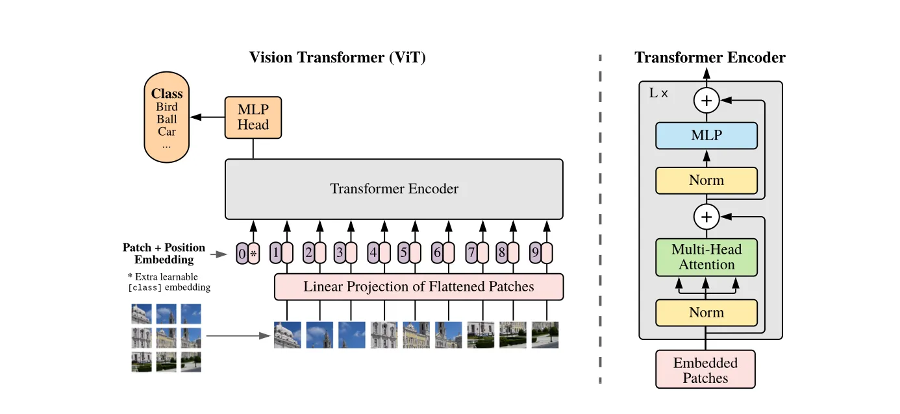

这篇论文由Google Brain团队于2020年发表，是计算机视觉（CV）领域的一个里程碑。它首次证明了，在拥有足够大规模的数据进行预训练的前提下，纯粹的Transformer架构可以超越当时最顶尖的卷积神经网络（CNN），在图像分类任务上取得SOTA（State-of-the-Art）的成果。

<!-- more -->
### 核心思想
论文的核心思想极其简洁和颠覆：将图像视为一个由“单词”组成的“句子”，然后直接应用自然语言处理（NLP）领域大获成功的Transformer模型进行分类。

"An Image is Worth 16x16 Words": 这个标题巧妙地概括了其核心方法。它将一张图像分割成一系列固定大小的小块（patches），例如16x16像素。每一个小块就被当作一个“单词”（word）。

"Transformers for Image Recognition at Scale": 这个副标题指出了模型的成功关键——大规模（at Scale）。与CNN不同，Transformer缺少一些内置的图像处理“先验知识”，因此需要海量数据来学习这些模式。

### Vision Transformer (ViT) 模型架构详解

#### 1.图像分块与序列化 (Image Patching)
输入: 一张2D图像，尺寸为 H x W x C (高x宽x通道数)。
进行以下操作:
1. 将图像分割成 N 个不重叠的、大小为 P x P 的小方块（Patches）。
N = (H * W) / (P * P) 就是序列的长度。
2. 将每个 P x P x C 的小块**展平（flatten）**成一个一维向量，长度为 P * P * C。

举个例子：对于一张 224 x 224 x 3 的ImageNet图像，如果patch大小为 16 x 16 (P=16)。
那么会得到 (224 * 224) / (16 * 16) = 14 * 14 = 196 个patches。
每个patch展平后是一个 16 * 16 * 3 = 768 维的向量。
至此，一张图像就变成了一个由196个向量组成的序列。 换种理解方式：**此时你得到了一个196个Token的序列，每个序列的d_model = 768**

#### 2.Patch + Position Embedding
Transformer本身是无法感知序列顺序的，因此需要额外的信息来告诉模型每个patch的原始位置。

1. 线性投射 (Linear Projection / Patch Embedding):
将每个768维的patch向量通过一个可学习的线性层（可以看作一个全连接层），将其投射到一个固定的维度 D（模型维度，例如768）。这与NLP中将单词映射为Word Embedding的过程非常相似。
\[196, 768] -> \[196, D]

2. \[class] Token:
借鉴了BERT模型的设计，在序列的开头加入一个特殊的可学习的向量，称为 [class] token。
这个token不代表任何一个patch，`它的作用是在经过Transformer Encoder之后，聚合整个图像的全局信息`。最终，我们只取这个token对应的输出向量来进行分类。

3. 位置编码 (Position Embedding):
为了保留patch的空间位置信息，需要为每个patch（以及 [class] token）添加一个位置编码。
ViT使用的是可学习的一维位置编码。即创建一个 (N+1) x D 的参数矩阵，在训练过程中学习每个位置应该是什么样的编码。
将位置编码与patch embedding逐元素相加，得到最终输入到Transformer的序列。

总结一下输入序列:
最终进入Transformer Encoder的输入是一个形状为 (N+1) x D 的矩阵，其中 N是patch数量，+1是为[class] token，D是模型维度。

#### 3.Transformer Encoder
这部分没有什么改动，采用transformer中标准的encorder架构。
一共L层，每层由多头自注意力 (Multi-Head Self-Attention, MSA) + FFN构成。

#### 4.分类头 (Classification Head)
这部分稍微特殊一些，
将经过 L 层Transformer Encoder处理后的序列输出。
只取出 [class] token对应的输出向量（此时它已经融合了所有patch的信息）。
将这个向量送入一个简单的MLP分类头（通常是一个带有激活函数的全连接层），最终输出各个类别的概率。

### Vision Transformer (ViT) 计算流程
论文一共用四个公式精确地描述了Vision Transformer (ViT) 模型的数据流和核心计算过程。
$$
\mathbf{z}_{0}=[ \mathbf{x}_{\mathrm{c l a s s}} ; \mathbf{x}_{p}^{1} \mathbf{E} ; \mathbf{x}_{p}^{2} \mathbf{E} ; \ldots; \mathbf{x}_{p}^{N} \mathbf{E} ]+\mathbf{E}_{\mathrm{p o s}} , \quad\mathbf{E} \in\mathbb{R}^{( P^{2} \cdot C ) \times D} , \quad\mathbf{E}_{\mathrm{p o s}} \in\mathbb{R}^{( N+1 ) \times D}
$$

**公式1**:这个公式描述了模型的最开始部分，即如何准备输入数据，具体含义：

- $x_p¹, x_p², ..., x_pᴺ$: 这代表图像被分割成的 N 个小块（Patches）。每个 $x_p^i$ 都是一个被**展平**的一维向量。例如，一个 16x16 的彩色（3通道）patch，展平后就是一个 16 * 16 * 3 = 768 维的向量。

- $E$: 这是一个可学习的线性投射矩阵（Linear Projection Matrix），也叫作Patch Embedding层。它的作用是将每个展平的patch向量从原始维度（P² * C，例如768）映射到模型内部使用的固定维度 D（例如 D=768）。$x_p¹E$ 表示将第1个patch向量与矩阵 $E$ 相乘，得到一个$ D$ 维的向量，我们称之为Patch Embedding。

- $x_{class}$: 这是一个特殊的可学习向量，称为 [class] token。它的作用类似于BERT模型中的 [CLS] token。它本身不代表图像的任何部分，而是一个“占位符”。在经过多层Transformer的全局信息交互后，这个token最终的输出向量将被用作整个图像的聚合表示，用于最终的分类任务。

- \[...]: 方括号表示拼接（Concatenation）。我们将 [class] token 和所有 N 个经过线性投射后的patch embeddings拼接在一起，形成一个长度为 N+1 的序列。

- $E_{pos}$: 这是位置编码（Position Embedding）。标准的Transformer不包含任何关于序列顺序的信息。但对于图像来说，patch的相对位置至关重要。E_pos 是一个可学习的矩阵，其中每一行对应序列中一个位置（0号位给 [class] token, 1到N号位给N个patch）的编码向量。通过将位置编码向量加到拼接好的序列向量上，模型就获得了每个patch的原始空间位置信息。

- $z₀$: 这是最终得到的、将要输入到第一个Transformer编码器层的序列。它的维度是 (N+1) x D，即一个包含 N+1 个 D 维向量的序列。

$$
{\bf z^{\prime}}_{\ell}=\mathrm{M S A ( L N ( z_{\ell-1} ) )+z_{\ell-1}} , \qquad\qquad\ell=1 \ldots L
$$

**公式2**: MSA表示多头注意力机制，LN表示LayerNorm , $+$符号表示和上一层的输出进行残差链接，$z_(ℓ-1)$: 第 $ℓ-1$ 层的输出序列。对于第一层（ℓ=1），它就是我们刚刚计算出的 $z₀$。

$$
\mathbf{z}_{\ell}=\mathrm{M L P} ( \mathrm{L N} ( \mathbf{z}^{\prime}_{\ell} ) )+\mathbf{z}^{\prime}_{\ell} , \qquad\qquad\qquad\qquad\ell=1 \ldots L
$$
**公式3**: 其中MLP表示多层感知机（Multi-Layer Perceptron）
$z'ℓ$: 上一步MSA模块的输出。
$z_ℓ$: 这是第 ℓ 层Transformer编码器的最终输出。这个输出将作为下一层（第 ℓ+1 层）的输入，如此循环 $L $次。

$$
\mathbf{y}=\mathrm{L N} ( \mathbf{z}_{L}^{0} )
$$

**公式4**:这个公式描述了如何从最后一层Transformer的输出中得到最终用于分类的特征向量。
$z_L$: 经过全部 L 层Transformer编码器处理后的最终输出序列。它的维度仍然是 $(N+1) *D$。
$z_L^0$: 这里的上标 0 表示我们从最终的序列$ z_L$ 中只取出第0个位置的向量。这个位置对应的正是我们一开始加入的那个 \[class] token。

$y$: 这就是代表整个图像的最终特征向量。这个向量 $y$ 会被送入一个简单的MLP分类头（例如一个全连接层），然后通过Softmax函数得到最终的分类概率。

