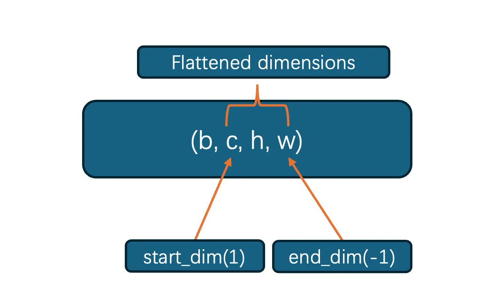

在编写深度学习模型的时候，有时候难免需要一些底层的函数，pytorch提供了大量的封装，本手册提供常用函数用法和参数解释。

<!-- more -->

### 1.torch.nn.Flatten
torch.nn.Flatten 的核心功能非常简单：将一个连续范围内的维度展平（flatten）成一个维度。

想象一下你有一张多层的、有高度和宽度的“数据饼”（比如一张彩色图片的数据），Flatten 的作用就是把它“压”成一条长长的“数据面条”。

`Example`\:Flatten 层的作用就是在这两者之间架起一座桥梁，它负责将 (N, C, H, W) 形状的张量转换为 (N, C * H * W) 的形状，这样就可以无缝地送入全连接层了。

`parameters`:
- start_dim (int): 开始展平的维度（包含该维度）。默认值为 1。
- end_dim (int): 结束展平的维度（包含该维度）。默认值为 -1。




代码实例：

```
import torch
from torch import nn

x = torch.randint(low=0, high=10, size=(1, 3, 4, 4))
print(x)

flatten = nn.Flatten()
y = flatten(x)
print(y)
```
输出：

```
tensor([[[[0, 9, 3, 4],
          [6, 4, 0, 7],
          [9, 5, 6, 8],
          [3, 7, 1, 9]],

         [[7, 8, 0, 8],
          [0, 0, 2, 5],
          [2, 6, 3, 5],
          [3, 3, 3, 8]],

         [[1, 9, 8, 4],
          [1, 1, 9, 4],
          [7, 0, 0, 3],
          [4, 2, 4, 7]]]])
tensor([[0, 9, 3, 4, 6, 4, 0, 7, 9, 5, 6, 8, 3, 7, 1, 9, 7, 8, 0, 8, 0, 0, 2, 5,
         2, 6, 3, 5, 3, 3, 3, 8, 1, 9, 8, 4, 1, 1, 9, 4, 7, 0, 0, 3, 4, 2, 4, 7]])
```
从代码运行可以观察到展开的顺序是从start_dim开始，然后逐行追加，直到一个通道的展开完后，再沿着第二个通道展开。

### 2.torch.nn.Conv2d
其函数为：`torch.nn.Conv2d(in_channels, out_channels, kernel_size, stride=1, padding=0, dilation=1, groups=1, bias=True, padding_mode='zeros', device=None, dtype=None)`

可以通过以下网页测试输出：https://www.jamesblog.top/c/con

**参数解释**

- `in_channels (int)`: 输入数据的通道数。
对于第一层卷积，如果是 RGB 图像，in_channels 就是 3。
对于后续层，in_channels 是上一层输出的通道数（即 out_channels）。
- `out_channels (int)`: 输出数据的通道数。
这个值等于卷积核的数量。每个卷积核都会生成一个输出通道（特征图）。
out_channels **决定了卷积层提取特征的种类数量。**
- `kernel_size (int or tuple)`: 卷积核的尺寸。
如果是一个整数 k，表示卷积核大小为 k x k。
如果是一个元组 (h, w)，表示卷积核大小为 h x w。
常用的有 3x3 (kernel_size=3) 和 5x5 (kernel_size=5)。
- `stride (int or tuple, optional)`: 卷积核滑动的步幅。默认为 1。stride=1 表示每次向右或向下移动 1 个像素。stride=2 表示每次移动 2 个像素，这会使得输出特征图的尺寸减半（降采样）。
- `padding (int or tuple, optional)`: 在输入数据的边界进行填充。默认为 0。在输入图像的周围填充指定数量的 0（或其他值）。

**卷积算子公式**
1. 核心数学运算：互相关（Cross-correlation）
严格来说，深度学习中的“卷积”操作在数学上是互相关（Cross-correlation）。真正的卷积需要将卷积核翻转180度。但由于卷积核的参数是学习得到的，翻转与否并不影响模型的学习能力，因此库都采用计算更简单的互相关。

假设：

- 输入特征图为 $I$ (尺寸 $H$ x $W$)
- 卷积核为 $K$ (尺寸 $k_h$ x $k_w$)
- 输出特征图为 $O$ (尺寸 $H_{out}$ x $W_{out}$)

输出特征图上 $(i, j)$ 位置的值 $O[i, j]$ 的计算公式为：

$$
\begin{aligned} {O [ i , j ]} & {{}=\left( \sum_{m=0}^{k_{h}-1} \sum_{n=0}^{k_{w}-1} I [ i+m , j+n ] \cdot K [ m , n ] \right)+b} \\ \end{aligned}
$$

2. 考虑多通道（Multi-channel）

这是实际情况。假设：

- 输入 $I$ 有 $C_{in}$ 个通道，表示为 $I[c, h, w]$
- 卷积核 $K$ 也有 $C_{in}$ 个通道，其尺寸为 $(C_{in}, k_h, k_w)$
- 输出 $O$ 的一个通道由一个完整的 $C_{in}$ 通道的卷积核生成。

为了生成输出特征图的一个通道，我们需要一个 $(C_{in}, k_h, k_w)$ 的卷积核。计算过程是：`将卷积核的每个通道与输入的对应通道进行二维互相关`，然后将 $C_{in}$ 个结果逐点相加，最后加上一个偏置项 $b$

假设我们有 $C_{out}$ 个这样的卷积核$（K_0, K_1, ..., K_{C_{out}-1}）$，就能得到 $C_{out}$ 个输出通道。

第 $k$ 个输出通道 $O_k$ 上 $(i, j)$ 位置的值为：

$$
\begin{aligned} {O_{k} [ i , j ]=\left( \sum_{c=0}^{C_{m}-1} \sum_{m=0}^{k_{h}-1} \sum_{n=0}^{k_{w}-1} I [ c , i+m , j+n ] \cdot K_{k} [ c , m , n ] \right)+b_{k}} \\ \end{aligned}
$$

- $k$ 是输出通道的索引 (0 到 $C_{out}-1$)。
- $c$ 是输入通道的索引 (0 到 $C_{in}-1$)。
- $K_k$ 是第 k 个卷积核（一个 3D 张量）。
- $b_k$ 是对应第 k 个输出通道的偏置项。

至于输入和输出的尺寸计算方式如下：
$$
H_{o u t}=\lfloor\frac{H_{i n}+2 \times\mathrm{p a d d i n g} [ 0 ]-\mathrm{d i l a t i o n} [ 0 ] \times( \mathrm{k e r n e l \_s i z e} [ 0 ]-1 )-1} {\mathrm{s t r i d e} [ 0 ]}+1 \rfloor
$$

$$
W_{o u t}=\lfloor\frac{W_{i n}+2 \times\mathrm{p a d d i n g} [ 1 ]-\mathrm{d i l a t i o n} [ 1 ] \times( \mathrm{k e r n e l \_s i z e} [ 1 ]-1 )-1} {\mathrm{s t r i d e} [ 1 ]}+1 \rfloor
$$

- ⌊ ... ⌋ 表示向下取整。
- padding[0], dilation[0], kernel_size[0], stride[0] 分别是高度维度的参数。
- padding[1], dilation[1], kernel_size[1], stride[1] 分别是宽度维度的参数。


### 3. torch.nn.BatchNorm2d

在训练深度网络时，每一层的输入分布会随着前一层参数的更新而不断变化，这种现象称为内部协变量偏移。这要求后续层需要不断地去适应新的分布，从而降低了训练速度，并使得训练深层次网络变得困难。

批量归一化通过对每个小批量（mini-batch）的数据进行归一化，将其强制转换为具有稳定均值和方差的分布，从而解决了这个问题。
nn.BatchNorm2d 的输入与输出

nn.BatchNorm2d 是专门为2D卷积层的4D输入输出数据设计的。

输入张量形状： (N, C, H, W)

- N： Batch Size（一个批次中的样本数量）
- C： Channels（通道数）
- H： Height（高度）
- W： Width（宽度）


输出张量形状： (N, C, H, W) （与输入形状相同）

它的核心操作是：沿着 N（batch），H（高度），W（宽度）维度计算统计量，而对每个通道 C 单独进行归一化。这意味着每个通道都有自己独立的均值和方差估计，以及自己独立的可学习参数。

对于给定的一个批次输入 x，BatchNorm2d 对每一个通道 c 执行以下计算步骤：

第一步：计算当前小批量的均值和方差

对于一个特定的通道 c，我们从整个批次的所有样本和该样本的所有空间位置（H x W）中提取值。

$$
\begin{aligned} {\mu_{c}} & {{}=\frac{1} {N \times H \times W} \sum_{n=1}^{N} \sum_{h=1}^{H} \sum_{w=1}^{W} x_{n , c , h , w}} \\ \end{aligned}
$$

$$
\sigma_{c}^{2}=\frac{1} {N \times H \times W} \sum_{n=1}^{N} \sum_{h=1}^{H} \sum_{w=1}^{W} ( x_{n , c , h , w}-\mu_{c} )^{2}
$$

第二步：归一化

使用第一步计算出的均值和方差，对该通道 c 上的所有值进行归一化，使其近似服从均值为 0、方差为 1 的标准正态分布。

$$
\hat{x}_{n , c , h , w}=\cfrac{x_{n , c , h , w}-\mu_{c}} {\sqrt{\sigma_{c}^{2}+\epsilon}}
$$

其中$\epsilon$ 是一个极小的常数（例如 1e-5），目的是防止分母为零，增加数值稳定性。

第三步：缩放和偏移（仿射变换）

仅仅进行标准化会改变层的表示能力。例如，对于 Sigmoid 激活函数，我们希望其输入不仅集中在 0 附近。因此，BN 引入了两个可学习的参数 $\gamma_c$（gamma，缩放）和 $\beta_c$（beta，偏移），对标准化后的值进行线性变换。

$$
\boldsymbol{y}_{n , c , h , w}=\gamma_{c} \cdot\hat{\boldsymbol{x}}_{n , c , h , w}+\beta_{c}
$$

$\gamma_c$ 和 $\beta_c$ 是长度为 C（通道数）的向量，每个通道一对。
在训练开始时，$\gamma$ 通常初始化为 1，$\beta$ 初始化为 0。
通过训练，网络可以学习到最适合数据的分布均值和方差。例如，如果网络认为原始分布更好，它可以通过学习将 $\gamma$ 设置为原始的标准差，将 $\beta$ 设置为原始的均值，从而“抵消”归一化的效果。

### 4.torch.nn.Linear
torch.nn.Linear 是 PyTorch 中的一个类，用于实现神经网络中的全连接层（Fully Connected Layer），也称为线性层（Linear Layer）或密集层（Dense Layer）。

它的核心功能是对输入的张量（tensor）进行一次线性变换。这个变换是神经网络中最基本的操作之一。

可以把它想象成一个函数，接收一个向量，然后输出另一个向量。这个转换过程由一个权重矩阵和一个偏置向量（可选）来定义。在训练过程中，网络会学习到最优的权重和偏置值，以完成特定任务（如分类或回归）。


torch.nn.Linear 执行的操作可以用以下数学公式表示：
$$
\quad\quad\quad y=x A^{T}+b
$$

参数构造：

```python
torch.nn.Linear(in_features, out_features, bias=True, device=None, dtype=None)
```

- x：输入的张量，通常是一个形状为 (N, in_features) 的二维张量，其中 N 是批量大小（batch size），in_features 是每个输入样本的特征数量。
- A：权重矩阵（weight），其形状为 (out_features, in_features)。
- A^T：权重矩阵 A 的转置，其形状变为 (in_features, out_features)。
- b：偏置向量（bias），其形状为 (out_features)。它是一个可选参数。
- y：输出的张量，其形状为 (N, out_features)。

使用 nn.Linear 时非常重要的一点：

- 输入形状：(\*, H_in)，其中 H_in 必须等于 in_features。* 表示任意数量的额外维度，最常见的是批量大小 N，所以输入通常是 (N, in_features)。
- 输出形状：(*, H_out)，其中 H_out 等于 out_features。nn.Linear 只会改变输入张量的最后一个维度，其他维度保持不变。

### tensor.reshape()
tensor.reshape() 是一个张量（tensor）操作，它的作用是在不改变张量中数据的情况下，改变张量的形状（shape）。

你可以把它想象成有一堆乐高积木，reshape 操作就像是把这些积木从一个矩形排列（比如 2x6）重新排列成另一个矩形（比如 3x4），积木的总数（12块）始终不变。

在定义新形状时，**你可以使用 -1 作为其中一个维度的占位符。PyTorch 会根据张量的总元素数和其他已确定的维度，自动计算出 -1 所在维度的大小。**


### torch.nn.BatchNorm1d()

BatchNorm1d 对一维特征向量（例如来自 Linear 的 (N, C)，或来自 Conv1d 的 (N, C, L)）做归一化：对每个通道（feature）分别计算均值/方差，标准化后再做可学习的仿射变换。目的是稳定训练、加速收敛并能起到轻微正则化作用。


```python
torch.nn.BatchNorm1d(num_features,
                     eps=1e-5,
                     momentum=0.1,
                     affine=True,
                     track_running_stats=True)

```

- num_features：特征通道数 C（若输入为 (N,C,L)，则是 C）。
- eps：数值稳定项，防止除以零。
- momentum：用于更新 running_mean 和 running_var 的动量系数（见公式）。注意：PyTorch 的 momentum 用在指数移动平均中，更新为 running = (1 - momentum) * running + momentum * batch_stat（与一些书写相反，要记清楚）。
- affine：是否学习缩放 γ（gamma，weight）和偏移 β（beta，bias）。
- track_running_stats：是否维护 running_mean / running_var（用于评估模式）。


注：输出与输入形状相同。


对某一通道 c，给定当前 mini-batch 的数据 $x_i$假定输入为 shape (N, C) 时，记 
$i = 1..N$:
1. 计算batch值：

$$
\mu_{\mathrm{B}}=\frac{1} {N} \sum_{i=1}^{N} x_{i}
$$
对于 (N, C, L) 的情况，若将空间维合并，则对$N×L$ 个元素求均值：
$$
\begin{aligned} {\mu_{\mathrm{B}}=\frac{1} {N L} \sum_{i=1}^{N} \sum_{t=1}^{L} x_{i , t}} \\ \end{aligned}
$$

2. 计算 batch 方差（无偏/有偏按实现，PyTorch 使用的是**矩估计（biased）**即除以 m 而不是 m-1）：

$$
\begin{aligned} {\sigma_{\mathrm{B}}^{2}} & {{}=\frac{1} {m} \sum_{i=1}^{m} ( x_{i}-\mu_{\mathrm{B}} )^{2}} \\ \end{aligned}
$$

其中$m=N$ 或 $m=N×L$（取决输入维度）。

3. 标准化（加 eps 保稳）：

$$
\hat{x}_{i}=\frac{x_{i}-\mu_{\mathrm{B}}} {\sqrt{\sigma_{\mathrm{B}}^{2}+\varepsilon}}
$$

4. 仿射变换（若 affine=True）：

$$
y_{i}=\gamma\hat{x}_{i}+\beta
$$

$γ ,β $为每通道的可学习参数（初始通常 $γ=1, β=0$）

### torch.norm
作用：计算张量的范数（norm）。既可以算向量范数（对某个维度）、也可以算矩阵范数（对两个维度，如 Frobenius、核范数）。

该函数的签名为：

```
torch.norm(input, p='fro', dim=None, keepdim=False, out=None, dtype=None)
```
- input是输入的张量
- p 表示范数类型，最常用的就是2
- dim 沿哪个维计算
- keepdim 保留被约简的维度（大小变为 1）。


比如我需要计算向量的L2范数和归一化，根据公式：

$$
L_2(v) = \sqrt{\sum_{i=1}^{n} v_{i}^{2}}
$$

代码：

```python
pred_v = torch.randn(3,1,2) # batch_size,object_num,2
print(f"原始向量：{pred_v}")

# 计算L2范数
norm_vec = torch.norm(pred_v, p=2, dim=-1, keepdim=True)
print(f"归一化L2长度：{norm_vec}")

# 归一化
pred_v = pred_v / norm_vec
print(f"归一化之后的向量：{pred_v}")

```

### torch.stack
torch.stack 用来把**形状完全相同**的一组张量，沿着一个`新维度`拼在一起。它不会在已有维度上延长长度，而是增加维度数。

函数签名：

```python
torch.stack(tensors, dim=0, *, out=None)
```

- tensors：可迭代对象（list/tuple），包含若干个形状、dtype、device 都一致的张量
- dim：插入新维度的位置（支持负索引）。范围是 [-(d+1), d]，其中 d 是输入张量的维度数
- 返回：一个新张量，形状是 (N, *orig_shape) 或在 dim 指定处插入长度为 N 的新维度

假设有 3 个形状相同的张量：

x, y, z 的形状都是 (C, H, W)。

torch.stack([x, y, z], dim=0) → 形状 (3, C, H, W)

torch.stack([x, y, z], dim=1) → 形状 (C, 3, H, W)（在第 1 维插入新轴）

直观理解：“把列表当作一个新轴的长度”。


### torch.cat
`torch.cat` 用来把一组形状相同（除某一维外）的张量，沿着`已有的某个维度`拼接在一起。它不会新增维度，只是把该维度的长度相加。

函数签名：

```python
torch.cat(tensors, dim=0, *, out=None)
```

- tensors：可迭代对象（list/tuple），每个元素都必须在除 dim 以外的所有维度上形状一致，且 dtype / device 一致
- dim：在哪个维度上拼接（支持负索引）
- 返回：新张量；其形状等于把输入们在 dim 维的长度相加，其他维度保持不变

设有两个形状 (B, C, H, W) 的张量 x, y：

`torch.cat([x, y], dim=0)` → 结果形状 (Bx + By, C, H, W)（沿 batch 维拼）

`torch.cat([x, y], dim=1)` → 结果形状 (B, Cx + Cy, H, W)（沿通道维拼）

直观理解：在选定维度上把“段”首尾相连。


