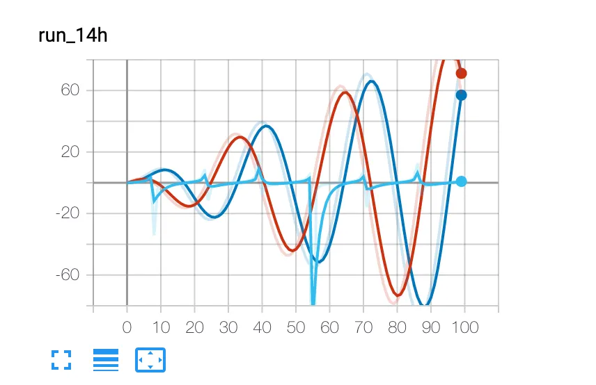
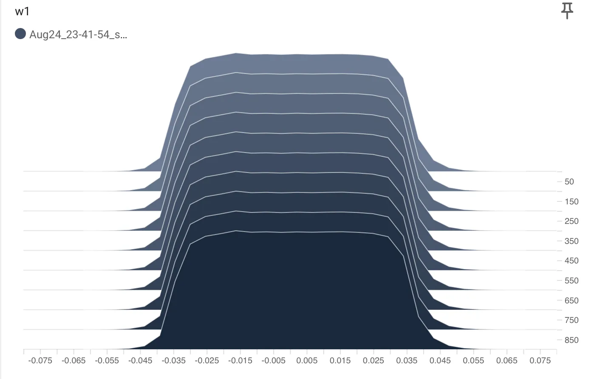

在机器学习的实践中，理解、调试和优化模型是至关重要的环节。为了应对这一挑战，Google 开发了一款强大的可视化工具——TensorBoard。它能够将训练过程中的各种数据，如指标、模型图、参数分布等，以直观的图形界面呈现出来，帮助我们更深入地洞察模型的行为。
本文将介绍几种常用的方法和技巧，方便训练过程中观测各种指标。

<!-- more -->

### 1.安装和启动

安装使用以下命令：
```
pip install tensorboard

```
运行：

```
tensorboard --logdir=runs
```
- logdir参数：表示日志文件输出目录，可以自己修改

### 2.使用教程

#### （1）初始化
以下是不同参数的初始化，可以根据需要选择：
```
from torch.utils.tensorboard import SummaryWriter

# 使用默认输出目录 
writer = SummaryWriter()
# folder location: runs/May04_22-14-54_s-MacBook-Pro.local/

# 使用指定目录名称
writer = SummaryWriter("my_experiment")
# folder location: my_experiment

# 使用comment参数会在目录后面追加comment
writer = SummaryWriter(comment="LR_0.1_BATCH_16")
# folder location: runs/May04_22-14-54_s-MacBook-Pro.localLR_0.1_BATCH_16/
```

#### （2）添加标量
有两种常用的方案，一种是只显示一种类型标量的折线图，另一种是对比显示的折线图，可以添加多个标量在同一个折线图中。

`add_scalar(tag, scalar_value, global_step=None, walltime=None, new_style=False, double_precision=False)`

参数说明：

| 参数 | 类型 | 说明 |
|------|------|------|
| `tag` | `str` | **数据标识符**，用于标记要保存的标量值。 |
| `scalar_value` | `float` 或 `string/blobname` | 要保存的**数值**。可以是浮点数，也可以是字符串（如 blob 名称）。 |
| `global_step` | `int` | **全局步骤值**，记录事件发生时的训练步数。 |
| `walltime` | `float` | 可选参数，用秒数（自 Unix 纪元以来）**覆盖默认墙时间**（即 `time.time()`）。 |
| `new_style` | `boolean` | 是否使用**新样式**（tensor 字段）而不是旧样式（simple_value 字段）。新样式可能导致更快的数据加载。 |

> **小贴士**  
> - `new_style=True` 时，数据会以张量字段形式存储，读取时更高效。  
> - 如果不需要兼容旧版本，建议开启 `new_style`。

Example:

```
from torch.utils.tensorboard import SummaryWriter
writer = SummaryWriter()
x = range(100)
for i in x:
    writer.add_scalar('y=2x的数值', i * 2, i)
writer.close()
```

另一种则是对比折线图，一次添加多个标量：
`add_scalars(main_tag, tag_scalar_dict, global_step=None, walltime=None)`

参数：
- **main_tag (str)** – 主标签名称，用于标识父标签  
- **tag_scalar_dict (dict)** – 键值对字典，存储标签及其对应的标量值  
- **global_step (int)** – 记录的全局步数  
- **walltime (float)** – 可选参数，用于覆盖默认walltime（`time.time()`），表示事件发生后经过的秒数

Example:

```
from torch.utils.tensorboard import SummaryWriter
writer = SummaryWriter()
r = 5
for i in range(100):
    writer.add_scalars('run_14h', {'xsinx':i*np.sin(i/r),
                                    'xcosx':i*np.cos(i/r),
                                    'tanx': np.tan(i/r)}, i)
writer.close()
```
结果图：



#### （3）添加参数分布图
在训练的时候需要观测参数分布是否过于平坦或者尖锐以避免梯度爆炸和消失，以下是数据分布图函数：
`add_histogram(tag, values, global_step=None, bins='tensorflow', walltime=None, max_bins=None)`

**参数说明**

| 参数 | 类型 | 说明 |
|------|------|------|
| **tag** | `str` | **数据标识符**，用于区分不同的直方图。 |
| **values** | `torch.Tensor`, `numpy.ndarray` 或 `string/blobname` | **构建直方图的数值**。可以是 PyTorch 张量、NumPy 数组，或者是指向文件/Blob 的字符串路径。 |
| **global_step** | `int` | **全局步数**，记录该直方图对应的训练步骤。 |
| **bins** | `str` | 取值为 `{‘tensorflow’, ’auto’, ‘fd’, …}` 之一，决定 **箱（bin）划分方式**。<br>更多可选项请参阅 <https://numpy.org/doc/stable/reference/generated/numpy.histogram.html>。 |
| **walltime** | `float` | **可选**，覆盖默认墙时间（`time.time()`），表示事件发生后经过的秒数。 |

> **提示**  
> - `tag` 与 `global_step` 共同用于在 TensorBoard 或类似工具中定位和排序直方图。  
> - `bins` 的不同取值会影响直方图的分箱策略，常见的 `tensorflow` 与 `auto` 与 TensorFlow 默认行为相同；`fd`（Freedman–Diaconis）则根据数据分散程度自动计算箱宽。  
> - `walltime` 主要用于时间轴可视化，若不指定则使用当前系统时间。

Example:

```
(flatten): Flatten(start_dim=1, end_dim=-1)
  (linear_relu_stack): Sequential(
    (0): Linear(in_features=784, out_features=512, bias=True)
    (1): ReLU()
    (2): Linear(in_features=512, out_features=1024, bias=True)
    (3): ReLU()
    (4): Linear(in_features=1024, out_features=512, bias=True)
    (5): ReLU()
    (6): Linear(in_features=512, out_features=10, bias=True)
  )
)

 writer.add_histogram('w1', model.linear_relu_stack[0].weight, batch)
```
将一个线性层的权重可视化：



#### （4）添加模型结构图
`add_graph(model, input_to_model=None, verbose=False, use_strict_trace=True)[source]`
- **model (torch.nn.Module)** – 用于绘图的模型。  
- **input_to_model (torch.Tensor 或 list of torch.Tensor)** – 用来喂给模型的变量，或一组变量的元组。  
- **verbose (bool)** – 是否在控制台打印图结构。  
- **use_strict_trace (bool)** – 是否将关键字参数 `strict` 传递给 `torch.jit.trace`。若想让追踪器记录可变容器类型（如 `list`、`dict`），请设为 `False`。

Example:

```
model = NeuralNetwork().to(device)
print(model)

dummy_input = torch.randn(batch_size, 1, 28, 28).to(device)
writer.add_graph(model, dummy_input)
```
