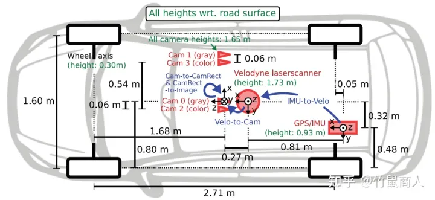
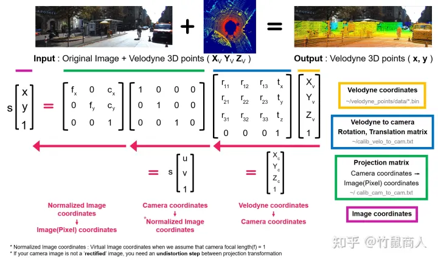

# KITTI数据集报告

​	KITTI数据集是自动驾驶数据当中最出名的数据集，其采集的数据主要包含激光雷达、相机、GPS和IMU的数据。相机数据包含两个灰度相机，两个彩色相机。在研究中使用的是经同步与校正处理的双目彩色图像序列，以png格式存储，大小1240*370左右；

<!-- more -->

​	对于相机和激光雷达其中最重要的就是数据的标注和校准，对于相机内的标注对象，适用3Dbox的方式提供注释，用激光雷达的坐标表示。每一个标注对象被赋予一个类别：行人、车辆，自行车等，还有对应的3D尺寸：长、宽、高。对于标注的角度，只提供了标注对象的偏航角：标注对象的X轴相对于激光雷达X轴的角度。另外标注信息还包括了遮挡和阶段的程度，用0-1的浮点数表示。

​	对于传感器的标定，首先最重要的就是坐标系统的定义。

* ​	相机坐标系统：x表示右方，y表示下方，z表示前方。 
* ​	雷达坐标系统：x表示前方，y表示左方，z表示上方。

传感器安装位置：

## 数据校准

一般以0号相加为参考，将3D点投影到第i个相机画面的像素中去：

$ y = P_{rect}^{(i)} R_{rect}^{(i)}x$

此处的x应该是相机的坐标系下的3D点的位置，要得到x还需要从激光雷达的坐标系转换到相机的坐标系，乘以齐次转换矩阵,所以完整的公式是：

$y = P_{rect}^{(i)} R_{rect}^{(i)}T_{velo}^{cam}x$

注：此处的x是雷达参考系的3D点云向量

## 补充知识

​	对于KITTI数据集涉及的校准有：

1. 相机内参校准：包括相机的焦距、主点位置、畸变等参数的校准，以确保相机捕捉到的图像和真实世界尺度之间的正确匹配。
2. 相机和激光雷达之间的外参校准：确定相机和激光雷达之间的相对位置和姿态，以便在3D空间中将它们的数据进行配准。
3. 激光雷达的时间戳校准：激光雷达和相机的数据可能是在不同的时间采集的，因此需要对它们进行时间戳的校准，以确保它们的数据可以在时间轴上正确对齐。
4. IMU校准：如果存在惯性测量单元（IMU），则需要校准IMU的陀螺仪和加速度计数据，以减少因姿态估计和加速度计偏差等原因引起的误差。
5. 车辆姿态校准：车辆的姿态（如俯仰角、偏航角、横滚角等）也需要进行校准，以确保车辆的运动轨迹可以准确地捕捉到。

  立体相机可以通过计算两个相机之间的视差（Disparity）来获取深度信息。视差是指在两个相机的图像中，同一点在图像中的位置差异，即两个相机中的对应点之间的水平像素偏移量。

在实际应用中，视差通常由以下步骤计算得到：

1. 对两幅图像进行预处理，例如去噪、对齐等。
2. 从左图像中选取一个像素点 P，通过搜索在右图像中对应的像素点 P'，找到 P 和 P' 之间的视差。
3. 在搜索 P' 的过程中，可以使用多种算法来加速计算，例如区域匹配、特征匹配等。其中最常用的是区域匹配算法，如半局部匹配（Semi-Global Matching，SGM）算法和快速可扩展的立体视觉（Fast and Scalable Stereo，FASSTER）算法。
4. 通过相机标定得到的基线距离和两个相机的内参，可以将视差转换为深度信息。这个转换公式为：深度 = 基线距离 × 左相机焦距 / 视差。

相机内参校准是计算机视觉中的一项重要任务，旨在确定相机的内部参数，以便从图像像素坐标到真实世界尺度之间进行正确的转换。相机内参校准通常需要计算以下参数：

1. 焦距（Focal length）：焦距是指相机的成像镜头到成像平面之间的距离，通常以毫米（mm）为单位。焦距越大，表示相机能够捕捉到更远的目标，但也会导致图像失真。
2. 主点位置（Principal point）：主点是指相机成像平面上的一个点，通常位于图像的中心位置。主点的位置可以影响图像的畸变和校正结果。
3. 畸变参数（Distortion parameters）：畸变是由于相机镜头成像时产生的一种误差，导致图像中的直线不是直的。畸变通常可以分为径向畸变和切向畸变两种类型。

相机内参校准的目的是确定这些参数的值。一般情况下，可以通过拍摄标定板（如棋盘格）并测量板上点的位置，从而推导出相机内部参数的值。具体步骤如下：

1. 拍摄标定板：将标定板放在相机的视野内，并拍摄多张照片，以获得不同的视角和距离。
2. 检测标定板：使用计算机视觉技术来检测标定板上的角点，以便将其与真实世界中的位置进行匹配。
3. 计算相机内参：使用检测到的标定板角点的像素坐标和真实世界中的位置，可以通过最小二乘法等方法计算出相机的内部参数，如焦距、主点位置和畸变参数等。
4. 评估校准效果：通过将标定板拍摄的图像与真实世界中的位置进行比较，可以评估相机内参校准的效果，并进行调整。

  在计算机视觉和机器人领域中，我们经常使用刚体变换（Rigid Transform）来描述一个刚体在空间中的运动或变形。这个变换包括旋转和平移，可以用一个矩阵来表示。这样，我们可以通过矩阵运算来描述一个刚体在运动或变形过程中的姿态和位置。

## 专业名词

panoramic image：全景图

disparity: 视差

