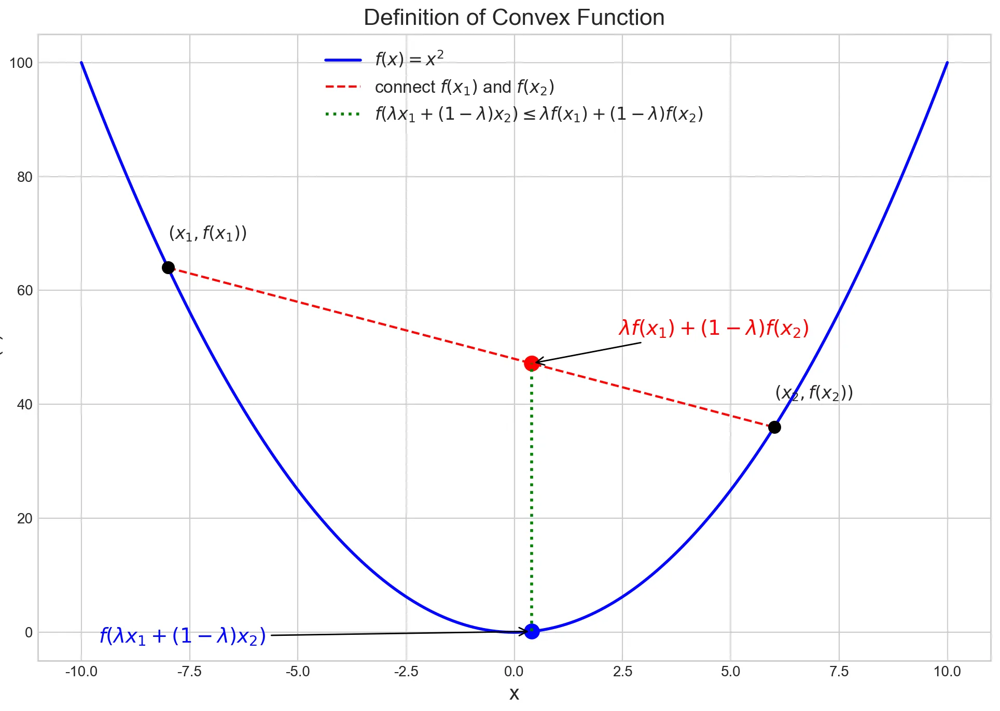

在深度学习中，我们依赖于梯度下降和反向传播来优化神经网络。这些方法的核心，正如其名，是“梯度”。梯度指引着我们如何调整参数以最小化损失函数。但如果我们的函数在某些点上没有梯度呢？这在现代神经网络中其实非常普遍，例如广泛使用的ReLU激活函数在x=0处就是不可导的。

这时候，“次梯度”（Subgradient）的概念就显得尤为重要。幸运的是，像PyTorch这样的现代深度学习框架已经巧妙地为我们处理了这些情况。这篇博客将带你深入浅出地理解什么是次梯度。


<!-- more -->

### 凸函数定义
在pytorch中求次梯度的概念是针对凸函数，凸函数的定义如下：

设函数$\boldsymbol{f} : \mathbb{R}^{n} \to\mathbb{R}_{\circ}$

定义：如果对任意两点$x_1,x_2$以及任意 $\lambda\in[ 0 , 1 ] $， 都有：

$$
f ( \lambda x_{1}+( 1-\lambda) x_{2} ) \leq\lambda f ( x_{1} )+( 1-\lambda) f ( x_{2} ) ,
$$

则称该函数是凸的。如何理解这个定义呢？
假设选定两个点$x_1 ,x_2$,在函数上利用$\lambda$作为一个“滑块”，控制自变量在$x_1，x_2$之间滑动,用下图表示：



满足定义则认为该函数是凸的。
在函数图像上，取两个点连成的线段，整条线段都在函数图像之上或重合。

凸函数在优化中非常重要，因为：
局部极小点就是全局极小点。
这是优化问题最核心的性质，使凸优化问题相对「好解」。
很多机器学习的目标函数（如线性回归的平方损失、逻辑回归的对数似然）都是凸的，因此便于优化。

凸函数像碗：往里放球（局部最优点），球一定会滚到最底部（全局最优点）。
凹函数像山峰：小球可能停在半山腰（局部极值），而不是山顶（全局极大）。

### 次梯度定义
先看凸函数梯度的特性：
对于一个在点 $x$ 可微的凸函数 $f: \mathbb{R}^n \to \mathbb{R}$，其梯度 $\nabla f(x)$ 定义了一个切面，这个切面是函数 $f$ 的一个全局下界支撑。用公式表达就是：
$$
f(y) \ge f(x) + \nabla f(x)^T (y - x) \quad \forall y \in \mathbb{R}^n
$$
这个公式意味着，从点 $(x, f(x))$ 出发的切线（或切面）永远不会跑到函数图像的上方。

当函数 $f$ 在点 $x$ 不可微时，我们无法找到唯一的梯度。但是，我们仍然可以找到满足上述不等式的向量。任何满足该条件的向量 $g$ 都被称为函数 $f$ 在点 $x$ 的一个**次梯度**。


一个向量 $g \in \mathbb{R}^n$ 是 $f$ 在 $x$ 处的次梯度，如果对于所有的 $y$ 都满足：
$$
f(y) \ge f(x) + g^T (y - x)
$$
在点 $x$ 的所有次梯度的**集合**被称为**次微分 (Subdifferential)**，记作 $\partial f(x)$。
$$
\partial f(x) = \{ g \in \mathbb{R}^n \mid f(y) \ge f(x) + g^T (y - x), \forall y \in \mathbb{R}^n \}
$$

**这表示梯度是一个向量，而次微分是次梯度是一个集合。**

**示例：绝对值函数 $f(x) = |x|$**

- 当 $x > 0$ 时, $f'(x) = 1$。次微分 $\partial f(x) = \{1\}$。
- 当 $x < 0$ 时, $f'(x) = -1$。次微分 $\partial f(x) = \{-1\}$。
- 当 $x = 0$ 时, 函数不可导。我们来找它的次梯度集合 $\partial f(0)$。
  我们需要找到所有满足 $|y| \ge |0| + g \cdot (y - 0)$ 的 $g$。
  也就是 $|y| \ge g \cdot y$。
  - 如果 $y > 0$, 我们需要 $y \ge g \cdot y \implies 1 \ge g$。
  - 如果 $y < 0$, 我们需要 $-y \ge g \cdot y \implies -1 \le g$。
  综合起来，我们得到 $-1 \le g \le 1$。
  所以，在 $x=0$ 处的次微分是区间内的所有值：
  $$
  \partial f(0) = [-1, 1]
  $$

现在我们来看pytorch对于不可微的函数如何处理：

> If the function is convex (at least locally), use the sub-gradient of minimum norm

这段话表示，如果函数是凸的，使用次梯度 $|| g ||^2$范数最小值。

### 为什么选择范数最小的次梯度？

在优化算法中（如次梯度下降法），我们需要一个确定的方向来进行更新，即 $x_{k+1} = x_k - \alpha_k g_k$，其中 $g_k \in \partial f(x_k)$。

但次微分 $\partial f(x_k)$ 是一个集合，我们应该从里面选哪个 $g_k$ 呢？

**原则：选择范数最小的那个次梯度。**
$$
g^* = \underset{g \in \partial f(x)}{\arg\min} \|g\|_2
$$
这个 $g^*$ 被称为**最小范数次梯度 (minimum norm subgradient)**。

**选择它的原因：**

1.  **最“安全”的下降方向**：在所有可能的支撑超平面中，由最小范数次梯度定义的那个是最“平坦”的。在几何上，$-g^*$ 是在点 $x$ 处函数 $f$ 的**最速下降方向 (steepest descent direction)**。它代表了在该点附近最稳健、最保守的下降方向。
2.  **唯一性和确定性**：次微分 $\partial f(x)$ 是一个闭凸集，因此它有唯一的最小范数元素。这为算法提供了一个确定的、唯一的更新方向，避免了选择的模糊性。
3.  **与邻近算子 (Proximal Operator) 的联系**：在更高级的凸优化理论中，这个选择与邻近算子紧密相关，后者是许多现代优化算法（如 ADMM、ISTA）的核心。

**示例续：对于 $f(x) = |x|$ 在 $x=0$ 处**
- 次微分是 $\partial f(0) = [-1, 1]$。
- 我们要找这个集合里L2范数（在这里就是绝对值）最小的元素。
- $\underset{g \in [-1, 1]}{\arg\min} |g| = 0$。
- 所以，最小范数次梯度是 $g^* = 0$。

---

### PyTorch 如何体现这个概念？

PyTorch 的自动求导引擎 `autograd` 在设计时就考虑了这些不可导的函数，因为它在深度学习中太常见了（例如 ReLU）。当 `backward()` 在一个不可导点被调用时，它必须返回一个**具体的值**作为梯度，而不是一个集合。PyTorch 的实现通常会选择一个有效的次梯度，而这个选择往往恰好是（或等价于）那个**范数最小的次梯度**。

#### 示例 1: ReLU 函数

- 函数: $f(x) = \text{ReLU}(x) = \max(0, x)$
- 在 $x > 0$ 时, $f'(x) = 1$。
- 在 $x < 0$ 时, $f'(x) = 0$。
- 在 $x = 0$ 时, 次微分是 $\partial f(0) = [0, 1]$。
- **最小范数次梯度**: $\underset{g \in [0, 1]}{\arg\min} |g| = 0$。

我们用 PyTorch 代码验证：
```python
import torch

# 创建一个 requires_grad=True 的张量，其值为 0.0
x = torch.tensor(0.0, requires_grad=True)

# 应用 ReLU 函数
y = torch.relu(x)

# 反向传播
y.backward()

# 打印 x 的梯度
print(x.grad)
```
**输出：**
```
tensor(0.)
```
PyTorch 在 `x=0` 处为 ReLU 的梯度选择了 `0`，这正是最小范数次梯度。

#### 示例 2: L1 范数 (torch.abs)

- 我们已经知道 $f(x) = |x|$ 在 $x=0$ 处的次微分是 $\partial f(0) = [-1, 1]$。
- **最小范数次梯度**: $g^* = 0$。

PyTorch 代码验证：
```python
import torch

x = torch.tensor(0.0, requires_grad=True)
y = torch.abs(x)
y.backward()

print(x.grad)
```
**输出：**
```
tensor(0.)
```
同样，PyTorch 选择了 `0`。

#### 示例 3: 多维最大值函数 (torch.max)

这是一个更复杂的例子，能更好地展示这个原则。
- 函数: $f(x_1, x_2) = \max(x_1, x_2)$
- 当 $x_1 > x_2$ 时, $\nabla f = [1, 0]^T$。
- 当 $x_2 > x_1$ 时, $\nabla f = [0, 1]^T$。
- 当 $x_1 = x_2 = a$ 时, 函数不可导。
  此时的次微分是两个梯度向量的**凸包 (convex hull)**：
  $$
  \partial f(a, a) = \text{conv}(\{[1, 0]^T, [0, 1]^T\}) = \{ g = [\lambda, 1-\lambda]^T \mid 0 \le \lambda \le 1 \}

- **寻找最小范数次梯度**: 我们要求解


  $$
  \underset{0 \le \lambda \le 1}{\arg\min} \|[\lambda, 1-\lambda]^T\|_2^2 = \underset{0 \le \lambda \le 1}{\arg\min} (\lambda^2 + (1-\lambda)^2)
  $$

  
  对 $\lambda^2 + (1-\lambda)^2$ 求关于 $\lambda$ 的导数并令其为0，得到 $2\lambda - 2(1-\lambda) = 0 \implies 4\lambda = 2 \implies \lambda = 0.5$。
  
  这个解在 $[0, 1]$ 区间内，所以是最小值点。
- 最小范数次梯度是 $g^* = [0.5, 0.5]^T$。

PyTorch 代码验证：
```python
import torch

# 在 x1 = x2 = 2.0 这个不可导的点
x = torch.tensor([2.0, 2.0], requires_grad=True)

# torch.max 对于多维输入会返回一个元素，所以我们用 .sum() 或直接取 y[0]
y = torch.max(x)

y.backward()

print(x.grad)
```
**输出：**
```
tensor([0.5000, 0.5000])
```
PyTorch 的计算结果完美地符合了最小范数次梯度的理论！
