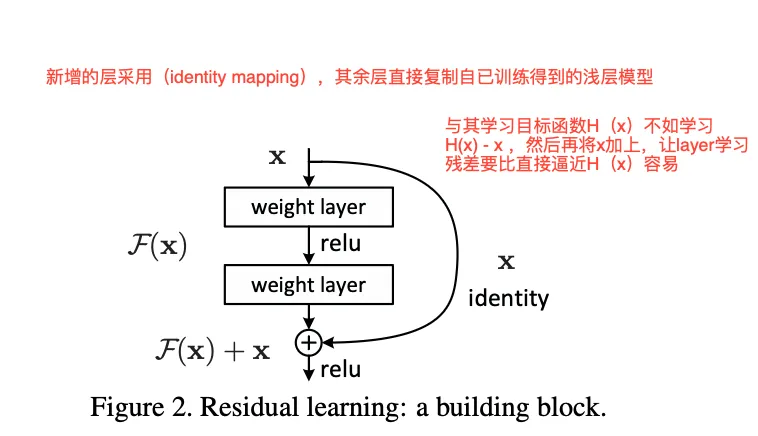
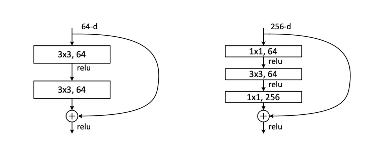

今天带来的论文是最最最经典的ResNet,这篇论文开启了深度学习“千层”的时代。在这篇论文之前，大量研究学者发现网络层数越深，效果非但没有提升，反而出现下降。经过大量分析，并不是梯度消失的问题，大家把这个网络深度增加带来的问题称为“网络退化”。而ResNet解决了长期困扰研究者们的“深度网络退化”问题，让构建成百上千层的神经网络成为可能。


<!-- more -->

### 论文核心思想 残差学习（Residual Learning）

我们将网络学习的过程看作一个优化过程，逐步逼近最优函数$H(x)$. 比如我设计了两个卷积层，目的就是让两个卷积层逼近一个$H(x)$。 ResNet则开创新的换了一种思维，设计两个卷积层，并不去逼近$H(X)$,而是逼近$F(x) = H(x) - x$ ,当两个卷积层学习到$F(x)$之后，再通过一个short connection把其连接起来， 即：$F(x) + x$, 使其等价于$H(x)$。具体如图：



这个小小的改变，却蕴含着巨大的能量。

- 如果最优的映射就是恒等映射（即 $H(x) = x$），那么对于残差学习来说，网络只需要将 $F(x)$ 的权重和偏置全部学成0即可。这比让一堆非线性层（如ReLU）去拟合一个恒等变换要容易得多。
- 在实际情况中，最优映射 $H(x)$ 可能与恒等映射 $x$ 非常接近。此时，网络只需要在 $x$ 的基础上学习一个微小的扰动 $F(x)$，这极大地降低了学习难度。

打个比方：让你重新画一幅《蒙娜丽莎》，这几乎不可能。但如果给你一幅几乎完美的《蒙娜丽莎》摹本，让你找出并修正其中的几处微小瑕疵，这就容易多了。这里的摹本就是 $x$，瑕疵就是残差 $F(x)$，而最终完美的画作就是 $H(x)$。


### 残差块的梯度分析
通过分析残差的梯度，我们可以发现，这种结构其实一定程度上缓解了梯度消失的问题。现在假设损失函数为$L$, 输入是$x$，如果要将梯度传递到$x$，利用链式法则分析：

输入$x$的梯度为：

$$
\cfrac{\partial{L}} {\partial x}=\cfrac{\partial{L}} {\partial y} \cdot\cfrac{\partial{y}} {\partial x}
$$
公式中的$y$就是残差结构:$y = F(x) + x$ ,$F(x)$可以看作图中的两个卷积层。求导可得：

$$
\cfrac{\partial y} {\partial x}=\cfrac{\partial F ( x )} {\partial x}+1
$$

再将上式代入链式法则：

$$
\cfrac{\partial L} {\partial x}=\cfrac{\partial L} {\partial y} \cdot\left( \cfrac{\partial F ( x )} {\partial x}+1 \right)=\cfrac{\partial L} {\partial y} \cdot\cfrac{\partial F ( x )} {\partial x}+\cfrac{\partial L} {\partial y}
$$

该结果具有关键意义：
- $\frac{\partial L} {\partial y} \ \cdot\ \frac{\partial F ( x )} {\partial x}$ 表示梯度经权重层传播的路径；
- $\frac{\partial L} {\partial y}$ 表示梯度通过快捷连接的路径。

其中$\frac{\partial L} {\partial y}$项至关重要：即使权重层的梯度$\frac{\partial F ( x )} {\partial x}$极小，接近零，梯度仍可通过快捷连接这一“高速公路”无损地反向传播。这一机制确保无论网络深度如何，梯度信号均可有效传递至浅层，从而保障整个网络的训练稳定性。


### 具体实现
在论文中一共提出两种基础的残差结构和三种不同的连接策略：



左边的是**基础块 (Basic Block)**，一般用在稍微浅层的网络如 ResNet-18 和 ResNet-34。它由两个 3x3 的卷积层组成。右边的是**瓶颈块 (Bottleneck Block)**：用于更深的网络，如 ResNet-50, 101, 152。为了降低计算复杂度，它采用了“1x1卷积 -> 3x3卷积 -> 1x1卷积”的结构。

- 第一个 1x1 卷积用于降维（例如将 256 维降到 64 维）。
- 中间的 3x3 卷积在低维空间进行计算，减少参数量。
- 最后一个 1x1 卷积用于升维（例如将 64 维恢复到 256 维）。


这种“先降维再升维”的设计，像一个瓶颈，因此得名。它在不显著影响性能的情况下，极大地减少了计算量和参数量，使得训练更深的网络成为可能。

论文中给出了三种short connection策略：

方案 A (Zero-Padding Shortcut)：
空间维度不匹配时，对 x 进行步长为2的下采样。
通道维度不匹配时，对增加的通道进行零填充（Zero-Padding）。
优点：不增加任何额外参数。
缺点：零填充是一种“硬编码”的方式，不如学习到的投影灵活。

方案 B (Projection Shortcut)：
仅在维度不匹配时使用1x1卷积进行投影变换。
在维度匹配时，仍然使用恒等快捷连接（Identity Shortcut）。
优点：在保持大部分连接为“零参数”的同时，为维度变换提供了必要的灵活性。

方案 C (All Projection)：
所有的快捷连接，无论维度是否匹配，都使用1x1卷积进行投影。
缺点：大幅增加了模型的参数量和计算复杂度，违背了快捷连接简洁高效的初衷。


下面给出相关的代码参考：

```python
class BasicBlock(nn.Module):
    """基础残差块实现
    
    遵循ResNet论文中的设计，包含两个3x3卷积层和跳跃连接。
    如果输入输出维度不匹配，使用1x1卷积进行维度调整。
    """
    
    def __init__(self, in_channels, out_channels, stride=1, downsample=None):
        """
        初始化基础残差块
        
        参数:
            in_channels: 输入通道数
            out_channels: 输出通道数
            stride: 卷积步长，默认为1
            downsample: 下采样函数，用于调整维度不匹配的情况
        """
        super(BasicBlock, self).__init__()
        
        # 第一个卷积层：3x3卷积，可能包含步长
        self.conv1 = nn.Conv2d(
            in_channels, 
            out_channels, 
            kernel_size=3, 
            stride=stride, 
            padding=1, 
            bias=False
        )
        self.bn1 = nn.BatchNorm2d(out_channels)
        
        # 第二个卷积层：3x3卷积，步长始终为1
        self.conv2 = nn.Conv2d(
            out_channels, 
            out_channels, 
            kernel_size=3, 
            stride=1, 
            padding=1, 
            bias=False
        )
        self.bn2 = nn.BatchNorm2d(out_channels)
        
        # 激活函数
        self.relu = nn.ReLU(inplace=True)
        
        # 下采样函数，用于处理维度不匹配的情况
        self.downsample = downsample
        self.stride = stride

    def forward(self, x):
        """前向传播"""
        identity = x  # 保存输入用于跳跃连接

        # 主路径：两个卷积层
        out = self.conv1(x)
        out = self.bn1(out)
        out = self.relu(out)

        out = self.conv2(out)
        out = self.bn2(out)

        # 如果维度不匹配，使用下采样函数调整identity
        if self.downsample is not None:
            identity = self.downsample(x)

        # 跳跃连接：主路径输出 + 恒等映射
        out += identity
        out = self.relu(out)  # 最终激活

        return out


# 使用示例
if __name__ == "__main__":
    # 创建残差块实例
    # 当输入输出通道数不同或需要下采样时，提供下采样函数
    downsample = nn.Sequential(
        nn.Conv2d(64, 128, kernel_size=1, stride=2, bias=False),
        nn.BatchNorm2d(128),
    )
    
    residual_block = BasicBlock(64, 128, stride=2, downsample=downsample)
    
    # 创建随机输入张量
    input_tensor = torch.randn(4, 64, 32, 32)  # (batch_size, channels, height, width)
    
    # 前向传播
    output = residual_block(input_tensor)
    
    print(f"输入形状: {input_tensor.shape}")
    print(f"输出形状: {output.shape}")
    
    # 验证残差连接
    print(f"残差连接正常工作: {not torch.allclose(output, input_tensor)}")
```

下面是另一种残差块的实现：

```python
import torch
import torch.nn as nn

class Bottleneck(nn.Module):
    """瓶颈残差块实现
    
    遵循ResNet论文中的设计，包含三个卷积层：
    1x1卷积（降维）-> 3x3卷积 -> 1x1卷积（升维）
    这种设计减少了参数数量和计算量，同时保持了表达能力。
    """
    
    expansion = 4  # 输出通道数是中间通道数的4倍
    
    def __init__(self, in_channels, out_channels, stride=1, downsample=None):
        """
        初始化瓶颈残差块
        
        参数:
            in_channels: 输入通道数
            out_channels: 中间层的通道数（最终输出通道数为out_channels * expansion）
            stride: 卷积步长，默认为1
            downsample: 下采样函数，用于调整维度不匹配的情况
        """
        super(Bottleneck, self).__init__()
        
        # 第一个1x1卷积层：降维，减少计算量
        self.conv1 = nn.Conv2d(
            in_channels, 
            out_channels, 
            kernel_size=1, 
            bias=False
        )
        self.bn1 = nn.BatchNorm2d(out_channels)
        
        # 第二个3x3卷积层：主要特征提取
        self.conv2 = nn.Conv2d(
            out_channels, 
            out_channels, 
            kernel_size=3, 
            stride=stride, 
            padding=1, 
            bias=False
        )
        self.bn2 = nn.BatchNorm2d(out_channels)
        
        # 第三个1x1卷积层：升维，恢复通道数
        self.conv3 = nn.Conv2d(
            out_channels, 
            out_channels * self.expansion, 
            kernel_size=1, 
            bias=False
        )
        self.bn3 = nn.BatchNorm2d(out_channels * self.expansion)
        
        # 激活函数
        self.relu = nn.ReLU(inplace=True)
        
        # 下采样函数，用于处理维度不匹配的情况
        self.downsample = downsample
        self.stride = stride

    def forward(self, x):
        """前向传播"""
        identity = x  # 保存输入用于跳跃连接

        # 主路径：三个卷积层
        out = self.conv1(x)
        out = self.bn1(out)
        out = self.relu(out)

        out = self.conv2(out)
        out = self.bn2(out)
        out = self.relu(out)

        out = self.conv3(out)
        out = self.bn3(out)

        # 如果维度不匹配，使用下采样函数调整identity
        if self.downsample is not None:
            identity = self.downsample(x)

        # 跳跃连接：主路径输出 + 恒等映射
        out += identity
        out = self.relu(out)  # 最终激活

        return out


# 使用示例
if __name__ == "__main__":
    # 创建瓶颈残差块实例
    # 当输入输出通道数不同或需要下采样时，提供下采样函数
    downsample = nn.Sequential(
        nn.Conv2d(64, 256, kernel_size=1, stride=2, bias=False),
        nn.BatchNorm2d(256),
    )
    
    bottleneck_block = Bottleneck(64, 64, stride=2, downsample=downsample)
    
    # 创建随机输入张量
    input_tensor = torch.randn(4, 64, 32, 32)  # (batch_size, channels, height, width)
    
    # 前向传播
    output = bottleneck_block(input_tensor)
    
    print(f"输入形状: {input_tensor.shape}")
    print(f"输出形状: {output.shape}")
    print(f"瓶颈块扩展因子: {Bottleneck.expansion}")
    
    # 验证残差连接
    print(f"残差连接正常工作: {not torch.allclose(output, input_tensor)}")
```
