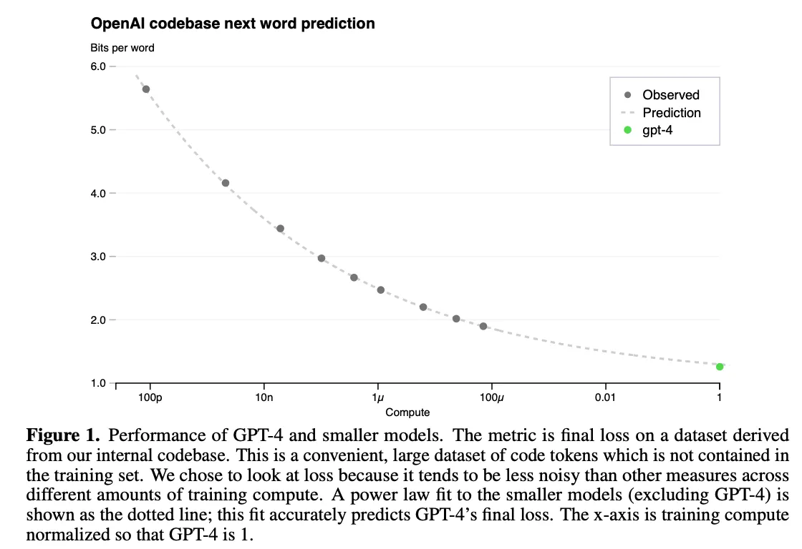
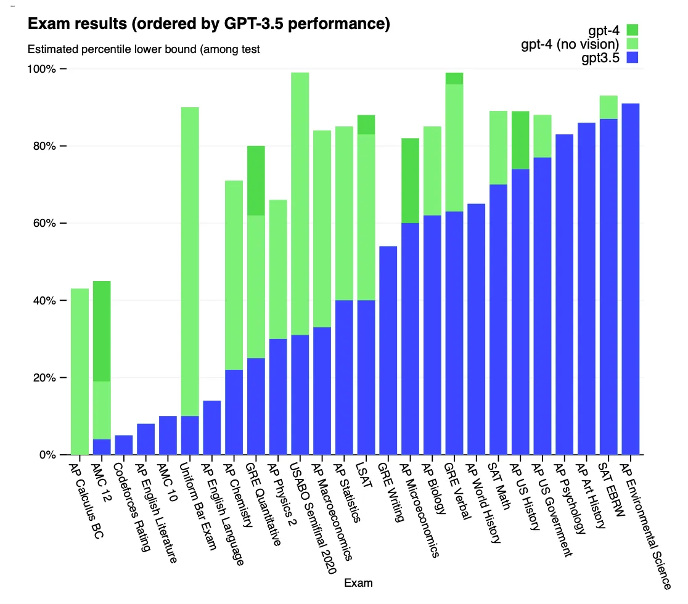
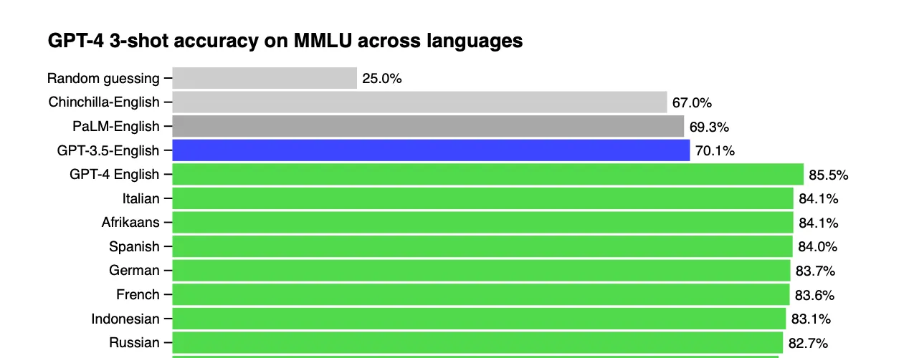
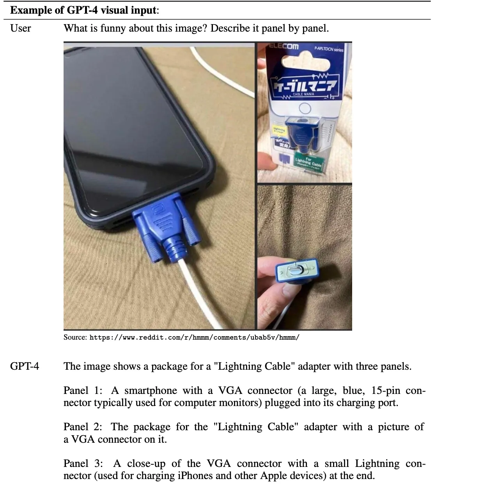
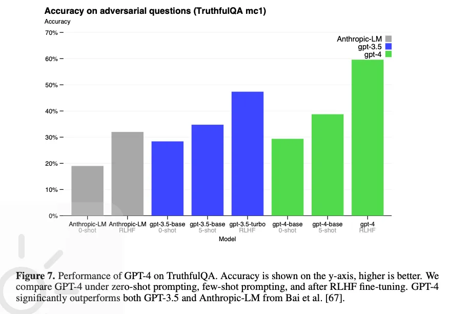
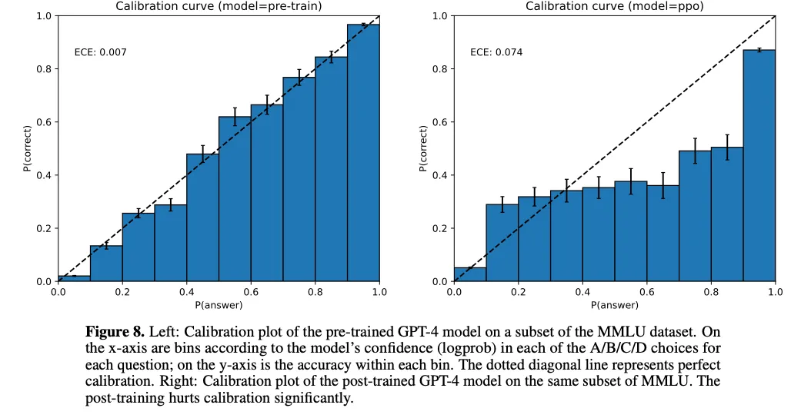

2023年3月14日，OpenAI发布了GPT-4，瞬间引爆了全球科技圈。随之而来的，还有一份备受期待的《GPT-4 Technical Report》。不过这份报告并没有太多技术细节，更像是一份“宣传手册”，重点强调模型能力和安全。但是作为一个AI世上重要的里程碑，今天简单解读一下这份手册的部分细节。

<!-- more -->
### 训练细节
处于各家AI竞争的格局考虑，OpenAI并未公布训练的模型参数大小，时间和成本等信息。不过提到了`Predictable Scaling`的部分细节。由于现阶段模型参数巨大，已经不可能使用手工调整超参数了，而是将Loss进行拟合，然后利用训练算力的1/100000 ～ 1/1000 去做最终训练结果的预测，其Scaling law的公式为：

$$
L ( C )=a C^{b}+c ,
$$

$C$表示计算资源，$a$是缩放系数，$a$越大，初始变化越剧烈，$c$表示
不可约误差，模型损失$L$无法低于$c$，$b$表示缩放指数，$b<0$，收益递增，$C$增加，$L$损失就会减小。
拟合结果如图：

### GPT的重要升级

根据这张图公布的数据，GPT4在各项测试中大幅度超越之前的chatgpt-3.5,例如：在模拟律师资格考试（Uniform Bar Exam）中，GPT-4的得分位列前10%（相比之下，GPT-3.5仅在后10%）

同时OpenAI开源了一个测试框架 OpenAI Evals：
> our framework for creating and running benchmarks for
evaluating models like GPT-4 while inspecting performance sample by sample

报告中提到了语言偏差，使用英文作为提示词会胜过其他语言作为提示词，不过差距不是特别明显，至少对于西语而言（并没有测评中文）：

同时GPT4引入了多模态，可以同时输入语言和文字，正式将多模态引入使用：

除此之外，gpt4推出时，已经有思维链的测试了，可能也是后续大模型推理的前身。

### 模型的限制
GPT4技术报告指出，模型预训练的知识截止日期是2021年9月。并且gpt4依旧存在幻觉，无法区分一些混淆问题，以及无法捕捉到问题中的关键词。gpt4的技术报告证实了后训练可以大幅度提升模型的能力，gpt4如果没有经过后训练，能力将会比gpt-3.5还要差，如图：

另外，OpenAI发现后训练虽然会增加模型的能力，但是也会增加模型的“自信程度”，对于错误问题，gpt会认为自己是对的，如果没有经过后训练，模型反而更“诚实”。这对于将要采用到医疗，法律等领域的大模型将是一个重要提示。具体如图：

### 总结
虽然GPT4带来了一次巨大的升级，不过出于竞争考虑，这份技术报告更像是一份宣传报告，技术细节反而比较少。大量的篇幅在强调安全相关的对齐技术。不过细节披露了，目前大模型训练投入需要依靠scaling law去预测结果来决定投入算力。
