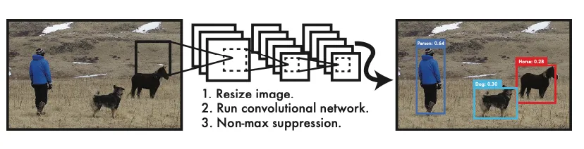
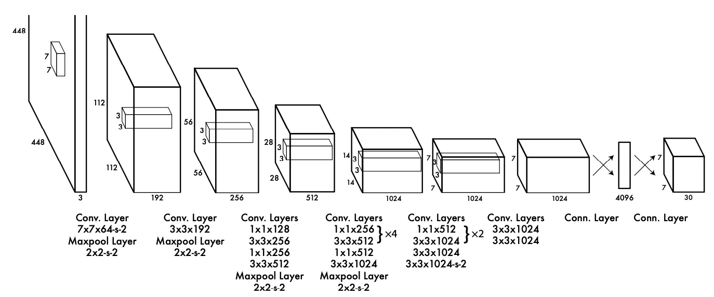

在计算机视觉领域，目标检测（Object Detection）是一个核心且极具挑战性的任务。在2015年之前，以R-CNN系列（R-CNN, Fast R-CNN, Faster R-CNN）为代表的检测算法占据了主导地位。它们通过一个复杂且多阶段的流程来实现高精度检测：首先生成潜在的候选区域（Region Proposal），然后对这些区域进行分类和位置精修。这个流程虽然精确，但速度却是一个巨大的瓶颈，难以满足实时应用的需求。

就在这时，一篇名为《You Only Look Once: Unified, Real-Time Object Detection》的论文横空出世，彻底改变了游戏规则。Joseph Redmon等人提出的YOLO（You Only Look Once）框架，只需要一次就可以同时回归类别和目标位置。

<!-- more -->

### 论文核心思想
YOLO 将目标检测任务重新定义为一个单一的回归问题。它将输入的图像送入一个单独的神经网络，该网络直接输出所有目标的边界框坐标、置信度以及类别概率。整个过程只需要一次前向传播，因此速度极快。这就是 "You Only Look Once" 名字的由来。

### 模型结构和计算
yolo的计算流程分为3个阶段，一是缩放到网络输入的张量尺寸，二是模型推理，最后采用非极大值抑制（NMS）算法保留检测框。流程如图：

我们来看一下yolo模型的架构，yolo1的年代比较早，其实模型结构也非常简单，如图：

从图中可以看到，仅由卷积和全连接层构成，重点在于输出的这个张量。是一个7x7x30的形状。接下来重点解析这个输出构成和损失函数的定义。

图中的7x7是因为将图像进行的划分，划分成了7x7个cell。30是由20个class组成的类别概率分布，剩下10个，是由B=2个检测器输出的回归信息，分别是$(x,y,w,h,c)$, 分别表示框的中心坐标和长宽，以及置信度。置信度的计算方式是真实边框和预测边框的Iou值
> the confidence prediction represents the IOU between the
> predicted box and any ground truth box.

### 数据集制作
要明白上面最终输出的张量形状含义，最好的方式就是制作一个标注的数据集。下面将介绍如何从标注到张量的构造：
假设我们有一张输入图片，以及它对应的标注信息。一个物体的标注信息通常包含：

类别 (Class ID)：例如，“狗”的类别 ID 是 16。
边界框 (Bounding Box)：通常是 [x_center, y_center, width, height] 的形式，这些值是相对于整张图片尺寸归一化后的结果（即都在 0 到 1 之间）。

YOLO 的目标是生成一个 $S \times S \times( B \times5+C )$
 的目标张量（Ground Truth Tensor），这个张量将作为“正确答案”与网络预测的张量进行比较，从而计算损失。我们以论文中的标准配置为例：$S=7 , \, B=2 , \, C=2 0$。目标张量的大小就是 $7 \times7 \times3 0$. 其中：
 
 - $S \times S$：划分的网格数量
 - $B$: 每个网格的检测器数量
 - $C$: 类别数量
#### 第一步：确定“负责”的网格单元
对于图中的每一个物体（Ground Truth Object），我们查看其中心点 (x_center, y_center) 的坐标。

将归一化的中心点坐标乘以网格尺寸$S$，得到它在$S \times S$中的绝对位置：

$$
abs_x = x_{center} * S
$$

$$
abs_y = y_{center} * S
$$

取这两个值的整数部分，就得到了该物体所在的网格单元的索引 :

$$
grid_{col} = floor(abs_x)
$$

$$
grid_{row} = floor(abs_y)
$$

这个$(grid_{col},grid_{row})$位置的网格单元，就是唯一负责预测这个物体的单元。

#### 第 2 步：转换边界框坐标
YOLO 预测的 (x, y) 坐标不是相对于整张图的，而是相对于其所在的网格单元左上角的偏移量。因此，我们也需要将真实的(x_center, y_center) 转换成这种相对坐标:

$$
x_{offset} = abs_x - grid_{col}
$$

$$
y_{offset} = abs_y - grid_{row}
$$

$x_{offset}$ 和 $y_{offset}$ 的值也会在 0 到 1 之间。
而边界框的宽高 (width, height) 不需要转换，它们仍然是相对于整张图片尺寸的归一化值。

#### 第 3 步：构建目标向量
现在我们已经确定了负责的网格单元 (grid_row, grid_col)，并且计算好了所需的坐标。接下来，我们要填充这个单元对应的长度为 $(B * 5 + C) = 30$ 的目标向量。

1.坐标 (x, y, w, h)：将我们在第 2 步计算出的 x_offset, y_offset 和原始的 width, height 填入。因为每个单元预测 B (这里是2) 个框，但只有一个物体，所以理论上我们只需要填充一个框的信息。在实践中，通常会将这些坐标信息同时填充到 B 个预测框的位置。损失函数中的$1_{i j}^{\mathrm{o b j}}$会确保只有那个和真实框 IoU 最高的预测框才参与坐标损失的计算。
- target_vector[0:4] = [x_offset, y_offset, width, height]
- target_vector[5:9] = [x_offset, y_offset, width, height]

2.置信度 (Confidence):对于这个负责检测物体的网格单元，其置信度的目标值是 1。这意味着我们确信这个地方有物体。对于图像中所有**其他不包含物体中心的网格单元**，它们对应的所有边界框的置信度目标值都是 0。
- target_vector[4] = 1
- target_vector[9] = 1

3.类别概率 (Class Probabilities):这是一个长度为 C (这里是20) 的向量。我们使用 one-hot 编码。如果该物体的类别 ID 是 16，那么向量的第 16 个元素为 1，其余均为 0。

这个映射过程也解释了 YOLOv1 的一个核心局限性：
每个网格单元只能预测一个物体。如果两个物体的中心点不幸落在了同一个网格单元内，那么在构建目标张量时，后一个物体的信息会覆盖前一个。模型在训练时只会看到其中一个物体，因此也无法学会同时预测它们。这就是为什么 YOLOv1 对密集的小物体（如一群鸟）检测效果不佳的原因。后续版本如 YOLOv2/v3 通过引入 Anchor Box 机制来解决这个问题。

### 损失函数计算
OLO 的训练核心在于其精心设计的多部分损失函数（Loss Function）。这个损失函数是一个加权和，包含了定位误差、置信度误差和分类误差。

损失函数由以下几个部分组成，它是一个在所有网格单元和每个单元的预测框上求和的均方差（Sum-Squared Error）：

$$
\begin{aligned}
\text{Loss} = & \quad \lambda_{\text{coord}} \sum_{i=0}^{S^2} \sum_{j=0}^{B} \mathbb{1}_{ij}^{\text{obj}} \left[ (x_i - \hat{x}_i)^2 + (y_i - \hat{y}_i)^2 \right] \\
& + \lambda_{\text{coord}} \sum_{i=0}^{S^2} \sum_{j=0}^{B} \mathbb{1}_{ij}^{\text{obj}} \left[ (\sqrt{w_i} - \sqrt{\hat{w}_i})^2 + (\sqrt{h_i} - \sqrt{\hat{h}_i})^2 \right] \\
& + \sum_{i=0}^{S^2} \sum_{j=0}^{B} \mathbb{1}_{ij}^{\text{obj}} (C_i - \hat{C}_i)^2 \\
& + \lambda_{\text{noobj}} \sum_{i=0}^{S^2} \sum_{j=0}^{B} \mathbb{1}_{ij}^{\text{noobj}} (C_i - \hat{C}_i)^2 \\
& + \sum_{i=0}^{S^2} \mathbb{1}_{i}^{\text{obj}} \sum_{c \in \text{classes}} (p_i(c) - \hat{p}_i(c))^2
\end{aligned}
$$

公式符号解释：

- $\mathbb{1}_{ij}^{\text{obj}}$ ：是一个指示函数，如果第 i个网格单元的第 j个边界框负责预测这个物体（通常是与真实框 IoU 最大的那个预测框），它的值为 1，否则为 0。
- $\mathbb{1}_{i}^{\text{obj}}$ 是一个指示函数，如果第 `i` 个网格单元中**存在**物体中心，则其值为 1，否则为 0。
- $\mathbb{1}_{ij}^{\text{noobj}}$ 如果第 i个单元的第 j个框不包含物体，值为 1。表示该预测器**不负责**预测物体。

#### 损失函数详解：
1.坐标预测损失 (Localization Loss)：公式的前两行。它只计算那些负责检测物体的预测框：
$( 1_{i j}^{\mathrm{o b j}}=1 )$的坐标误差。对宽高（w, h）取平方根：这是为了解决一个问题——对于大框和小框，同样的坐标偏差，其影响是不同的。例如，一个大框的宽度偏差 10 个像素可能不明显，但对一个小框来说可能是致命的。通过对宽高取平方根，可以减小大框的梯度，增加小框的梯度，使得模型对小框的尺寸误差更敏感。

2.置信度损失 (Confidence Loss)：公式的第三、四行。这部分分为两种情况：
- 包含物体的框（第三行）：计算其置信度与真实置信度（即预测框与真实框的 IoU）之间的误差。
- 不包含物体的框（第四行）：计算其置信度与0的误差由于图像中大部分网格都不包含物体，这部分样本数量远多于包含物体的样本。为了平衡样本不均的问题，给不包含物体的框的置信度损失一个较小的权重$\lambda_{\mathrm{n o o b j}}$。论文中设为 0.5

3.分类损失 (Classification Loss)：公式的最后一行。它只计算那些**包含物体中心**的网格单元$
( 1_{i}^{\mathrm{o b j}}=1 )$的分类误差。对该单元预测的类别概率向量与真实类别向量计算均方差。

### NMS算法

由于每个网格都有B个检测器，一共有$S \times S$个网格，所以推理完毕后存在大量冗余的检测框，为了去除掉这些重复的检测框，就需要用到非极大值抑制算法。这里简单讲解一下算法执行的原理：

简答来说就是 **“保留分数最高的框，并删除与它高度重叠的其他框。”**

在NMS中，我们会预先设定一个IoU阈值（Threshold），比如0.5。如果两个框的IoU大于这个阈值，我们就认为它们“高度重叠”，即检测的是同一个物体。

假设我们有N个候选框，以及它们各自的置信度分数。
输入：
- B: 所有候选框的列表，每个框包含坐标信息 (x1, y1, x2, y2)。
- S: 对应每个候选框的置信度分数列表。
- N_t: IoU阈值（例如 0.5）。

输出：

D: 经过NMS筛选后保留下来的最终边界框列表。

按置信度排序：将所有候选框 B 按照它们的置信度分数 S 从高到低进行排序。

初始化：创建一个空列表 D，用于存放最终结果。

循环处理：当 B 不为空时，执行以下循环：

- a. 选出最佳框：从 B 中选择置信度最高的框 M，将其从 B 中移除，并添加到最终结果列表 D 中。
- b. 计算IoU：遍历 B 中剩余的所有框 b_i，分别计算它们与框 M 的IoU值。
- c. 抑制重叠框：检查每个 b_i 与 M 的IoU值。如果 IoU(M, b_i) > N_t，则将 b_i 从 B 中移除。因为我们认为 b_i 和 M 检测的是同一个物体，而 M 的分数更高，所以 b_i 应该被抑制。

重复：回到第3步，继续从剩余的 B 中选择分数最高的框，并重复上述过程，直到 B 为空。
返回结果：返回列表 D，这就是NMS处理后的最终检测框。

⚠️注意：NMS算法针对的是同一类的检测框，NMS通常是按类别独立执行的。
这里的置信度分数计算方式：

$$
Confidence_{Score}(Class_i) = P(Object) * P(Class_i | Object)
$$

其中P(Object) 表示物体置信度：这个边界框里包含一个物体的可能性有多大？
P(Class_i | Object)表示类别条件概率：假如这个框里确实有物体，那么它属于各个类别（如‘猫’、‘狗’、‘汽车’）的概率。
