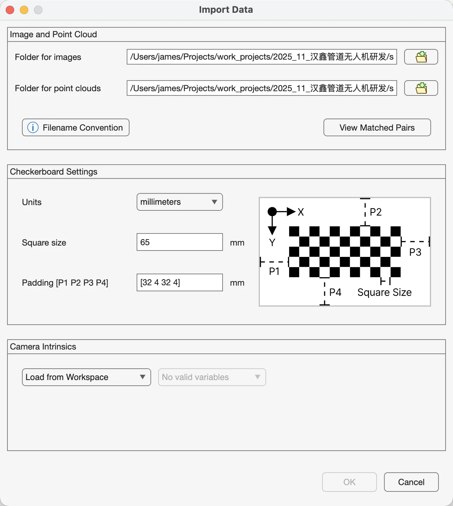
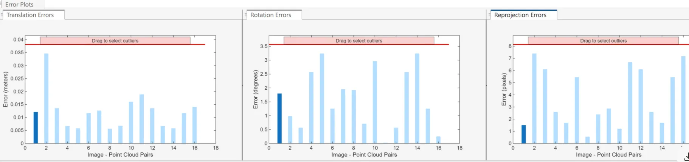
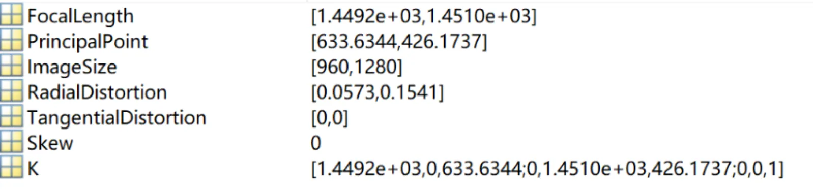

在自动驾驶、机器人和无人机等领域，激光雷达（LiDAR）和相机（Camera）是最常见的两类传感器。激光雷达擅长提供精确的三维空间几何信息，相机则能提供丰富的纹理与颜色信息。为了充分发挥两者优势，我们需要将它们的坐标系统一，这一过程被称为激光雷达与相机联合标定（LiDAR-Camera Calibration）。
本文将详细介绍标定流程和标定结果分析。

<!-- more -->

### 标定流程

### 数据处理代码

### 标定测试

### 标定结果分析

#### 联合标定分析

根据上图我们可以看到一共有三个子图，它通过三个关键指标来展示标定结果的优劣：平移误差（Translation Errors）、旋转误差（Rotation Errors） 和 重投影误差（Reprojection Errors）。
在分析之前，我们先理解这三个图的含义：

- X轴（Image - Point Cloud Pairs）：代表你采集的每一对有效的标定数据。每一对数据都是一个棋盘格（或其他标定板）在某一特定位置和姿态下，被相机和激光雷达同时捕捉到的结果。例如，X轴上的“2”就代表第二组标定板数据。
- Y轴（Error）：代表该组数据的误差大小。误差越小，说明这组数据质量越高，也说明最终计算出的标定参数对这组数据拟合得越好。
- 深蓝色条：代表当前选中的数据对。
- 浅蓝色条：代表其他未选中的数据对。
- 红色区域（Drag to select outliers）：这是一个交互功能，你可以拖动红线，将红线以上的误差条标记为“离群点”（Outliers）。剔除这些误差过大的离群点后，工具会重新计算一个更精确的标定结果。

1. 平移误差（Translation Errors）

这个图显示的是标定板在三维空间中的位置误差。它计算的是，根据标定结果（外参矩阵），将激光雷达检测到的标定板平面位置转换到相机坐标系后，与相机直接检测到的标定板平面位置之间的物理距离差异。 **单位：米（meters）。**

从图上看，平移误差绝大部分都在0.02米（2厘米）以下，最大值约为0.035米（3.5厘米）。整体平均误差看起来在1-2厘米左右。对于自动驾驶，厘米级精度足够了。

2. 旋转误差（Rotation Errors）

这个图显示的是标定板在三维空间中的姿态误差。它计算的是，激光雷达检测到的标定板平面法向量与相机检测到的平面法向量，在经过旋转矩阵转换后的角度差异。**单位：度（degrees）。**

越接近0越好。通常认为误差在1度以内是比较好的结果，0.5度以内则非常优秀。

3. 重投影误差（Reprojection Errors）

这是最重要、最综合的一个评估指标。它描述的是：将激光雷达点云中标定板的角点，通过你计算出的内外参矩阵投影回相机成像平面上，这个投影点与相机图像上实际检测到的角点之间的像素距离。它同时反映了平移、旋转和相机内参的综合误差。**单位：像素（pixels）。**

越接近0越好。对于一个百万像素级别（如1920x1080）的相机，平均重投影误差在1-2个像素以内被认为是优秀的结果，5个像素以内通常可以接受，超过10个像素则说明标定质量较差。

#### 图像标定参数结果分析

这张图展示的是相机标定后得到的 **内参（Intrinsic Parameters）** 结果

1. 焦距 (FocalLength)

这表示相机的焦距，但它的单位是像素，而不是毫米。它包含两个值：fx 和 fy。
fx 和 fy 分别是x轴和y轴方向上的焦距。在理想情况下，相机传感器的像素是正方形的，此时 fx 和 fy 会非常接近。你的结果中这两个值非常接近，说明像素几乎是正方形的，这是一个高质量传感器的典型特征。

焦距值决定了相机的视场角（Field of View）。值越大，视场角越窄（类似长焦镜头）；值越小，视场角越宽（类似广角镜头）。

2. 主点 (PrincipalPoint)

这是相机光轴与成像平面的交点，也称为图像的“光学中心”。它包含两个值：cx 和 cy。
cx = 633.6344 像素
cy = 426.1737 像素

理想情况下，主点应该位于图像的正中心。你的图像尺寸（ImageSize）是 [960, 1280]，即高960像素，宽1280像素。
图像的物理中心是 (1280 / 2, 960 / 2) = (640, 480)。
主点 (633.6, 426.2) 与物理中心 (640, 480) 非常接近。这个微小的偏差是完全正常的，由镜头和传感器安装时的微小误差造成。这同样表明相机硬件质量不错。

3. 径向畸变 (RadialDistortion)

这是描述镜头径向畸变的系数，通常表示为 [k1, k2, ...]。径向畸变是由于镜头透镜的形状引起的，会导致图像中的直线在靠近边缘处变弯曲。
k1 = 0.0573
k2 = 0.1541

桶形畸变 (Barrel Distortion): 当 k1 为正值时，图像向外凸出，像一个木桶。
枕形畸变 (Pincushion Distortion): 当 k1 为负值时，图像向内凹陷，像一个枕头。
我的 k1 是正数，说相机镜头存在轻微的桶形畸变。这在消费级和工业相机中非常常见。这些系数是用来在后续处理中校正这种畸变的。

4. 切向畸变 (TangentialDistortion)

这是描述镜头切向畸变的系数，通常表示为 [p1, p2]。这种畸变是由于镜头和成像平面不完全平行造成的。
我的结果是 [0, 0]，说明标定算法认为切向畸变可以忽略不计。这是一个非常好的结果，表明相机镜头安装得很好，与传感器平面非常平行。

5. 倾斜系数 (Skew)

这个参数描述了图像传感器x轴和y轴之间的倾斜程度。
对于现代的数字相机，像素阵列的x和y轴几乎总是完美的90度垂直，所以这个值几乎永远是0。结果是0，符合预期。

6. 内参矩阵 (K)

这是所有核心内参的集合体，是一个3x3的矩阵。它将一个在相机坐标系下的三维点 (X, Y, Z) 映射到成像平面上的二维像素坐标 (u, v)。
这个矩阵完美地整合了上面我们分析的各个参数。

### 参考
相关资料参考：

【1】https://www.mathworks.com/help/lidar/ug/read-lidar-and-camera-data-from-rosbag.html

【2】https://www.mathworks.com/help/lidar/ug/lidar-and-camera-calibration.html
