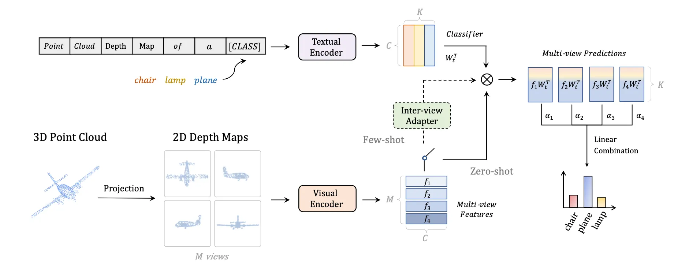
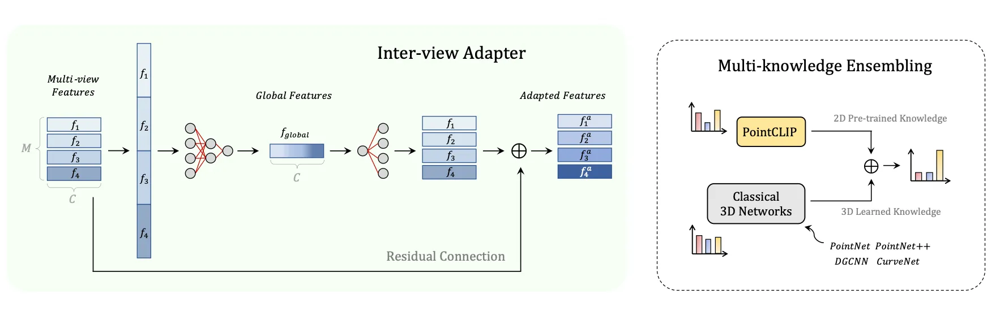

近年来，点云理解在自动驾驶、机器人感知、增强现实等领域具有广泛应用。然而，点云标注数据昂贵且有限，制约了点云深度学习的发展。相比之下，图像领域有大量标注数据和强大的预训练模型，尤其是 CLIP（Contrastive Language-Image Pre-training），通过对齐图像与文本表示，展现了卓越的零样本识别能力。
论文 PointCLIP 提出了一个核心问题：
能否将强大的 图像-文本多模态模型 CLIP 迁移到 点云理解 中，而无需大规模点云标注数据？

<!-- more -->

### 论文核心思想
将点云投影为多视角图像，再利用 CLIP 的图像编码器与文本编码器进行对齐，从而实现点云的零样本识别。

将3D点云这种CLIP模型看不懂的“语言”，翻译成了CLIP能理解的2D图像“语言”。具体来说，它通过将3D点云投影（渲染）成一系列多视角的2D深度图（Depth Map），然后利用预训练好的CLIP模型强大的2D图像与文本匹配能力，来实现对3D点云的零样本（Zero-shot）和少样本（Few-shot）分类。

如图所示：

### 方法流程

#### 1.点云到多视图深度图的投影 (Point Cloud to Multi-view Depth Map Projection)

为了完整地捕捉物体的三维结构，PointCLIP设置了多个固定的虚拟相机视角。最常用的方法是6个正交视图（前、后、左、右、上、下），就像把物体放在一个盒子里，从六个面朝里看。有时也会使用更多（如12个）的icosahedral（二十面体）视图。

对于每个视角，将点云的所有点（x, y, z）投影到该视角的2D平面上。对于2D平面上的每个像素，其值被设为落入该像素的所有3D点中，离相机最近的那个点的深度值。这就形成了一张深度图。

#### 2.文本与视觉编码 (Text & Visual Encoding)

首先，构建一系列“提示模板” (Prompt Template)。例如，对于一个分类任务，类别有“飞机 (airplane)”、“椅子 (chair)”等。模板通常是 “a depth map of a [CLASS]”。
将所有类别名填入模板，形成 “a depth map of an airplane”, “a depth map of a chair” 等一系列句子。
然后，将这些句子输入到CLIP的文本编码器中，得到每个类别对应的文本特征向量 (Text Features)。这个过程只需要做一次。

将上一步生成的每一张深度图，像普通图片一样，输入到CLIP的视觉编码器中。
得到每一张深度图对应的视觉特征向量 (Visual Features)。如果一个点云生成了6张深度图，就会得到6个视觉特征向量。

#### 3.零样本分类 (Zero-shot Classification)
对于某一张深度图的视觉特征，计算它与所有类别的文本特征之间的余弦相似度 (Cosine Similarity)。
单视图预测： 相似度最高的那个文本特征所对应的类别，就是这张深度图的预测结果。
现在我们有多个视图的预测结果（例如6个）。PointCLIP通过简单的投票 (Voting) 或对相似度分数进行平均，来决定整个3D点云的最终预测类别。这种集成策略可以有效减少因单一视角信息不完整而导致的错误。

### 少样本微调适配器

虽然零样本能力已经很惊艳，但在有少量标注数据（如每个类别只有1、2、4、8、16个样本）时，我们希望能进一步提升性能。
如果直接微调（Fine-tuning）整个CLIP模型，不仅参数量巨大，而且容易导致模型在海量2D数据上学到的知识被遗忘（即灾难性遗忘 Catastrophic Forgetting），反而损害其泛化能力。

PointCLIP引入了一个轻量级的适配器 (Adapter) 模块。如图：

Adapter的作用是学习一个“残差”或者说“调整量”。它在不改变CLIP原有知识结构的基础上，对特征进行微小的、任务相关的调整，使其更好地适应从深度图提取的特征。这样既能利用少量3D数据提升性能，又能最大程度地保留CLIP的泛化能力。

Adapter的设计上参考了llm模型的FFN结构，将特征先升维再降维，相当于一次过滤器，将难以过滤的特征在高维上过滤后再恢复到原来的维度。降维会损失信息，但是损失的是对于任务无关的信息。
