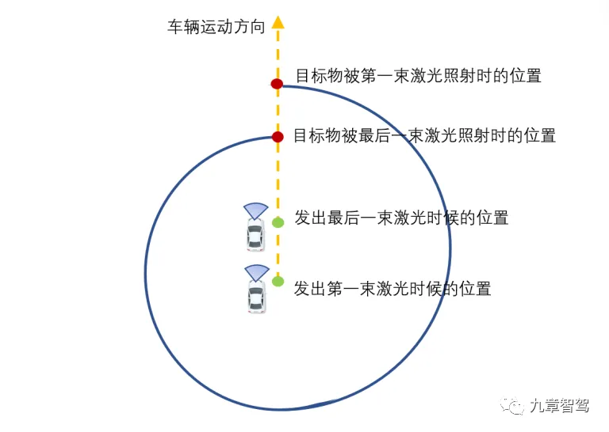

# 激光数据处理

主要流程：数据读取->数据保存->数据预处理->数据输入模型->输出结果

<!-- more -->

## 数据格式

二进制格式: bin ,详细参考KITTI数据集的解析代码

数据包:pcap 

通用格式: pcd格式 (x,y,z,i), i表示强度值，不同物体反射强度值不一样，可以根据强度值绘制灰度图

## 相关工具

point cloud library, rviz,ros

## 预处理

1. 解析raw data,详细参考本文件夹的激光雷达手册
2. 运动畸变补偿

### 纯估计方法(ICP/VICP)

迭代最近点（ICP）方法是采用ICP算法来匹配两个点云，通过不断地算法迭代后，将点云之间的误差缩至最小。VICP方法是ICP算法的变种形式，模型假设车辆是在匀速运动，在进行匹配点云的同时估计车辆的自身速度。迭代最近点（ICP）和VICP被统称为“纯估计方法”。

### 传感器辅助方法(IMU/ODOM)

惯性测量单元（IMU）方法是在IMU队列中查找相邻两帧IMU的数据，然后通过球面线性插值的方式计算扫描点所在时刻的激光雷达位姿，并应用齐次坐标系变化将两个点云坐标变换至同一坐标系下。轮式里程计（ODOM）方法是通过求解当前帧激光雷达数据中每个点云对应的坐标系下的里程计位姿后，再根据求得的位姿把每个点云坐标都转化到同一坐标系下（需要转化两次），最后重新封装该帧点云数据。惯性测量单元（IMU）和轮式里程计（ODOM）被统称为传感器辅助方法。

### 融合的方法

该方法是同时使用里程计和ICP的融合方案，会先利用里程计方法进行矫正，去除大部分的运动畸变，再通过ICP方法进行匹配，得到里程计的误差值，再把误差值均摊到每个点云上，并重新对点云位置进行修正。最后，再利用ICP方法进行迭代，直至误差收敛为止。

### 点云组帧

单个点云数据包的点云较少，通常会把多个数据包叠加到同一帧上，让这一帧上的点云数据能包含上万个点云，以便后续感知和定位流程的处理。

### 外参变化

点云数据通过解析得到的点云坐标系属于激光雷达坐标系，而在实际的自动驾驶技术应用中，仍需要将激光雷达的坐标系转化为车辆的坐标系，这个建立联系的过程称之为点云的外参变化。

由于激光雷达与车体是刚性连接，所以在车辆运动过程中，两者之间的相对姿态和位移是固定不变的，只需要建立两者相对坐标系之间的位置关系，通过旋转或者平移的方式，就能将这两个三维坐标系统一到一个三维坐标系下（也称为全局坐标系或世界坐标系）。

### 滤波处理

受各种因素影响，点云数据中通常会带有噪点（对模型处理无用的点）和离群点（远离主观测区域的点）。通常采用算法过滤，常用算法有：平均值滤波，中位值滤波，一阶滤波，卡尔曼滤波。

## 感知模型和算法

传统算法：

1. 地面点云分割: **平面栅格法**，**点云法向量**，**模型拟合法-平面拟合（RANSAC）**，**面元网格法**，
2. 目标物的点云分割: **基于边缘的方法**, **基于区域增长的方法**,**基于属性的方法**
3. 目标聚类分析: **K-means**,**DBSCAN**,**欧式聚类**
4. 匹配与跟踪: 配和跟踪的算法流程是先将目标预测的结果与测量的点云数据计算关联矩阵，然后利用匈牙利算法（其核心原理是寻找增广路径，从而达成最大匹配）进行匹配关系的确定，最后将点云数据分为匹配上的目标和未匹配上的目标两类，将其分别保存，并为跟踪做准备。

基于深度学习：

- **PointNet**，**PointNet++**，**VoxelNet**，**SECOND**，**PointPillar**，**PCT**

## 地图匹配

在提取完周围目标物的特征后，感知算法人员就需要根据这些特征来进行点云地图匹配，来获取各个点云之间的相对位姿。点云地图匹配一般可分为帧间匹配和高精地图匹配。

- 帧间匹配，也叫子图匹配，指将前后帧上有相同特征的点云做匹配，最后得到一张局部小地图。

- 高精地图匹配，指将优化后的点云与高精地图做匹配。
  
