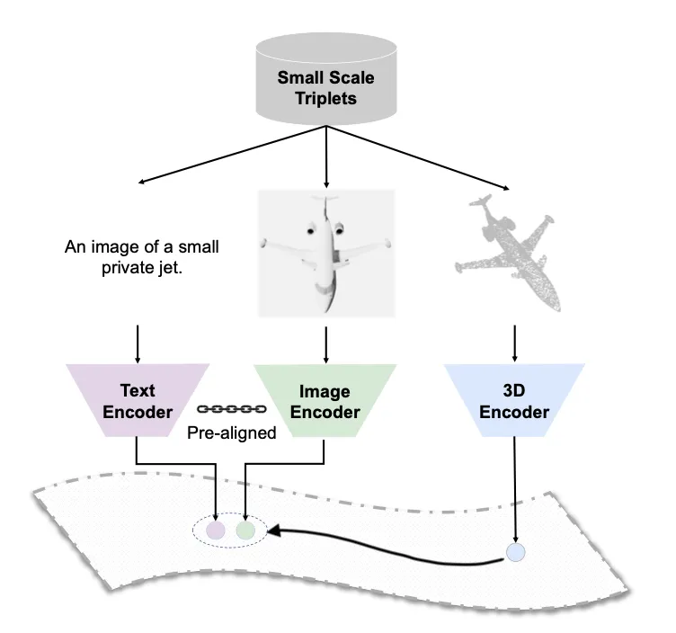
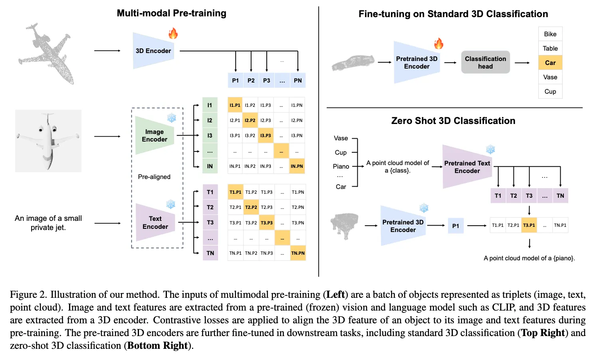

ULIP（Unified Language-Image-Point cloud representation）旨在学习一个统一的表示空间，将三种不同的数据模态——语言（Text）、图像（Image）和点云（Point Cloud）——映射到同一个特征空间中。其核心思想是利用已经在大规模2D图文数据上预训练好的模型（如CLIP），将3D点云的特征与已经对齐好的图文特征进行对齐。

通过这种方式，ULIP成功地将3D表示与丰富的2D视觉和语言语义联系起来，从而实现了强大的零样本（Zero-shot）3D理解能力。例如，模型在没有见过任何3D标注数据的情况下，仅通过文本描述（如“一张红色的椅子”）就能对3D点云进行分类或检索。

<!-- more -->

### 论文核心思想
ULIP的解决思路非常巧妙，它并没有直接去收集海量的（点云，文本）数据对，而是利用 2D图像作为“桥梁” 来连接3D点云和文本。

具体步骤如下：

1.利用现成的图文对齐能力： 直接采用一个预训练好的、且权重被冻结的CLIP模型。这个模型已经建立了一个稳固的、语义丰富的图文联合表示空间。
创建（点云，图像，文本）三元组： 对于一个3D物体（如ShapeNet数据集中的椅子模型），可以：
获取其点云表示。

2.通过渲染（rendering）技术，从不同视角生成该物体的2D图像。
为其匹配相应的文本描述（例如，直接使用物体的类别名 "chair"）。
对齐3D与2D/文本： 训练一个点云编码器，其目标是使其提取的3D特征，能够与CLIP模型提取的对应图像特征和文本特征在同一个空间中对齐。

3.通过这种方式，点云特征被“拉拢”进了CLIP已经建立好的语义空间，从而间接实现了与文本和图像的对齐。详情如图：

### 方法介绍
ULIP的架构主要由三个部分组成，分别对应三种模态的编码器：
文本编码器 (Text Encoder)，图像编码器 (Image Encoder)，点云编码器 (Point Cloud Encoder)。

在训练过程中，文本和图像编码器权重固定不变，只有点云编码器和投影矩阵（将点云特征投影到和其他模态一样的特征性状）可以训练。

整体流程图如下：

#### 1.特征提取

$$
\mathbf{h}_{i}^{P}=f_{P} ( P_{i} ) ,
$$

首先看第一个公式，$f_{P}$表示3D点云的backbone, $P_i$是点云输入，$\mathbf{h}_{i}^{P}$表示提取的点云特征。

$$
\mathbf{h}_{i}^{I}=f_{I} ( I_{i} ) .
$$

第二个公式是图像特征提取，输入的$I_{i}$是图像，$f_{I}$表示图像编码器，比如viT,输出的是图像特征向量。但是需要注意的是，这里的图像是通过点云渲染的（参考了pointClip），利用不同角度对点云渲染,训练的时候随机抽取一张图像输入。

$$
\mathbf{h}_{i}^{S}=A v g ( f_{S} ( \mathbf{S}_{i} ) ) .
$$

第三个公式表示文本特征提取，这里的$\mathbf{S}_{i}$不是一个句子，而是一组模板句子，所以是一个集合。通过文本编码器$f_{S} $得到一组特征，再通过平均池化，得到文本特征$\mathbf{h}_{i}^{S}$.

#### 2. 模态对齐

这里使用的是经典的对称性对比损失函数（Symmetric Contrastive Loss），通常被称为 InfoNCE Loss 的一种变体。

$$
L_{(M1, M2)} = \sum_{(i,j)} -\frac{1}{2}\log\frac{\exp\left(\frac{\mathbf{h}_i^{M1} \mathbf{h}_j^{M2}}{\tau}\right)}{\sum_k \exp\left(\frac{\mathbf{h}_i^{M1} \mathbf{h}_k^{M2}}{\tau}\right)} -\frac{1}{2}\log\frac{\exp\left(\frac{\mathbf{h}_i^{M1} \mathbf{h}_j^{M2}}{\tau}\right)}{\sum_k \exp\left(\frac{\mathbf{h}_k^{M1} \mathbf{h}_j^{M2}}{\tau}\right)}
$$

上面的公式看着比较复杂，实际上比较简单。我们可以简化一下：

$$
\mathcal{L}=\cfrac{1} {2} ( \mathcal{L}_{I \to P}+\mathcal{L}_{P \to I} )
$$

这两个公式是等价的，表示两种模态的对称损失。

- $\mathbf{h}_i^{M1} \mathbf{h}_j^{M2}$ 表示两个模态归一化的向量点积，等价于余弦相似度。
- τ(tau): 称为温度系数 (temperature parameter)。这是一个可学习的或固定的超参数。作用是缩放 (scale) 相似度得分。一个较小的 τ会使得相似度分布更加“尖锐”，模型会更关注于区分那些特别难分的负样本。一个较大的 τ则会使分布更“平滑”。
- exp 表示指数函数，其实就是softmax函数，将相似度转化为了概率分布。

再看下面的公式：
$$
L_{f i n a l}=\alpha L_{( I , S )}+\beta L_{( I , P )}+\theta L_{( P , S )} .
$$

将几个模态之间的损失函数相加，α 被设为常数 0，β 与 θ 均设为 1；因为在预训练阶段发现，如果更新 CLIP 的图像和文本编码器，由于数据量有限，容易出现灾难性遗忘现象。这会导致在将 ULIP 应用于下游任务时性能显著下降。因此，我们在整个预训练过程中冻结 fS(·) 和 fI(·) 的权重，只用 Lfinal 更新 fP(·)。

