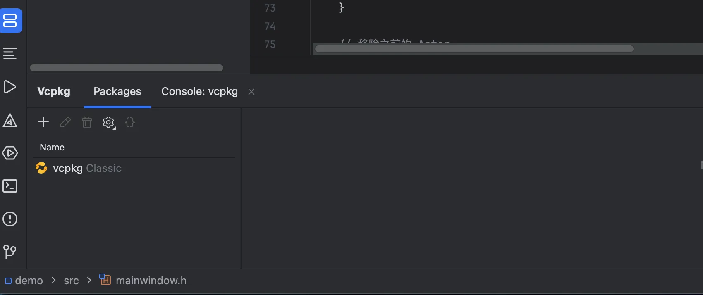
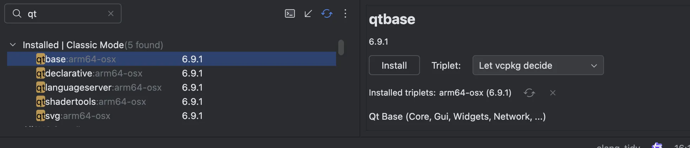
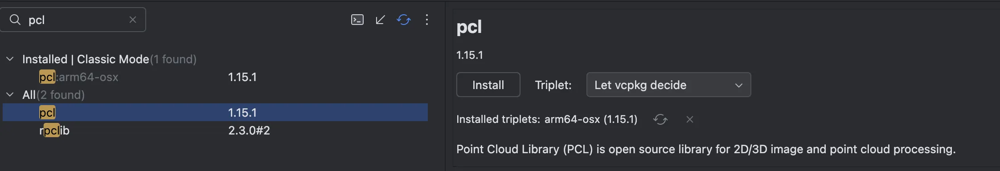

本文档简单介绍如何在多个平台配置Pcl+Vtk+Qt的开发环境，
主要依靠vcpkg的跨平台包管理


<!-- more -->

### 第一步设置vcpkg

点击View->ToolWindow 添加vcpkg
添加后可以看到如图



然后点击左边的➕添加vcpkg的仓库

### 第二步安装qt
搜索qt安装qtbase,点击右边的install按钮



### 第二步安装vtk[qt]

这一步不要使用默认的clion的ui安装，无法选择qt版本的vtk
所以找到vcpkg安装的目录，然后执行以下代码：

Mac平台：
```
./vcpkg install "vtk[qt]:arm64-osx"
```

Win平台：


```
.\vcpkg.exe install "vtk[qt]:x64-windows"
```

### 第三部安装pcl

pcl是处理点云的库,搜索后点击install即可




## 配置cmake文件
参考配置如下，根据自己的代码结构进行修改：


```
cmake_minimum_required(VERSION 4.0)
project(demo)


set(VCPKG_C_FLAGS "-fPIC" CACHE STRING "VCPKG C Flags")
set(VCPKG_CXX_FLAGS "-fPIC" CACHE STRING "VCPKG CXX Flags")


set(CMAKE_CXX_STANDARD 20)
set(CMAKE_AUTOMOC ON)
set(CMAKE_AUTORCC ON)
set(CMAKE_AUTOUIC ON)


find_package(Qt6 COMPONENTS
        Core
        Gui
        Widgets
        REQUIRED)


find_package(PCL REQUIRED COMPONENTS
        common
        io
        visualization
        filters
        kdtree
        search)
find_package(VTK COMPONENTS
        RenderingOpenGL2
        GUISupportQt
        REQUIRED)

include_directories(
        ${PCL_INCLUDE_DIRS}
        ${VTK_INCLUDE_DIRS}
)

add_definitions(${PCL_DEFINITIONS})

add_executable(demo src/main.cpp
        src/mainwindow.h
        src/mainwindow.cpp
        src/DataManager.cpp
        src/DataManager.h

)
target_link_libraries(demo
        Qt::Core
        Qt::Gui
        Qt::Widgets
        VTK::GUISupportQt # VTK 的 Qt 支持
        VTK::RenderingOpenGL2 # VTK 的 OpenGL2 后端
        ${PCL_LIBRARIES}
        ${VTK_LIBRARIES}
)


```
