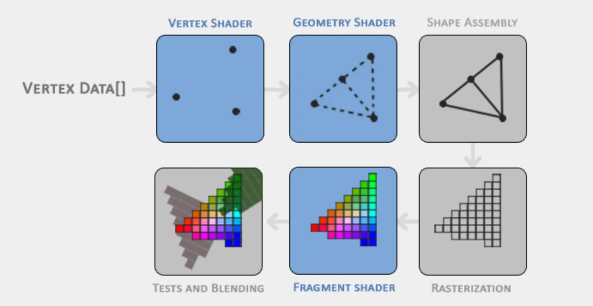

本篇文章记录学习opengl过程中的笔记和心得。

笔记的主要构成是关键名词和对应的解释与理解。
<!-- more -->

### OpenGL
opengl本质上是图形api接口,通过接口，用户可以利用显卡高效的在屏幕上绘制想要的内容。不过更加广义的opengl是一套接口标准，只要你的图像接口叫opengl,就应该符合标准。

### GLFW
glfw是一个比较常用的库，主要是处理用户输出，提供opengl初始化的context,提供渲染窗口,原文描述：`It allows us to create an OpenGL context, define window parameters, and handle user input, which is plenty enough for our purposes.`

### GLAD
由于显卡型号繁多、驱动版本天天更新，每个函数（比如 glUseProgram）在内存中的位置是不固定的。在编译阶段，编译器不知道这些函数在运行时会在哪里。当你写代码调用 glDrawArrays 时，实际上是看了一眼 GLAD 的本子，然后直接找到了对应的位置去执行。


:::info{title="比喻"}
GLAD 是一个“翻译官”或“寻址员”，它负责在你的显卡驱动里找到每一个 OpenGL 函数的具体内存地址。
:::

### Graphics Pipeline
图像管线，这个词经常听到。指代图像渲染整个流程，如下图：我们会编写管线上的处理程序，又叫shader。 其中功能蓝色的表示可以由人修改的部分。




### Shader
本质上是一段程序，用GLSL语言编写。Shader 代码的逻辑是写给“一个点”看的，但在运行时，GPU 会并行地对“一堆点”同时执行这份代码【将shader分配到多个gpu核心上】。

当你调用 OpenGL 的绘制命令（如 glDrawArrays）时，GPU 会瞬间叫来几千个工人（GPU 核心）。
- 每个工人都拿着你写的那份同一张“操作指南”。
- 每个工人手里拿一个不同的球（不同的数据）。
- 所有人同时开始工作（并行计算）。

### Vertex
一个Vertex就是指代一个顶点数据，GPU 要处理的“一个点”的整体数据。包含多个属性。原文：`A vertex is a collection of data per 3D coordinate. `

Vertex的字段就是用`vertex attributes`表示。这个点身上的各个字段，比如位置、颜色、法线、纹理坐标等。


### Vertex Shade
告诉 GPU “三角形的三个角在画布的什么位置”。

### Fragment Shader
告诉 GPU “三角形内部涂什么颜色”。

### 绘制一个三角形的流程
画一个三角形听起来简单，但在 OpenGL 中，它是一个把数据从 **CPU（你的内存）** 搬运到 **GPU（显存）**，并告诉显卡如何处理的过程。

为了容易理解，把 GPU 想象成一个**高度自动化的画室**。

我们需要三个角色：
1.  **VBO (Vertex Buffer Object)**：**专用颜料桶**（存放原始数据）。
2.  **VAO (Vertex Array Object)**：**说明书/档案夹**（记录数据怎么用）。
3.  **Shader (着色器)**：**画师**（执行绘画逻辑）。

下面是绘制一个三角形的完整流程：

---

### 第一阶段：准备工作（初始化）

在画画之前，你得先把材料送进画室（GPU），并写好说明书。

#### 1. 准备数据（CPU）
你在 C++ 代码里定义了一个数组，里面有 3 个顶点的坐标：
```cpp
float vertices[] = {
    -0.5f, -0.5f, 0.0f, // 左下
     0.5f, -0.5f, 0.0f, // 右下
     0.0f,  0.5f, 0.0f  // 顶部
};
```
这时候数据还在你的内存里（CPU），GPU 根本看不见。

#### 2. 创建 VAO（档案夹）
**这步非常重要，一定要先做！**
你想：“我要开始配置一组新的绘画动作了。”
于是你拿出一个空的**档案夹 (VAO)** 并在桌子上打开它 (`glBindVertexArray`)。
*   **作用**：从此以后，你对 VBO 做的一切配置，都会被自动记录在这个档案夹里。

#### 3. 创建 VBO（颜料桶）并传输数据
你需要把内存里的数据搬到显存里。
*   **动作**：你在显存里申请了一块空间，我们叫它 **VBO**。
*   **绑定**：你把这个 VBO 放在当前的工位上 (`glBindBuffer`)。
*   **填装**：你把 CPU 里的 `vertices` 数组倒进这个 VBO 里 (`glBufferData`)。
*   **现状**：现在 GPU 拥有了一堆数字，但它只知道这是一堆二进制数据，不知道这代表坐标、颜色还是法线。

#### 4. 解释数据（写进 VAO 档案夹）
这时候，VAO（档案夹）还是打开状态。你需要告诉 GPU 如何读取刚才那个 VBO 里的数据。
你发出指令 (`glVertexAttribPointer`)：
*   “每隔 3 个数字读一次（因为是 x, y, z）。”
*   “这些数据是浮点数 (float)。”
*   “这是顶点的位置信息 (Layout 0)。”

**关键点**：当你做完这步，**VAO 默默地把“在这个 VBO 上怎么读数据”这个配置记录下来了。**

#### 5. 解绑（合上档案夹）
配置完成。你合上 VAO 档案夹 (`glBindVertexArray(0)`)，把它放回架子上。此时，VBO 里的数据已经安家在 GPU 了，VAO 里也记好了怎么用它。

---

### 第二阶段：雇佣画师（编译 Shader）

你需要写两段代码（Vertex Shader 和 Fragment Shader），编译并链接成一个 **Shader Program**。

*   **Vertex Shader**：告诉 GPU “三角形的三个角在画布的什么位置”。
*   **Fragment Shader**：告诉 GPU “三角形内部涂什么颜色”。

---

### 第三阶段：开始绘制（渲染循环）

这一步是每一帧（Loop）都要做的事情。虽然之前准备工作很繁琐，但画的时候非常快。

流程如下：

1.  **呼叫画师**：
    `glUseProgram(shaderProgram);`
    *   喊出：“Shader 画师团队，准备干活！”

2.  **拿出档案夹 (VAO)**：
    `glBindVertexArray(VAO);`
    *   这是最神奇的一步。你不需要再重新告诉 GPU “去哪个 VBO 找数据”、“怎么读数据”。
    *   你只要把之前的 **VAO 档案夹** 拿出来打开，GPU 立刻就知道了：“噢，我要去那个 VBO 拿数据，每 3 个一组读……”
    *   **这就是为什么要用 VAO：它像一个快捷方式，保存了所有的状态配置。**

3.  **下令绘制**：
    `glDrawArrays(GL_TRIANGLES, 0, 3);`
    *   喊出：“开画！画三角形，画 3 个点！”

---

### 总结一下他们的关系

*   **VBO** 是 **仓库**：实实在在地存着那堆数字。
*   **VAO** 是 **管理员的记录本**：它不存数据，它存的是**指针和格式**。它记录了“数据在哪个 VBO”以及“格式是什么”。
*   **Shader** 是 **操作流水线**：数据进来，经过 Shader 的计算，变成屏幕上的颜色。

**最精简的流程记忆：**
1.  生成 VAO -> 绑定 VAO。
2.  生成 VBO -> 绑定 VBO -> 塞数据。
3.  设置解析格式 (`glVertexAttribPointer`) -> 启用格式。
4.  **渲染循环里**：用 Shader -> 绑定 VAO -> `glDrawArrays`。


### glBindVertexArray
这个函数初学很容易忽略，更像是一个录制开关。
当你第一次创建好 VAO 并调用 glBindVertexArray(VAO) 时，你实际上是对 OpenGL 说了这句话：

“OpenGL 听好了！从现在开始（直到我解绑为止），我所做的所有关于‘顶点属性配置’的操作，请全部记在这个 VAO 的账上！”
它具体“录制”了什么？
当你绑定了 VAO 后，紧接着调用的以下函数，都会被记录在这个 VAO 里：

- glBindBuffer(GL_ARRAY_BUFFER, VBO)：虽然 VBO 存的是数据，但 VAO 会记住“我们要用哪个 VBO”。
- glVertexAttribPointer(...)：VAO 记住了“第几列数据是坐标，第几列是颜色，偏移量是多少”。
- glEnableVertexAttribArray(...)：VAO 记住了“启用了哪些属性通道”。
- glBindBuffer(GL_ELEMENT_ARRAY_BUFFER, EBO)：如果有索引缓冲（EBO），VAO 也会记住它。
- 解绑 (glBindVertexArray(0))：
这相当于按下“停止录制”。OpenGL 此时不再把配置记在这个 VAO 头上了，恢复到默认状态。

### glEnableVertexAttribArray
这个函数也很关键，是理解shader语言中的location的关键。

为了理解它，我们需要先理清 数据是如何从内存流向 Shader 的。这里有一个关键的“断点”。

1. 核心比喻：水管与水龙头
想象一下你的渲染流程：

VBO (显存里的数据)：这是一个巨大的蓄水池，里面装满了水（顶点数据）。
glVertexAttribPointer：这是铺设管道。你告诉 OpenGL：“请铺设一根管子，从蓄水池引出来，每隔 3 个单位取一次水，管子接到 Location 0 这个位置。”
Vertex Shader (着色器)：这是水龙头。里面写着 layout (location = 0) in vec3 aPos;，等着水流进来。
但是！默认情况下，OpenGL 为了节省性能，把所有连接 Shader 的总闸（阀门）都关掉了。

glEnableVertexAttribArray(0)：这就是拧开 0 号位置的阀门。
如果你铺好了管道（写了 glVertexAttribPointer），但是忘了拧开阀门（没写 glEnable...），水根本流不到 Shader 里。Shader 里的 aPos 读不到 VBO 里的数据，它只会读到一个默认值（通常是 0），导致你屏幕上一片漆黑或者图形缩成一个点。

在 OpenGL 中，顶点着色器（Vertex Shader）可能有多个输入槽位（Attribute Location）。

举个例子，你的 Shader 可能长这样：


```
#version 330 core
layout (location = 0) in vec3 aPos;    // 0号槽位：位置
layout (location = 1) in vec3 aColor;  // 1号槽位：颜色
layout (location = 2) in vec2 aTexCoord; // 2号槽位：纹理
```

显卡有多个“通道”来喂数据给这些变量。

有些时候，你可能只想画形状，不想画纹理。
有些时候，你可能只想用一种固定的颜色，不需要从 VBO 里读颜色。
所以 OpenGL 默认把这些通道都设为 Disable（禁用） 状态。

当你调用 glEnableVertexAttribArray(1) 时，你是在告诉 GPU：“请启用 1 号通道，去 VBO 里按照我之前定义的格式读取数据，然后喂给 Shader 里的 location = 1 那个变量。”

这个开关的状态是保存在 VAO 里的！
这就是为什么代码通常是这样写的：

```
// 1. 绑定 VAO (打开档案夹)
glBindVertexArray(VAO);

// 2. 绑定 VBO (准备数据)
glBindBuffer(GL_ARRAY_BUFFER, VBO);

// 3. 告诉 OpenGL 怎么读数据 (铺设管道)
glVertexAttribPointer(0, 3, GL_FLOAT, GL_FALSE, 3 * sizeof(float), (void*)0);

// 4. 【关键】启用 0 号属性 (打开 0 号阀门)
glEnableVertexAttribArray(0);  // <--- 这一步的状态被记录在了 VAO 里

// 5. 解绑 VAO
glBindVertexArray(0);
```
