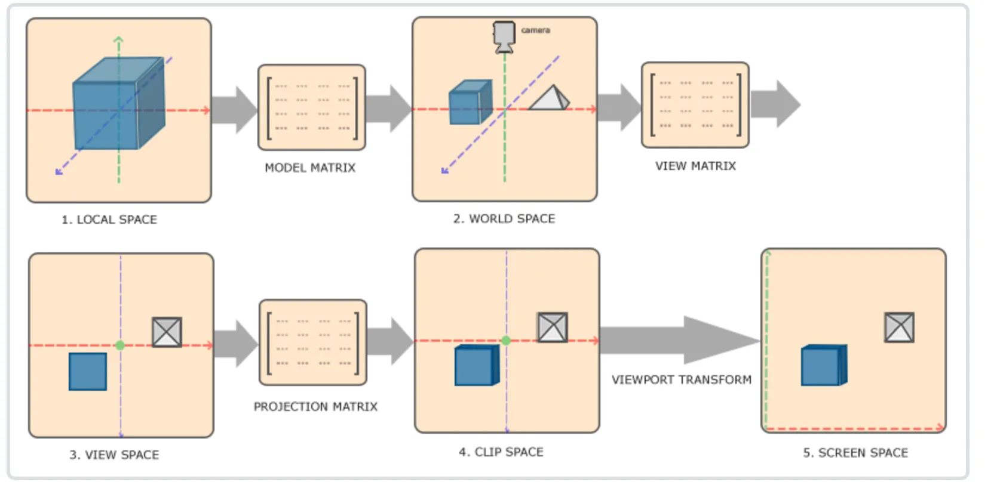
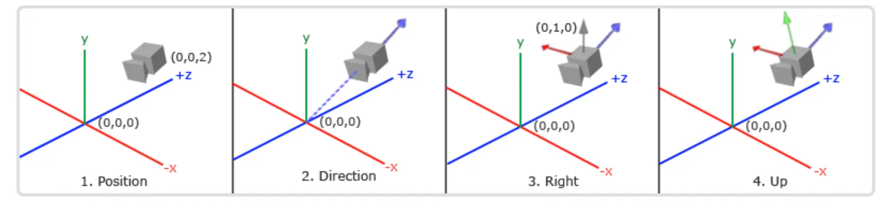

本文将简述常见的空间变换矩阵和相关公式推导。


<!-- more -->

### 1️⃣三种基本变换：平移、旋转和缩放

我们先尝试只用3x3矩阵来表示这些变换。这种方式很容易让人接受【但计算机没那么喜欢】

- 缩放（Scale）: 可以完美地用3x3矩阵表示。

$$
\left[ \begin{matrix} {S_{x}} & {0} & {0} \\ {0} & {S_{y}} & {0} \\ {0} & {0} & {S_{z}} \\ \end{matrix} \right] \left[ \begin{matrix} {x} \\ {y} \\ {z} \\ \end{matrix} \right]=\left[ \begin{matrix} {S_{x} \cdot x} \\ {S_{y} \cdot y} \\ {S_{z} \cdot z} \\ \end{matrix} \right]
$$

- 旋转（Rotation）: 也可以完美地用3x3矩阵表示（例如绕Z轴旋转）。

$$
\left[ \begin{matrix} {\operatorname{c o s} \theta} & {-\operatorname{s i n} \theta} & {0} \\ {\operatorname{s i n} \theta} & {\operatorname{c o s} \theta} & {0} \\ {0} & {0} & {1} \\ \end{matrix} \right] \left[ \begin{matrix} {x} \\ {y} \\ {z} \\ \end{matrix} \right]=\left[ \begin{matrix} {x \operatorname{c o s} \theta-y \operatorname{s i n} \theta} \\ {x \operatorname{s i n} \theta+y \operatorname{c o s} \theta} \\ {z} \\ \end{matrix} \right]
$$

- 平移：我们无法找到一个3x3矩阵使得$\mathbf{M}\cdot\vec{v}=\vec{v}+\vec{t}_{\circ}$

因为矩阵乘法是线性变换（输出是输入的线性组合），而平移是仿射变换，它有一个常量偏移。你无法通过 $ax + by + cz$ 这种形式来得到 $x + T_x$。

在引入齐次矩阵前，先推导一下旋转矩阵的得来：
假设在2D平面中有一个点 $P(x,y)$，我们将其绕原点逆时针旋转角度 $θ$得到新点 $ P'(x', y') $。设点 $P$ 到原点的距离为 $r$与 $x$ 轴的夹角为 $α$，则有:

$$
x=r \operatorname{c o s} \alpha, \quad y=r \operatorname{s i n} \alpha
$$

旋转后：

$$
x^{\prime}=r \operatorname{c o s} ( \alpha+\theta) , \quad y^{\prime}=r \operatorname{s i n} ( \alpha+\theta)
$$

利用三角函数公式展开：

$$
\begin{array} {c} {x^{\prime}=r ( \operatorname{c o s} \alpha\operatorname{c o s} \theta-\operatorname{s i n} \alpha\operatorname{s i n} \theta)=x \operatorname{c o s} \theta-y \operatorname{s i n} \theta} \\ {y^{\prime}=r ( \operatorname{s i n} \alpha\operatorname{c o s} \theta+\operatorname{c o s} \alpha\operatorname{s i n} \theta)=x \operatorname{s i n} \theta+y \operatorname{c o s} \theta} \\ \end{array}
$$

写成矩阵形式：
$$
\left[ \begin{matrix} {x^{\prime}} \\ {y^{\prime}} \\ \end{matrix} \right]=\left[ \begin{matrix} {\operatorname{c o s} \theta} & {-\operatorname{s i n} \theta} \\ {\operatorname{s i n} \theta} & {\operatorname{c o s} \theta} \\ \end{matrix} \right] \left[ \begin{matrix} {x} \\ {y} \\ \end{matrix} \right]
$$

因此，2D旋转矩阵为：
$$
R ( \theta)=\left[ \begin{matrix} {\operatorname{c o s} \theta} & {-\operatorname{s i n} \theta} \\ {\operatorname{s i n} \theta} & {\operatorname{c o s} \theta} \\ \end{matrix} \right]
$$

### 平移与齐次坐标
3x3矩阵无法表示平移变换。为了解决这个问题，数学家们想出了一个巧妙的办法：将3D向量升维到4D空间。这就是齐次坐标。

一个3D点在齐次坐标系下表示为$( x , y , z , w )$，其中 w 是一个分量。


$$
\left[ \begin{matrix} {1} & {0} & {0} & {T_{x}} \\ {0} & {1} & {0} & {T_{y}} \\ {0} & {0} & {1} & {T_{z}} \\ {0} & {0} & {0} & {1} \\ \end{matrix} \right] \left[ \begin{matrix} {x} \\ {y} \\ {z} \\ {1} \\ \end{matrix} \right]=\left[ \begin{matrix} {x+T_{x}} \\ {y+T_{y}} \\ {z+T_{z}} \\ {1} \\ \end{matrix} \right]
$$

通过引入齐次矩阵，解决了平移的问题，为什么要用乘法而不是直接用加法，目的是为了统一这三种基本变换的算子，让计算机做连续的矩阵乘法。可以将多次变换提前计算出来，存储为一个齐次矩阵。


### 2️⃣ 矩阵变换实际应用

在计算机图形学中，矩阵变换是最常用的，下面以opengl为例子，讲述矩阵变换的实际应用场景。

首先我们需要明白：

:::info{title="空间变换"}
要用一个矩阵把向量从“空间 A”变到“空间 B”，核心就是：要知道空间 B 的“坐标轴”在空间 A 里长什么样，再加上（如果需要的话）原点怎么平移。
:::

首先看一下opengl的坐标变换体系：





#### 局部空间到世界空间
这一步非常好理解，局部空间主要是存放模型的顶点，原点：通常是模型的几何中心或某个参考点。
通常会标准化到 [-1, 1] 范围。

Model矩阵的意义就是定义模型在世界空间的尺寸和位姿，在model矩阵中填入模型的rotate,scale和tranlate 组成model矩阵。

#### 局部空间到观察空间

这里涉及的主要知识就是线形代数中的**基变换**。
本质：向量不变，基向量变了，所以坐标（系数）必须变。

`矩阵 P：由新基向量在旧系中的坐标作为列组成。`

口诀：
*   新 $\to$ 旧：直接乘 $P$ （$P \mathbf{x}_{new} = \mathbf{x}_{old}$）
*   旧 $\to$ 新：乘逆矩阵 $P^{-1}$ （$\mathbf{x}_{new} = P^{-1} \mathbf{x}_{old}$）

在 OpenGL 或计算机图形学中，**从世界坐标（World Space）变换到相机坐标（Camera/View Space）** 是“坐标变换”最经典、最实用的例子。

这个变换通常由 **视图矩阵（View Matrix）** 完成。

我们将利用上一节提到的**“Old $\to$ New 需要逆矩阵”**的理论来一步步推导这个过程。

---

### 1. 场景设定与直观理解

#### 设定
*   **旧坐标系（世界坐标）**：绝对的 $(0,0,0)$，基向量是标准的 $X, Y, Z$。
*   **新坐标系（相机坐标）**：以**相机为中心**，相机永远觉得自己是在原点 $(0,0,0)$，看向 $-Z$ 轴（OpenGL右手系标准）。
*   **物体**：一个茶壶放在世界坐标 $(10, 5, 3)$ 的位置。
*   **相机**：放在世界坐标 $(0, 5, 10)$ 的位置，看向茶壶。

#### 直观理解：相对运动
在图形学中，移动相机太麻烦了（因为屏幕是死的），所以我们采用**“逆向思维”**：
> **不移动相机，而是反向移动整个世界。**

如果你想把相机向**右**移 5 米，等同于把世界里所有的物体向**左**移 5 米。
这就解释了为什么我们需要计算**“逆（Inverse）”**。

---

### 2. 构建相机的“基向量”（UVN系统）

首先，我们需要知道新坐标系（相机）长什么样。通常我们使用 `gluLookAt(eye, center, up)` 函数来定义：

1.  **Eye (相机位置)**: $P_{eye}$
2.  **Center (看向哪里)**: $P_{target}$
3.  **Up (世界的大致上方)**: $\vec{up}_{world}$ (通常是 $0,1,0$)


:::tip{title="提示"}
定义相机的Position,Target,Up 本质上就是构建新的坐标的基向量，也是构建过渡矩阵
:::


我们需要构建相机的三个正交基向量（Right, Up, Direction）：

1.  **Z轴（方向轴 $\vec{f}$）**：
    在OpenGL中，相机看向 $-Z$ 方向，所以 $+Z$ 指向相机的背后。
    $$ \vec{z}_{cam} = \text{normalize}(P_{eye} - P_{target}) $$
2.  **X轴（右轴 $\vec{r}$）**：
    利用叉乘（Cross Product）。右轴垂直于“上方向”和“Z轴”。
    $$ \vec{x}_{cam} = \text{normalize}(\vec{up}_{world} \times \vec{z}_{cam}) $$
3.  **Y轴（上轴 $\vec{u}$）**：
    垂直于已经算出来的 Z 和 X。
    $$ \vec{y}_{cam} = \vec{z}_{cam} \times \vec{x}_{cam} $$

现在，我们有了新坐标系的基向量：$\vec{r}, \vec{u}, \vec{f}$。

这里根据rgb颜色观察相机的x,y,z轴



---

### 3. 矩阵推导：平移与旋转

我们要把一个点 $P_{world}$ 变成 $P_{camera}$。
公式是：
$$ P_{camera} = \text{ViewMatrix} \cdot P_{world} $$

这个变换分为两步：**先平移（把相机移回原点），再旋转（把相机的朝向对准坐标轴）。**

#### 第一步：平移矩阵 $T$
相机当前在 $P_{eye} = (x_e, y_e, z_e)$。
要把相机移回世界原点 $(0,0,0)$，我们需要平移 $(-x_e, -y_e, -z_e)$。

$$ 
T = \begin{bmatrix} 
1 & 0 & 0 & -x_e \\
0 & 1 & 0 & -y_e \\
0 & 0 & 1 & -z_e \\
0 & 0 & 0 & 1
\end{bmatrix} 
$$

#### 第二步：旋转矩阵 $R$（核心应用！）
这里是应用我们之前理论的关键点。

我们知道旋转矩阵 $R_{orientation}$ 的**列**应该是新基向量（相机的 $\vec{r}, \vec{u}, \vec{f}$）在世界坐标下的值。

$$ 
R_{orientation} = \begin{bmatrix} 
| & | & | & 0 \\
\vec{r} & \vec{u} & \vec{f} & 0 \\
| & | & | & 0 \\
0 & 0 & 0 & 1 
\end{bmatrix} 
$$

**但是！** 上面这个矩阵代表的是 **Camera $\to$ World** 的变换（把相机坐标转成世界坐标）。
正如第一部分理论所说：**已知旧坐标求新坐标（World $\to$ Camera），需要乘以逆矩阵 $P^{-1}$。**

**线性代数的小魔法：**
对于纯旋转矩阵（正交矩阵），**逆矩阵等于转置矩阵（Inverse = Transpose）**。
所以，我们不需要辛苦算逆，直接把行变成列即可：

$$ 
R = (R_{orientation})^{-1} = (R_{orientation})^{T} = \begin{bmatrix} 
- & \vec{r} & - & 0 \\
- & \vec{u} & - & 0 \\
- & \vec{f} & - & 0 \\
0 & 0 & 0 & 1 
\end{bmatrix} = \begin{bmatrix} 
r_x & r_y & r_z & 0 \\
u_x & u_y & u_z & 0 \\
f_x & f_y & f_z & 0 \\
0 & 0 & 0 & 1 
\end{bmatrix} 
$$

*(注意：这里的基向量现在横着躺在了**行**里)*

---

### 4. 最终的视图矩阵 (View Matrix)

将两步合起来（先平移，再旋转，注意矩阵乘法顺序是从右向左）：
$$ 
\text{ViewMatrix} = R \cdot T 
$$


$$ 
\text{ViewMatrix} = \begin{bmatrix} 
r_x & r_y & r_z & 0 \\
u_x & u_y & u_z & 0 \\
f_x & f_y & f_z & 0 \\
0 & 0 & 0 & 1 
\end{bmatrix} \cdot \begin{bmatrix} 
1 & 0 & 0 & -x_e \\
0 & 1 & 0 & -y_e \\
0 & 0 & 1 & -z_e \\
0 & 0 & 0 & 1 
\end{bmatrix} 
$$

计算结果就是经典的 **LookAt Matrix**：

$$ 
\begin{bmatrix} 
r_x & r_y & r_z & -\vec{r} \cdot P_{eye} \\
u_x & u_y & u_z & -\vec{u} \cdot P_{eye} \\
f_x & f_y & f_z & -\vec{f} \cdot P_{eye} \\
0 & 0 & 0 & 1 
\end{bmatrix} 
$$

*(注：最后的一列实际上就是 $-\vec{r} \cdot P_{eye}$，也就是平移向量在新基向量上的投影)*

---

### 5. 总结与举例验证

假设：
*   **相机位置**：$(0, 0, 5)$
*   **看向**：$(0, 0, 0)$
*   **上方**：$(0, 1, 0)$
*   **世界中有一个点**：$P_{world} = (0, 0, 2)$

**人脑直观推测**：
相机在 $z=5$ 看向原点，点在 $z=2$。对相机来说，这个点在它前方 3 米处。因为相机看的是 $-Z$ 方向，所以在相机坐标系里，这个点的坐标应该是 $(0, 0, -3)$。

**利用矩阵计算**：
1.  **基向量**：
    *   $\vec{f} = (0,0,1)$ (指向相机背后)
    *   $\vec{r} = (1,0,0)$
    *   $\vec{u} = (0,1,0)$
2.  **旋转矩阵 $R$** (转置后还是它自己，因为是对角阵)：单位矩阵。
3.  **平移矩阵 $T$**：$z$ 轴平移 $-5$。
4.  **运算**：


    $$ P_{cam} = \begin{bmatrix} 1 & 0 & 0 & 0 \\ 0 & 1 & 0 & 0 \\ 0 & 0 & 1 & -5 \\ 0 & 0 & 0 & 1 \end{bmatrix} \begin{bmatrix} 0 \\ 0 \\ 2 \\ 1 \end{bmatrix} = \begin{bmatrix} 0 \\ 0 \\ 2-5 \\ 1 \end{bmatrix} = \begin{bmatrix} 0 \\ 0 \\ -3 \\ 1 \end{bmatrix} $$

**结果吻合！**

### 关键点回顾
在 OpenGL 的这个例子中，体现了坐标变换的两个精髓：
1.  **逆向思维**：World $\to$ Camera 本质上是把世界做了一个**逆变换**（$T^{-1} \cdot R^{-1}$）。
2.  **基变换计算**：利用正交矩阵的性质（$R^{-1} = R^T$），将相机的基向量作为**行**填入矩阵，即可完成旋转变换。


### 3️⃣FPS相机与轨道相机

轨道相机的本质是球坐标系 (Spherical Coordinates) 到 直角坐标系 (Cartesian Coordinates) 的转换。

假设我们盯着点$P_{target}$,距离为 R，角度为 θ(Pitch) ,我们要算出相机的位置$P_{eye}$.
计算公式:

$$
\begin{aligned} {x} & {{}=R \cdot\operatorname{c o s} ( \theta) \cdot\operatorname{c o s} ( \phi)} \\ {y} & {{}=R \cdot\operatorname{s i n} ( \theta)} \\ {z} & {{}=R \cdot\operatorname{c o s} ( \theta) \cdot\operatorname{s i n} ( \phi)} \\ \end{aligned}
$$

这算出来的是相对于目标点的偏移量 (Offset)。所以，相机的最终位置是：

$$
P_{e y e}=P_{t a r g e t}+\left[ \begin{matrix} {x} \\ {y} \\ {z} \\ \end{matrix} \right]
$$

最直观的感受就是：
- FPS：输入改变角度，导致你看到的画面在旋转，但物体不动（除非你按W前进）。

- 轨道：输入改变角度，导致世界在旋转（其实是相机绕到了物体侧面），物体始终在屏幕中心。

计算代码参考：

```c++
void Camera::updateViewMatrix() {
    // 计算相机朝向角度的弧度值以及相关三角函数值
    const float yawRad = qDegreesToRadians(m_yaw);
    const float pitchRad = qDegreesToRadians(m_pitch);
    const float cosPitch = qCos(pitchRad);

    // 根据欧拉角计算相机前方方向向量
    QVector3D forward(
        qSin(yawRad) * cosPitch,
        qSin(pitchRad),
        qCos(yawRad) * cosPitch
    );
    forward.normalize();

    // 根据目标点、前方方向和距离计算相机实际位置
    m_position = m_target - forward * m_distance;
    
    // 构建视图矩阵
    m_viewMatrix.setToIdentity();
    m_viewMatrix.lookAt(m_position, m_target, m_up);
}
```
