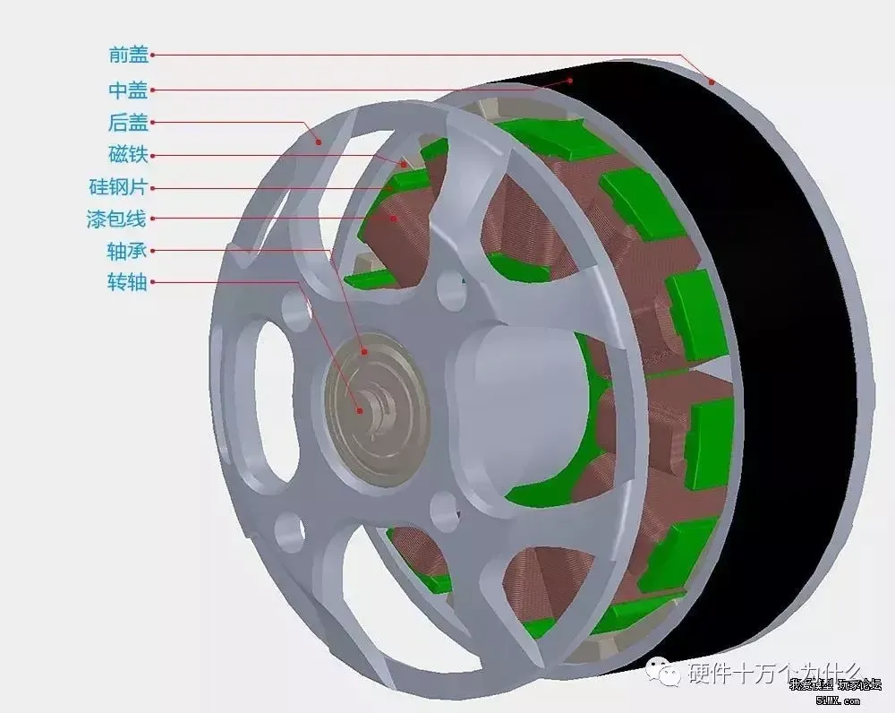
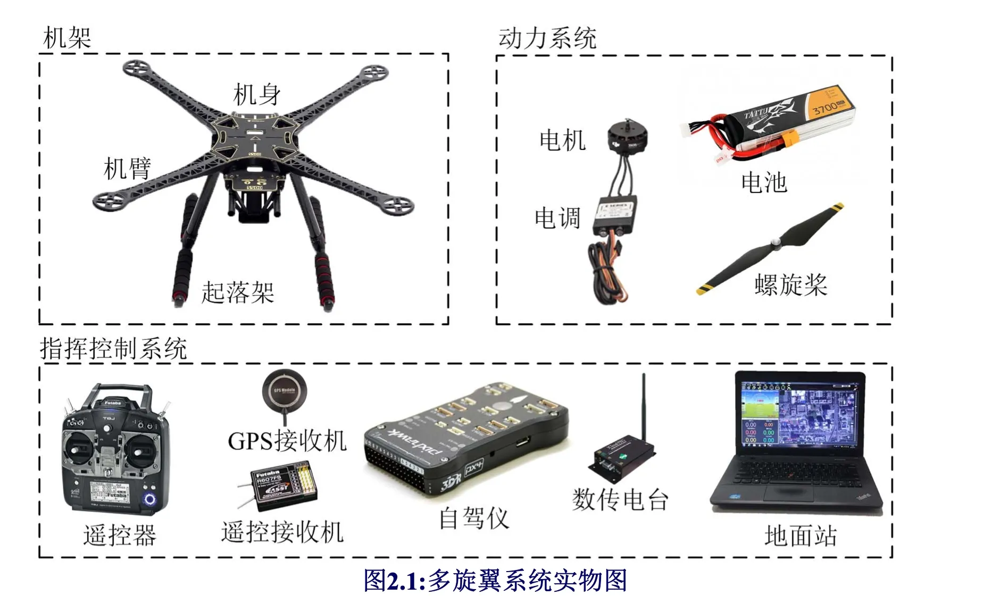
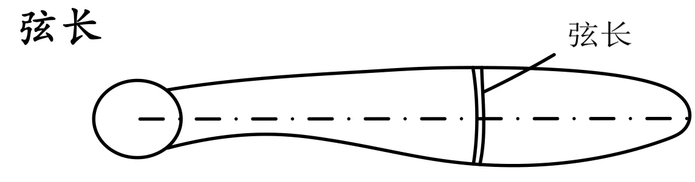
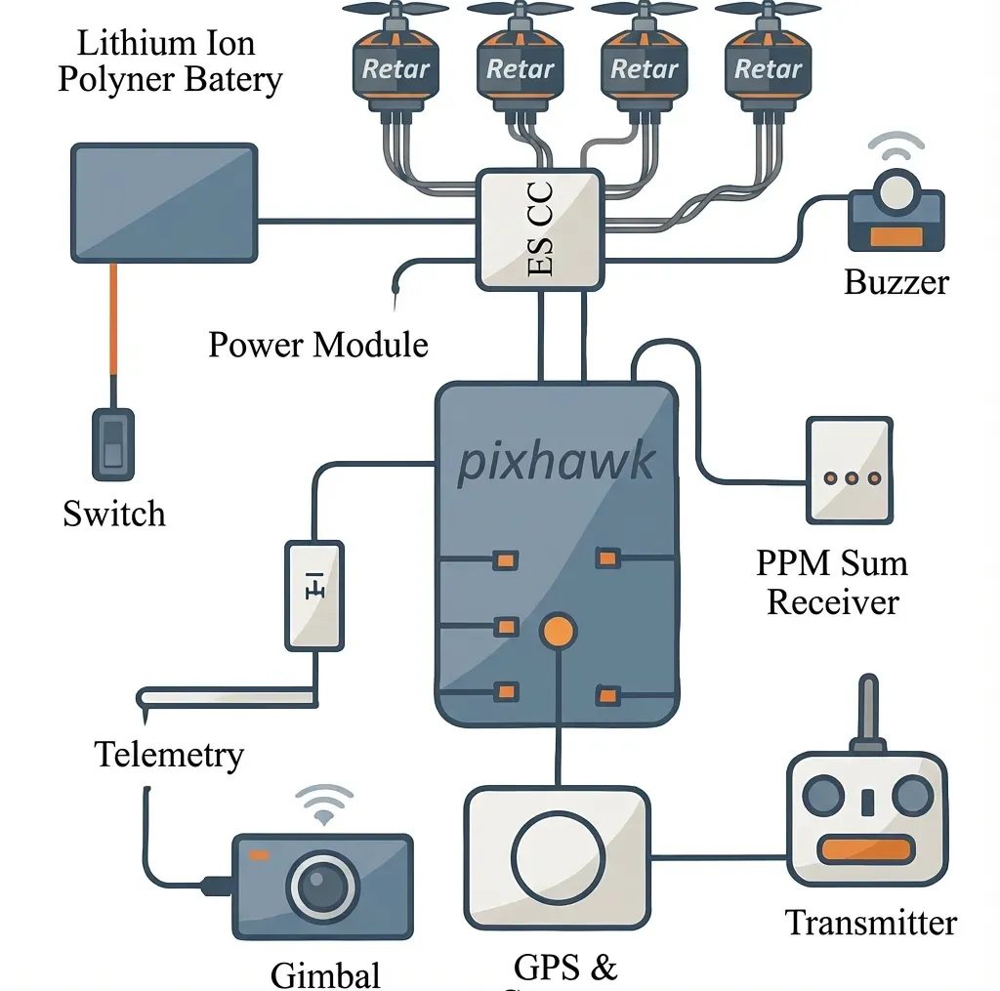
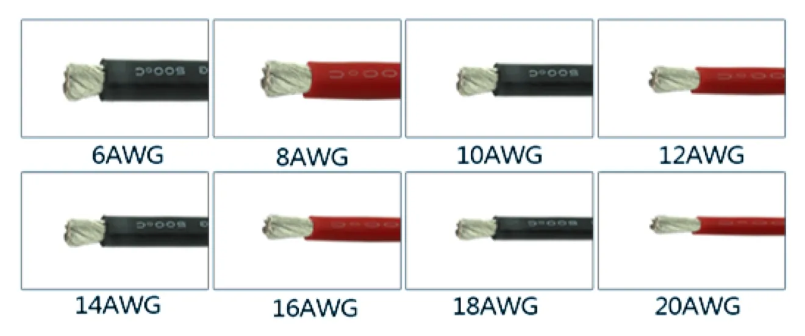
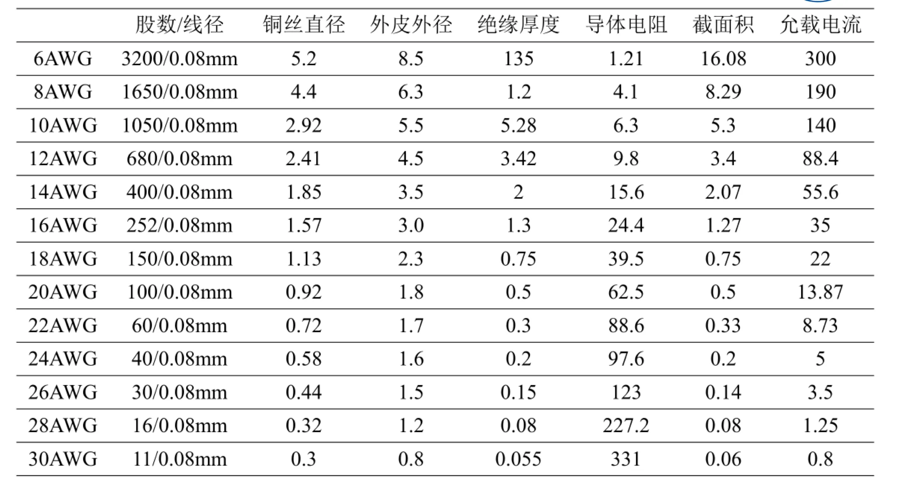
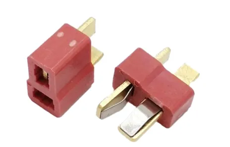
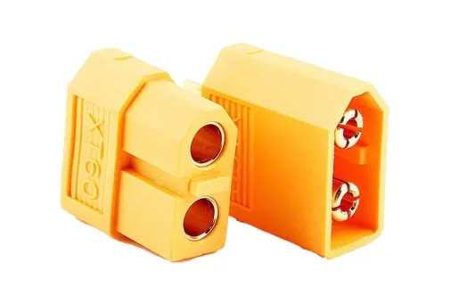
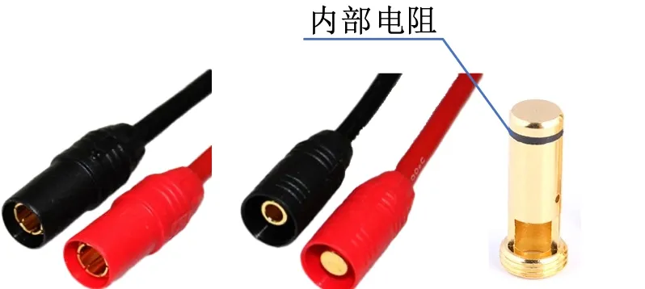

本文主要记录多旋翼飞行器的笔记。

<!-- more -->

### 实验场地搭建：

5m x 7m x 2.2m 【长x宽x高】

1. 电机拉力测试平台（515元，用于测试螺旋桨拉力和计算无人机力效） 

【淘宝】7天无理由退货 https://e.tb.cn/h.7b0BVzqtVX0jNuF?tk=bEYFfr5mYYD HU293 「Mayatech MT10PRO+涵道航模桨电机拉力测试台10KG 拉力计电流功率」
点击链接直接打开 或者 淘宝搜索直接打开

1. 螺旋桨静平衡器 （137元，调平螺旋桨平衡，降低无人机飞行时的震动和抖动）

【淘宝】7天无理由退货 https://e.tb.cn/h.7bb7N6pjJD7t1bX?tk=kGCWfr5AdL1 CZ356 「航模多功能平衡仪、航模螺旋桨平衡仪、直升机主旋翼重心定位仪」
点击链接直接打开 或者 淘宝搜索直接打开

1. 航模遥控器（900 元）

【淘宝】7天无理由退货 https://e.tb.cn/h.7bbtAVMfRQqw6Lo?tk=Zks8frg7DQn HU287 「WFLY天地飞ET16S航模遥控器固定翼FPV穿越机兼容多协议黑羊高频头」
点击链接直接打开 或者 淘宝搜索直接打开

### SLAM经典算法

[**FAST_LIO**](https://github.com/hku-mars/FAST_LIO)

[**FAST-LIVO2**](https://github.com/hku-mars/FAST-LIVO2)

mid360 复现https://github.com/hku-mars/FAST-LIVO2/issues/119

## 问题：

1. 为什么多旋翼不适合推广到大型飞行器？

当桨叶变大，其**转动惯量（Inertia）** 会呈指数级增加。这意味着电机无法迅速改变桨叶的转速。

1. 如何理解飞行器的失速？
机翼因角度过大（迎角超限）而导致机翼失去了足够的升力，无法再支撑飞行器的重量。
## 电机知识

无刷电机不论是外转子结构还是内转子结构**旋转的都是磁铁**。所以任何一个电机都是由**定子**和**转子**共同构成的。

无刷电机的定子是**产生旋转磁场**的部分，能够支撑转子进行旋转，主要由[硅钢片](https://zhida.zhihu.com/search?content_id=104149598&content_type=Article&match_order=1&q=%E7%A1%85%E9%92%A2%E7%89%87&zhida_source=entity)、漆包线、轴承、支撑件构成；而转子则是黏贴**钕铁硼磁铁**，在定子旋转磁场的作用进行旋转的部件，主要由转轴、磁铁、支持件构成。除此之外，定子与转子组成的[磁极对数](https://zhida.zhihu.com/search?content_id=104149598&content_type=Article&match_order=1&q=%E7%A3%81%E6%9E%81%E5%AF%B9%E6%95%B0&zhida_source=entity)还影响着电机的转速与扭力。

简单的一句话总结：**磁极对数越多，电机转速越慢，扭力越大；磁极对数越少，电机转速越快，扭力越小。（这解释了为什么无人机电机的磁极对数比RC车的磁极对数多）**

在交流电机（如感应电机、永磁同步电机 PMSM、无刷直流电机 BLDC）中，转速的理论公式为：

$$

 n=\cfrac{6 0 \times f} {p} 

$$

$n$:表示同步转速（RPM）

$f$:表示电源频率（HZ）

$p$:磁极对数 （1p表示2个磁极）

结构原理图如下所示：

### 机架参数

轴距：两个对角螺旋桨的距离

布局： 除非特殊，一律选择 quad x布局

现在还有很多基于 X 型的改良布局，例如：

- **Stretch X (长X):** 缩短左右间距，拉长前后间距，为了高速直线竞速（减少扰流）。
- **True X (正X):** 正方形布局，手感最均衡，花飞首选。
- **Dead Cat (死猫型):** 前两个机臂角度张得更开，确保超广角镜头也拍不到桨叶（常见于 DJI Avata 或远航穿越机）。

### 空气动力学

计算叶尖雷诺系数：

$$
R e_{t i p}=\frac{V_{t i p} \cdot C_{t i p}} {\nu}
$$

$V_{tip}$:表示叶尖线速度，单位($m/s$), 螺旋桨最外边缘划过空气的速度

$C_{tip}$: 表示叶尖弦长，单位($m$) 

$v$ :表示空气运动粘度，单位($m^2/s$), 这是一个常数，取决于气温和海拔。**标准海平面（15°C）下，$\nu\approx1 . 4 6 \times1 0^{-5} m^{2} / s$**

### 螺旋桨

📝：*1英寸 = 2.54 厘米*

**命名规则**： e.g 5045[x] 桨，前两个数字表示直径：5英寸，后两个数字表示螺距：4.5英寸, x表示叶数。 **有R（如 5045R）：** 代表顺时针旋转（CW），通常叫“反桨”。【*无人机必须买一对正桨、一对反桨才能飞，所以通常是成套卖的*】

**螺距**：螺旋桨每转一圈，就会向前进一个距离，就称为螺距或桨距。

低螺距看起来比较平，切风时的阻力小，响应快，低速扭矩快，极速低。e.g 5030

高螺距看起来比较斜，转速提升慢，需要较大电流。 e.g 5050

**弦长**：螺旋桨叶片的“**宽度**”

**桨叶数**：数量越多，推力越大，效率越低。反之推力越小，效率越高。

**转动惯量**：计算公式（$I = mr^2$）,$m$ 表示质量，$r$表示距离旋转中心的距离。 转动惯量越大，越难旋转和停止。

### 无人机力效

通俗地说，力效就是：**你每消耗 1瓦特（Watt）的电，能买来多少克（gram）的拉力？**

数值越高，说明越省电，核心计算公式如下：

$$
力效 = \frac{拉力(g)}{电压(V) \times 电流(A)}
$$

⚠️：力效这个数字不是固定的，它会随着**油门大小**、**螺旋桨尺寸**而剧烈变化。**低油门区的力效更高**

### 动力控制系统

### 电源线

硅胶线：多股缠绕，可以通过很大的电流，同时又保证线材比较柔软；二是线皮用硅橡胶，非常柔
软，不过同时也很容易破损

注：AWG越小，能通过的电流越大，参考如下：

### 插头

1. T形头

一般使用T型头。一般电源上为母头，而电调上的为公头，适合较小电流的情况

2.XT60

可以通过**60A**以上的电流。其内部是两个香蕉头，适合较大电流的情况

3.AS150

额定电流为70A，瞬时电流为150A，最高可承受500V直流，具备防打火设计

### 图传解码算法比较

| 编码算法 | 压缩效率 | 典型总延迟 | **4K（3840×2160）所需带宽** | **1080p（1920×1080）所需带宽** | 备注 |
| --- | --- | --- | --- | --- | --- |
| **H.264 (AVC)** | 基准 | **80–150 ms** | **20–40 Mbps** | **6–12 Mbps** | 最低延迟，兼容广，图传常用 |
| **H.265 (HEVC)** | 比 H.264 节省 30–50% | **120–200 ms**（略高） | **12–25 Mbps** | **3–8 Mbps** | 高压缩率，但复杂度更高 |
| **专用低延迟编码（如 DJI 优化算法）** | 接近 H.265 | **30–80 ms（行业最佳）** | **10–20 Mbps** | **4–8 Mbps** | 深度优化延迟与抗干扰 |

### 系统通信协议

1. **遥控器与接收器**
- PPM(**Pulse Position Modulation**) :模拟信号，但通过一根线传输所有通道数据。比PWM简洁，但精度和抗干扰能力一般。
- **SBUS (Serial Bus):** 由Futaba开发，基于串口的**数字协议**。它使用反向电平，一根线可传输16-18个通道，延迟低，是目前最常用的协议之一。
- **CRSF (Crossfire):** 由TBS (Team BlackSheep) 开发的高速、双向数字协议。它是目前远航和穿越机的主流协议（如**ExpressLRS**也主要使用CRSF协议与飞控通信），具有极低的延迟和带宽，支持OTA固件升级和参数调整。

1. **飞控与电调**
- **Standard PWM:** 传统的模拟信号（1ms-2ms脉宽），刷新率低（50Hz-400Hz），响应慢。
- **DShot (150/300/600/1200):** 目前的**绝对主流**。这是一种**数字协议**。 抗干扰能力强，无需校准行程，支持反乌龟模式（电机反转），且可以通过电调回传转速信息。数字越大代表传输速度越快（如DShot600）。

1. **控与板载传感器/外设通信（内部总线）**
- **I2C (Inter-Integrated Circuit):** 通用串行总线。常用于连接磁力计（罗盘）、气压计以及部分旧型号的陀螺仪。优点是只用两根线（SDA, SCL）挂载多个设备，缺点是速度相对较慢，抗干扰差。
- **SPI (Serial Peripheral Interface):** 高速同步串行接口。目前高性能飞控主要使用SPI连接**陀螺仪**（如MPU6000, BMI270）和SD卡槽。SPI拥有比I2C高得多的带宽，能满足8KHz甚至32KHz的PID循环频率需求。
- **UART (Universal Asynchronous Receiver/Transmitter):** 也就是串口。这是飞控上最通用的接口，用于连接GPS、数传电台、接收机、激光雷达等。

1. **飞控与地面站通信**
- **MAVLink (Micro Air Vehicle Link):** 开源无人机领域（ArduPilot, PX4）的**行业标准**。它是一种极其强大、轻量级的消息传输协议，用于飞控与地面站（如Mission Planner, QGroundControl）以及机载电脑（如树莓派、Jetson）之间的双向通信。
- **MSP (MultiWii Serial Protocol):** 主要用于Betaflight/Cleanflight/iNav固件。用于飞控参数配置、OSD设置。相比MAVLink更轻量，但功能偏向于穿越机和竞速调整。
