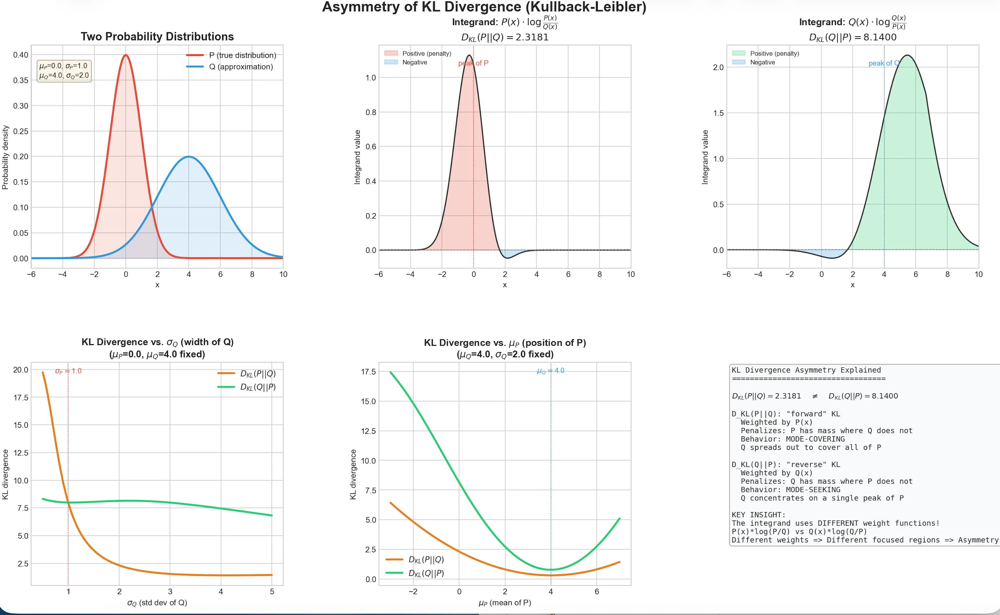
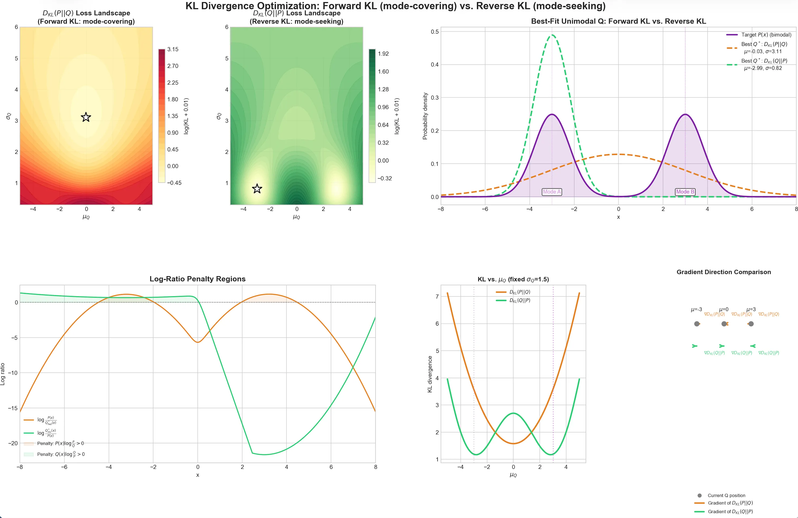

理解熵，交叉熵与KL散度是迈入信息论和众多机器学习算法大门的关键。有太多人知道如何计算交叉损熵损失函数，但是从来不知道为何要这样计算。就好像能看懂乐谱，却无法直接从乐谱听到音乐。本文将由浅入深的介绍这三个概念。

<!-- more -->

## 熵的理解
首先我们引入一个概念“惊奇度”，假设你要听一个新闻，新闻的价值（信息量）取决于这件事发生的概率。
- 高概率事件：“明天太阳从东边升起” $(概率P ≈ 1)$. 你听到这句话毫无波澜，因为你早就知道了。信息量极低，惊奇度为 0。
- 低概率事件：“明天外星人降临地球”$(概率P ≈ 0)$.你听到后会极度震惊。信息量极大，惊奇度极高。

所以我们可以简单得到一个结论：**一个事件包含的信息量，应该和它发生的概率$P(x)$成反比**.
此时我们认为：
$$
 信息量 = \frac{1}{P(x)}
$$

但是信息论的祖师爷：香农，给信息下了一个定义，两个系统（分布）的信息量总和等于两个系统各自信息量相加。这个定义就是**信息量需要满足可加性**。

假设你扔两次硬币，两次都是正面的概率是乘法$P=\frac{1} {2} \times\frac{1} {2}=\frac{1} {4}$

但你获得的信息量应该是两次信息的叠加（加法）。 两个独立时间的联合概率分布是乘法，为了把乘法转化成加法，所以我们需要修改信息量的定义：
$$
信息量 = \log (\frac{1}{P(x)}) = - \log P(x)
$$

$- \log P(x)$就代表了某一个具体事件$x$发生时，给你带来的“惊奇度”或“信息量”。

 $- \log P(x)$只是算出了某一个具体事件的信息量。但是，一个系统（比如一个骰子、明天的天气）包含好几种可能的结果。我们如何衡量整个系统的混乱程度或不确定性呢？

答案是：算期望（加权平均）。

你不能只看最极端的情况，你要根据每种情况发生的概率，求一个平均的“惊奇度”。
$$
\ H ( X )=-\sum_{x} P ( x ) \operatorname{l o g} P ( x )
$$

这个公式就是熵的计算公式，**信息熵，就是系统中所有可能事件的“信息量”的数学期望（加权平均值）。**

但是，要注意区分熵和信息量还是存在区别的。

熵针对“整个系统/概率分布”，它计算的是系统里所有可能发生的情况的信息量的加权平均值（数学期望）。

信息量针对“单个事件”
它计算的是某一种具体情况 x 发生时，所包含的信息。

## 交叉熵的理解
先看交叉熵的公式：
$$
H ( P , Q )=-\sum_{x} P ( x ) \operatorname{l o g} Q ( x )
$$
和熵的公式长得几乎一模一样，唯一的区别是：对数里面变成了 $Q ( x )$, 这里的P和Q分别代表：
- $P(x)$:真实世界（数据的真实分布，比如这张图片 100% 是一只猫）。
- $Q(x)$:你的模型/你的假设（模型预测的分布，比如模型认为这张图片有 80% 是猫，20% 是狗）。

把它们乘起来求和，意思就是：
在真实世界 P发生的频率下，你使用基于假设 Q设计的编码系统，平均需要花费的代码长度（总代价）。

此外可以通过琴生不等式证明交叉熵是大于等于熵，当Q与P一致的时候交叉熵等于熵。

## KL散度的理解

刚刚说到交叉熵是用错误的分布去编码所付出的代价，并且代价（平均代码长度）大于熵，二者之间其实存在一个代价差，这个代价差就是KL散度：
$$
交叉熵=信息熵+KL散度
$$

$$
H ( P , Q )=H ( P )+D_{K L} ( P | | Q )
$$

KL散度就是**额外浪费的成本**。 根据定义可以推导出计算公式：
$$
D_{K L} ( P | | Q )=\sum\mathbf{P ( x )} \operatorname{l o g} \frac{P ( x )} {Q ( x )}
$$

在机器学习中，我们通常希望模型学习到的分布$Q(x)$越近似真实分布$P(x)$越好，让KL散度越小越好，但是为是把交叉熵作为损失函数而不是KL散度？

答案很简单，对于交叉熵求梯度和KL散度求梯度是等价的：
$$
\nabla_{\theta} H ( P , Q )=\nabla_{\theta} H ( P )+\nabla_{\theta} D_{K L} ( P \parallel Q )
$$
公式中的$ H ( P )$ 表示数据集的真实分布的熵，是一个常数，所以梯度为0.

## KL散度的不对称性

在日常生活中，我们理解的“差异”或“距离”通常是对称的。比如从北京到上海的直线距离，等于从上海到北京的直线距离。
但 KL散度不是真正的“距离”，它是有方向的。

首先我们给出正向（前向）和反向的KL散度公式：

$$
D_{K L} ( P | | Q )=\sum{\bf P ( x )} \operatorname{l o g} \frac{P ( x )} {Q ( x )}
$$

$$
D_{K L} ( Q | | P )=\sum\mathbf{Q ( x )} \operatorname{l o g} \frac{Q ( x )} {P ( x )}
$$

这两个公式乍一看很难理解，所以我们通过可视化来理解：

第一张图展示了真实分布$P$和设计的分布$Q$, 可以看到，P 和 Q 的中心位置（均值）和宽度（标准差）都有明显差异。

第二张图展示了前向 KL 散度的积分公式内部的被积函数，我们可以观察到外部乘数是$P(x)$,这意味着计算时主要关注$P(x)$概率密度高的区域,如果在这个区域$Q(x)$很小，就会导致散度（惩罚）很大。

第三张图展示了反向KL 散度的积分公式内部的被积函数，我们可以观察到外部乘数是$Q(x)$,这意味着计算时主要关注$Q(x)$概率密度高的区域,如果在这个区域$P(x)$很小，就会导致散度（惩罚）很大。

**第二和第三张图对比可以发现，前向散度的惩罚主要集中在$P(x)$ 附近，反向散度的惩罚主要集中在$Q(x)$附近。**

第四张图展示了固定$Q(x)$的均值，改变其方差（覆盖范围），会让前向散度（惩罚）快速下降，说明**前向散度的优化目标是仅可能覆盖真实分布$P(x)$。**

第五张图展示了固定$Q(x)$的方差，改变其均值，会让反向散度（惩罚）在靠近真实分布的密度峰值附近下降，说明**反向散度的优化目标是精准覆盖“单峰”。**

下面用一张图直观展示优化目标的差异：

可以直观的看到精准覆盖和大范围覆盖的差异。
