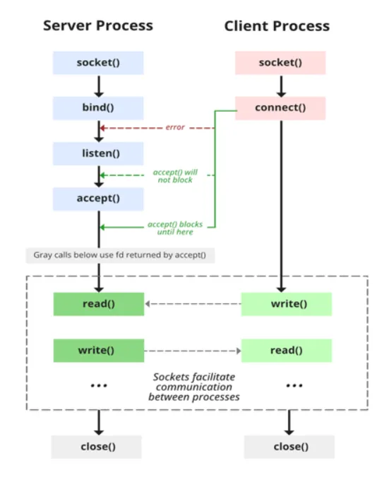
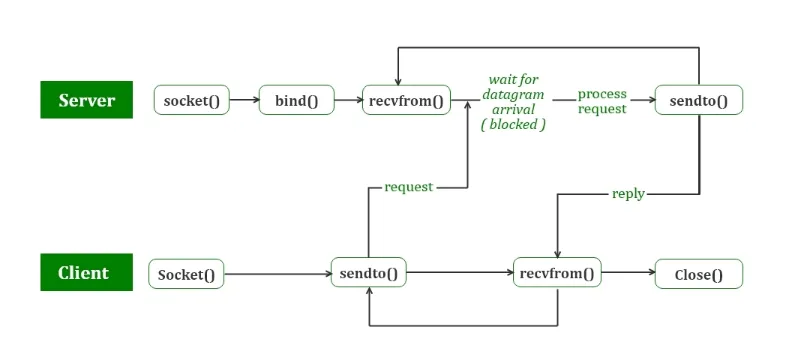

# C++网络编程

​	本文的网络编程指代C++ 套接字程序编写，讲述常用的两种连接TCP和UDP的socket.对应**流式套接字（SOCK_STREAM）,数据报套接字(SOCK_DGRAM)**。当然还有第三种**原始套接字(SOCK_RAW)**，使用较少。

C++使用原始未封装的socket还需要考虑跨平台，windows和linux使用的库并不一样，写法也不一样，但是建立连接的方式和原理是一样的。

<!-- more -->


## TCP socket连接过程



TCP（传输控制协议）是一种面向连接的、可靠的、全双工的传输层协议。但是连接的双方并不是完全平等的，而是分为客户端和服务端。客户端和服务端的初始状态是不同的。上图比较清晰的展示了连接过程，服务端需要四步才能完成初始化进入等待连接，客户端只需要两步。 服务端需要改变socket的监听状态并通过**accept()**阻塞等待客户端的消息。

## UDP socket连接过程




UDP（用户数据报协议）是一种无连接的、不可靠的传输层协议，用于在计算机网络中进行简单的、低延迟的数据传输。同样这也是全双工，可以相互通信，但是不需要服务端不需要修改监听状态，客户端也不需要连接，只需要直接发送数据。注意：`recvfrom()` 函数是阻塞的，但是也可以使用超时和非阻塞的方式接收数据，比如可以将接收数据的操作放在一个单独的线程或进程中，使主线程或进程不被阻塞，从而实现并发处理。

## Linux socket编程

### 编程使用的相关库

使用的库【必须】：<arpa/inet.h> <sys/socket.h> <netinet/in.h>

可选的库【坑：实际是必选的close函数在里面有声明，不然无法关闭套接字】：<unistd.h>

`<arpa/inet.h>` 是 C/C++ 编程中的一个头文件，它提供了一些用于 IP 地址转换的函数。主要用于在网络编程中对 IP 地址和端口进行**网络字节序和主机字节序之间的转换**。

这个头文件提供了以下常用函数，这些函数在网络编程中常用于 IP 地址和端口的转换、显示以及配置。在使用这些函数时，请确保正确地处理返回值和错误码，以保证网络数据的正确处理。：

1. `in_addr_t inet_addr(const char *cp);`: 该函数将一个点分十进制字符串表示的 IPv4 地址（如 "192.168.1.1"）转换为 `in_addr_t` 类型的网络字节序表示。`in_addr_t` 是一个 32 位无符号整数类型，用于表示 IPv4 地址。
2. `char *inet_ntoa(struct in_addr in);`: 该函数将一个 `struct in_addr` 结构体表示的 IPv4 地址（以网络字节序存储）转换为点分十进制字符串。`in_addr` 结构体包含一个字段 `s_addr`，表示一个 IPv4 地址。
3. `int inet_pton(int af, const char *src, void *dst);`: 该函数将一个点分十进制字符串表示的 IPv4 或 IPv6 地址（取决于 `af` 参数）转换为网络字节序存储的二进制形式。`af` 参数可以是 `AF_INET`（IPv4）或 `AF_INET6`（IPv6）。
4. `const char *inet_ntop(int af, const void *src, char *dst, socklen_t size);`: 该函数将一个网络字节序存储的 IPv4 或 IPv6 地址（取决于 `af` 参数）转换为点分十进制字符串表示。`af` 参数可以是 `AF_INET`（IPv4）或 `AF_INET6`（IPv6）。


`<sys/socket.h>` 是 C/C++ 编程中的一个头文件，它提供了对套接字（socket）编程的支持。套接字是在网络编程中用于实现进程间通信的一种机制。这个头文件提供了一系列函数和常量，用于创建、绑定、监听、接受、连接、发送和接收套接字数据。通过使用 `<sys/socket.h>` 头文件提供的函数和常量，你可以在网络编程中实现不同类型的套接字通信，包括 TCP 和 UDP 等协议的通信。这个头文件是在进行网络编程时必不可少的重要工具之一。需要注意的是，使用套接字编程需要对网络协议和底层数据传输有一定的了解，同时需要仔细处理返回值和错误码以保证程序的正确性和可靠性。

一些常用的函数和常量包括：

1. **函数：**
   * `socket()`：创建一个套接字。
   * `bind()`：将套接字绑定到一个特定的 IP 地址和端口。
   * `listen()`：开始监听传入的连接请求。
   * `accept()`：接受一个传入的连接请求。
   * `connect()`：与远程套接字建立连接。
   * `send()`：发送数据。
   * `recv()`：接收数据。
2. **常量：**
   * `AF_INET`：IPv4 地址族。
   * `AF_INET6`：IPv6 地址族。
   * `SOCK_STREAM`：面向连接的套接字类型（用于 TCP）。
   * `SOCK_DGRAM`：无连接的套接字类型（用于 UDP）。

`<netinet/in.h>` 头文件通常与 `<sys/socket.h>` 和其他网络编程相关的头文件一起使用，**用于定义和处理网络地址和端口**。它是在进行网络编程时必不可少的重要工具之一。需要注意的是，这些函数主要用于处理 IPv4 地址和端口，如果要处理 IPv6 地址，需要使用 `<netinet/in6.h>` 头文件和相应的数据结构和函数。

主要功能包括：

1. **数据结构定义：**
   * `struct sockaddr_in`：用于表示 IPv4 地址和端口的数据结构。
   * `struct in_addr`：用于表示 IPv4 地址的数据结构。
2. **函数：**
   * `htons()` 和 `ntohs()`：用于主机字节序和网络字节序之间的 16 位整数转换。
   * `htonl()` 和 `ntohl()`：用于主机字节序和网络字节序之间的 32 位整数转换。
   * `inet_addr()`：将点分十进制表示的 IPv4 地址转换为网络字节序的二进制表示。
   * `inet_ntoa()`：将网络字节序的二进制表示的 IPv4 地址转换为点分十进制表示的字符串。


`<unistd.h>` 提供了一组与 POSIX（可移植操作系统接口）标准相关的系统调用（system call）函数和符号常量。这些函数和常量主要用于在操作系统层面进行系统调用和对操作系统提供的一些基本功能进行访问。【设计并行处理的时候可能需要】

一些常用的函数和常量包括：

1. **函数：**
   * `read()`：从文件描述符中读取数据。
   * `write()`：向文件描述符写入数据。
   * `close()`：关闭文件描述符。
   * `fork()`：创建一个新进程（通过复制当前进程）。
   * `exec()`：用于在当前进程中执行新程序。
   * `pipe()`：创建一个管道，用于进程间通信。
   * `getpid()`：获取当前进程的进程ID。
   * `getuid()`：获取当前用户的用户ID。
   * `sleep()`：让当前进程睡眠一段时间。
   * `usleep()`：让当前进程以微秒级别睡眠。
   * `access()`：检查文件或目录的访问权限。
2. **常量：**
   * `STDIN_FILENO`：标准输入文件描述符。
   * `STDOUT_FILENO`：标准输出文件描述符。
   * `STDERR_FILENO`：标准错误输出文件描述符。

### TCP代码详解

服务端完整代码：

```cpp
#include <iostream>
#include <cstdio>
#include <cstdlib>
#include <cerrno>
#include <cstring>

#include <sys/socket.h>
#include <sys/types.h>
#include <netinet/in.h>
#include <unistd.h>
#include <arpa/inet.h>

int main() {
    std::cout << "This is server" << std::endl;
    // socket
    int listenfd = socket(AF_INET, SOCK_STREAM, 0);
    if (listenfd == -1) {
        std::cout << "Error: socket" << std::endl;
        return 0;
    }
    // bind
    struct sockaddr_in addr;
    addr.sin_family = AF_INET;
    addr.sin_port = htons(8000);
    addr.sin_addr.s_addr = INADDR_ANY;
    if (bind(listenfd, (struct sockaddr*)&addr, sizeof(addr)) == -1) {
        std::cout << "Error: bind" << std::endl;
        return 0;
    }
    // listen
    if(listen(listenfd, 5) == -1) {
        std::cout << "Error: listen" << std::endl;
        return 0;
    }
    // accept
    int conn;
    char clientIP[INET_ADDRSTRLEN] = "";
    struct sockaddr_in clientAddr;
    socklen_t clientAddrLen = sizeof(clientAddr);
    while (true) {
        std::cout << "...listening" << std::endl;
        conn = accept(listenfd, (struct sockaddr*)&clientAddr, &clientAddrLen);
        if (conn < 0) {
            std::cout << "Error: accept" << std::endl;
            continue;
        }
        inet_ntop(AF_INET, &clientAddr.sin_addr, clientIP, INET_ADDRSTRLEN);
        std::cout << "...connect " << clientIP << ":" << ntohs(clientAddr.sin_port) << std::endl;

        char buf[255];
        while (true) {
            /// 此处数据处理会阻塞主线程，可以使用多线程处理数据，主线程继续accept其它的客户端连接。
            memset(buf, 0, sizeof(buf));
            int len = recv(conn, buf, sizeof(buf), 0);
            buf[len] = '\0';
            if (strcmp(buf, "exit") == 0) {
                std::cout << "...disconnect " << clientIP << ":" << ntohs(clientAddr.sin_port) << std::endl;
                break;
            }
            std::cout << buf << std::endl;
            send(conn, buf, len, 0);
        }
        
        close(conn);
    }
    close(listenfd);
    return 0;
}
```

下文将会截取以上代码的核心片段进行解析，如下：
```cpp
int socket(int domain, int type, int protocol);
```

创建一个socket返回唯一一个表示符

**domain**：指定协议域，或称协议族（family），决定了socket的地址类型。

| 名称             | 含义              | 名称         | 含义                     |
| ---------------- | ----------------- | ------------ | ------------------------ |
| PF_UNIX,PF_LOCAL | 本地通信          | PF_X25       | ITU-T X25 / ISO-8208协议 |
| AF_INET,PF_INET  | IPv4 Internet协议 | PF_AX25      | Amateur radio AX.25      |
| PF_INET6         | IPv6 Internet协议 | PF_ATMPVC    | 原始ATM PVC访问          |
| PF_IPX           | IPX-Novell协议    | PF_APPLETALK | Appletalk                |
| PF_NETLINK       | 内核用户界面设备  | PF_PACKET    | 底层包访问               |

**type**：指定socket类型。

| 名称           | 含义                                                         |
| -------------- | ------------------------------------------------------------ |
| SOCK_STREAM    | Tcp连接，提供序列化的、可靠的、双向连接的字节流。支持带外数据传输 |
| SOCK_DGRAM     | 支持UDP连接（无连接状态的消息）                              |
| SOCK_SEQPACKET | 序列化包，提供一个序列化的、可靠的、双向的基本连接的数据传输通道，数据长度定常。每次调用读系统调用时数据需要将全部数据读出 |
| SOCK_RAW       | RAW类型，提供原始网络协议访问                                |
| SOCK_RDM       | 提供可靠的数据报文，不过可能数据会有乱序                     |
| SOCK_PACKET    | 这是一个专用类型，不能呢过在通用程序中使用                   |

**protocol**：指定协议。常用的协议有，IPPROTO_TCP、IPPTOTO_UDP、IPPROTO_SCTP、IPPROTO_TIPC等，它们分别对应TCP传输协议、UDP传输协议、STCP传输协议、TIPC传输协议。这个参数一般填入0，会自动选择。

```cpp
int bind(int sockfd, const struct sockaddr *addr, socklen_t addrlen);
```

**sockfd**：即要操作的socket描述字，socket()函数的返回值。
**addr**：一个const struct sockaddr *指针，指向要绑定给sockfd的协议地址。这个地址结构根据地址创建socket时的地址协议族的不同而不同。此处一般将 struct sockaddr_in addr的指针 转换成sockaddr类型的指针。

源码中的结构体定义：

```cpp
// ipv4
struct sockaddr_in {
    sa_family_t    sin_family; /* address family: AF_INET */
    in_port_t      sin_port;   /* port in network byte order */
    struct in_addr sin_addr;   /* internet address */
};
转换后的类型：
/* Structure describing a generic socket address.  */
struct sockaddr
  {
    __SOCKADDR_COMMON (sa_);	/* Common data: address family and length.  */
    char sa_data[14];		/* Address data.  */
  };

/* Internet address. */
struct in_addr {
    uint32_t       s_addr;     /* address in network byte order */
};

// ipv6
struct sockaddr_in6 { 
    sa_family_t     sin6_family;   /* AF_INET6 */ 
    in_port_t       sin6_port;     /* port number */ 
    uint32_t        sin6_flowinfo; /* IPv6 flow information */ 
    struct in6_addr sin6_addr;     /* IPv6 address */ 
    uint32_t        sin6_scope_id; /* Scope ID (new in 2.4) */ 
};
struct in6_addr { 
    unsigned char   s6_addr[16];   /* IPv6 address */ 
};

// Unix
#define UNIX_PATH_MAX    108
struct sockaddr_un { 
    sa_family_t sun_family;               /* AF_UNIX */ 
    char        sun_path[UNIX_PATH_MAX];  /* pathname */ 
};
```

```cpp
int listen(int sockfd, int backlog);
```

**sockfd**：即为要监听的socket描述字，
**blacklog**：为相应socket可以排队的最大连接个数。
socket()函数创建的socket默认是一个主动类型的，listen函数将socket变为被动类型的，等待客户的连接请求。

```cpp
int accept(int sockfd, struct sockaddr *addr, socklen_t *addrlen);
```

**sockfd**：为服务器的socket描述字，
**addr**：为指向struct sockaddr *的指针，用于返回客户端的协议地址，
**addrlen**：为协议地址的长度。

**返回值**：由内核自动生成的一个全新的描述字，代表与返回客户的TCP连接。

注意：accept的第一个参数为服务器的socket描述字，是服务器开始调用socket()函数生成的，称为监听socket描述字；而accept函数返回的是已连接的socket描述字。一个服务器通常通常仅仅只创建一个监听socket描述字，它在该服务器的生命周期内一直存在。内核为每个由服务器进程接受的客户连接创建了一个已连接socket描述字，当服务器完成了对某个客户的服务，相应的已连接socket描述字就被关闭。

```cpp
send(conn, buf, len, 0);
```

代码解释如下源码的注释：

```cpp
/* Send N bytes of BUF to socket FD.  Returns the number sent or -1.

  This function is a cancellation point and therefore not marked with

  __THROW.  */

extern ssize_t send (int __fd, const void *__buf, size_t __n, int __flags);

/* Read N bytes into BUF from socket FD.

  Returns the number read or -1 for errors.

  This function is a cancellation point and therefore not marked with

  __THROW.  */

extern ssize_t recv (int __fd, void *__buf, size_t __n, int __flags);
```

###  UDP代码详解

完整的服务端代码：

```cpp
#include <iostream>
#include <cstring>
#include <sys/socket.h>
#include <netinet/in.h>
#include <unistd.h> 

int main() {
    int sockfd;
    struct sockaddr_in serverAddr, clientAddr;
    char buffer[1024];

    // Create UDP socket
    sockfd = socket(AF_INET, SOCK_DGRAM, 0);
    if (sockfd < 0) {
        std::cerr << "Error creating socket." << std::endl;
        return 1;
    }

    // Set up server address
    memset(&serverAddr, 0, sizeof(serverAddr));
    serverAddr.sin_family = AF_INET;
    serverAddr.sin_addr.s_addr = INADDR_ANY; // Accept connections from any IP
    serverAddr.sin_port = htons(12345);      // Port to bind to

    // Bind socket to server address
    if (bind(sockfd, (struct sockaddr*)&serverAddr, sizeof(serverAddr)) < 0) {
        std::cerr << "Error binding socket." << std::endl;
        close(sockfd); 
        return 1;
    }

    std::cout << "UDP server is running and waiting for data..." << std::endl;

    while (true) {
        socklen_t clientAddrLen = sizeof(clientAddr);
        // Receive data from client
        ssize_t receivedBytes = recvfrom(sockfd, buffer, sizeof(buffer) - 1, 0,(struct sockaddr*)&clientAddr, &clientAddrLen);
        if (receivedBytes > 0) {
            buffer[receivedBytes] = '\0';
            std::cout << "Received data from client: " << buffer << std::endl;

            // Send response back to client
            // 也可以不发送，不响应
            sendto(sockfd, buffer, receivedBytes, 0, (struct sockaddr*)&clientAddr, clientAddrLen);
        }
    }

    close(sockfd); // Close the socket before exiting the program
    return 0;
}

```

相比较TCP的服务端，UDP服务端同样需要创建套接字，同样绑定端口。不同在于不需要listen和accept函数的用。直接使用函数recvfrom阻塞当前主线程用于等待接收数据。

差异代码：

```cpp
 ssize_t receivedBytes = recvfrom(sockfd, buffer, sizeof(buffer) , 0,(struct sockaddr*)&clientAddr, &clientAddrLen);

// 源码声明
__fortify_function ssize_t
recvfrom (int __fd, void *__restrict __buf, size_t __n, int __flags,
	  __SOCKADDR_ARG __addr, socklen_t *__restrict __addr_len)
```

**sockfd**: 用于接收数据的socket标识符

**buffer**: 缓冲区

**n**:缓冲区大小

**flag**:默认填0

**(struct sockaddr*)&clientAddr**: 用于存储客户端sokcet信息的地址（指针）

**&clientAddrLen**： 地址长度

返回值：实际接收的数据量，字节数

udp客户端完整代码：


```cpp

#include <iostream>
#include <cstring>
#include <sys/socket.h>
#include <netinet/in.h>
#include <unistd.h> 

int main() {
    int sockfd;
    struct sockaddr_in serverAddr;
    char buffer[1024];

// Create UDP socket
sockfd = socket(AF_INET, SOCK_DGRAM, 0);
if (sockfd < 0) {
    std::cerr << "Error creating socket." << std::endl;
    return 1;
}

// Set up server address
memset(&serverAddr, 0, sizeof(serverAddr));
serverAddr.sin_family = AF_INET;
serverAddr.sin_port = htons(12345);  // Server port
inet_pton(AF_INET, "127.0.0.1", &serverAddr.sin_addr); // Server IP address

// Send a message to the server
const char* message = "Hello, UDP Server!";
sendto(sockfd, message, strlen(message), 0, (struct sockaddr*)&serverAddr, sizeof(serverAddr));

// Wait for the server's response
struct sockaddr_in responseAddr;
socklen_t responseAddrLen = sizeof(responseAddr);
ssize_t receivedBytes = recvfrom(sockfd, buffer, sizeof(buffer) - 1, 0,
                                 (struct sockaddr*)&responseAddr, &responseAddrLen);
if (receivedBytes > 0) {
    buffer[receivedBytes] = '\0';
    std::cout << "Received response from server: " << buffer << std::endl;
} else {
    std::cerr << "Error receiving response from server." << std::endl;
}

close(sockfd); // Close the socket
return 0;
}
```
## Windows socket编程

--待更新 
