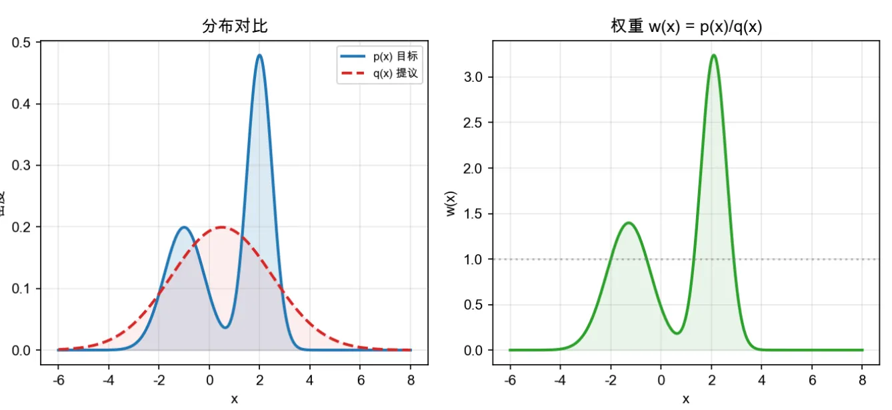
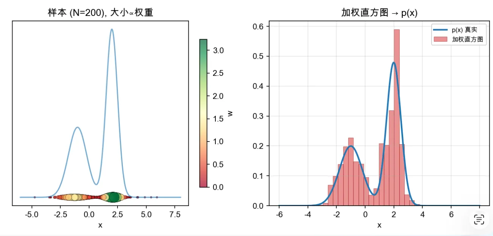

当你想要评估一个函数在一个分布$P$上的期望，但是无法从这个期望直接采样，于是从另一个分布$Q$去采样，然后计算在$P$上的期望，因为是从$Q$上进行采样的，所以需要一个权重去修正。这种修正的方法就叫重要性采样，下面将详细介绍其数学原理和应用

<!-- more -->
## 数学本质
重要性采样是一个“加权”的过程：用分布 Q产生的数据，去估计分布 P的期望值。 那个权重，就叫**重要性权重**（Importance Weight）。

在统计学中，我们想求函数 $f(x)$ 在真实分布 $p(x)$ 下的期望 $E_{x \sim p}[f(x)]$，但我们只能从另一个分布 $q(x)$ 中采样。

根据期望的定义，我们可以做一个简单的数学变换：

$$ 
E_{x \sim p}[f(x)] = \sum p(x) f(x) 
$$

$$ 
= \sum q(x) \frac{p(x)}{q(x)} f(x) 
$$

$$ 
= E_{x \sim q} \left[ \frac{p(x)}{q(x)} f(x) \right] 
$$

结论非常优雅：你可以从 $q(x)$ 中采样，但要把每次得到的结果 $f(x)$ 乘以一个比例 $\frac{p(x)}{q(x)}$。这个比例就是**重要性权重**。
*   如果 $p(x) > q(x)$，权重 $> 1$，说明这个样本在目标分布中更重要，要放大它的影响。
*   如果 $p(x) < q(x)$，权重 $< 1$，说明要缩小它的影响。

看下面的可视化图：

$p(x)$ 的peak附近会拉高权重，让采样的时候增加影响。通过下面的采样图可以更直观感受：

## 强化学习中的应用
在 RL 中，我们有两个策略：
1.  **目标策略 $\pi$ (Target Policy)**：我们正在训练、想要评估的策略。
2.  **行为策略 $\mu$ (Behavior Policy)**：在环境中实际与环境交互、收集数据的旧策略。

我们想计算目标策略 $\pi$ 跑完一局（一条轨迹 $\tau$）的期望总回报 $J(\pi)$。但手头只有行为策略 $\mu$ 跑出来的轨迹数据。

一条轨迹 $\tau = (s_0, a_0, s_1, a_1, ... , s_T)$ 在策略 $\pi$ 下发生的概率是：

$$ 
P_\pi(\tau) = P(s_0) \prod_{t=0}^T \pi(a_t|s_t) P(s_{t+1}|s_t, a_t) 
$$
*(初始状态概率 $\times$ 每一步的动作概率 $\times$ 每一步的环境状态转移概率)*

根据重要性采样，我们需要计算权重 $\rho = \frac{P_\pi(\tau)}{P_\mu(\tau)}$：

$$ 
\rho = \frac{P_\pi(\tau)}{P_\mu(\tau)} = \frac{P(s_0) \prod \pi(a_t|s_t) P(s_{t+1}|s_t, a_t)}{P(s_0) \prod \mu(a_t|s_t) P(s_{t+1}|s_t, a_t)} 
$$

分子和分母中的初始状态概率 $P(s_0)$ 和 环境的状态转移概率 $P(s_{t+1}|s_t, a_t)$ 是完全一样的，它们被约掉了

$$ 
\rho = \prod_{t=0}^T \frac{\pi(a_t|s_t)}{\mu(a_t|s_t)} 
$$

强化学习中，**我们通常不知道环境的动态模型 $P(s_{t+1}|s_t, a_t)$**（比如超级马里奥游戏内部的物理引擎）。重要性采样让我们完美绕过了环境模型，只需要知道“新策略采取该动作的概率”除以“旧策略采取该动作的概率”连乘起来即可。

有了 $\rho$，我们就可以用旧策略收集的回报 $G$，去更新新策略了：$E_\pi[G] = E_\mu[\rho \cdot G]$。

## 数学目的与工程结果的统一

*   **统计学中：** 用分布 $Q$ 的数据，加权评估分布 $P$ 的期望。
*   **在 PPO 中：** 分布 $Q$ 就是**旧策略**（收集数据时的策略 $\pi_{old}$），分布 $P$ 就是**新策略**（正在通过梯度下降更新的神经网络 $\pi_\theta$）。

我们想知道：“如果用我现在的**新策略**去玩游戏，期望得分会是多少？” 
如果没有重要性采样，唯一的办法就是把新策略放到环境里去跑一局（这就导致每次更新都要重新采样，数据利用率极低）。

因为重要性采样保留了“评估另一个分布的期望”的数学能力，它在 RL 工程上自然而然地产生了巨大的红利：**数据复用（Sample Efficiency）**。所以，增加数据利用率不是它目的的改变，而是其数学属性在现实中的直接变现。

现在我们来看公式：

$$
L^{I S} ( \theta)=\cfrac{\pi_{\theta} ( a_{t} | s_{t} )} {\pi_{o l d} ( a_{t} | s_{t} )} A_{t}=r_{t} ( \theta) A_{t}
$$

这个公式告诉神经网络：“新策略 $\pi_\theta$ 去评估一下旧策略做的动作。如果旧策略觉得是个好动作（$A_t>0$），而且你现在做这个动作的概率比旧策略还要高（$r_t > 1$），那我就给你更高的奖励得分。”

$A_t$是就策略在采样时期的优势评估值。
