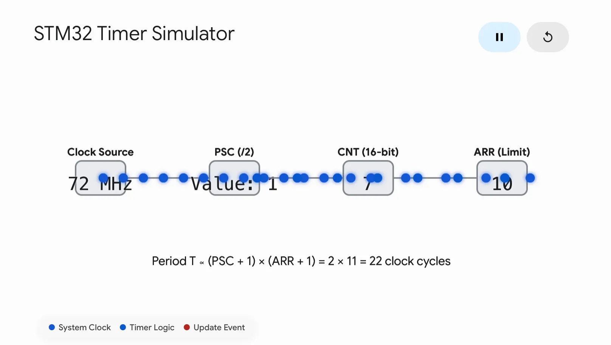
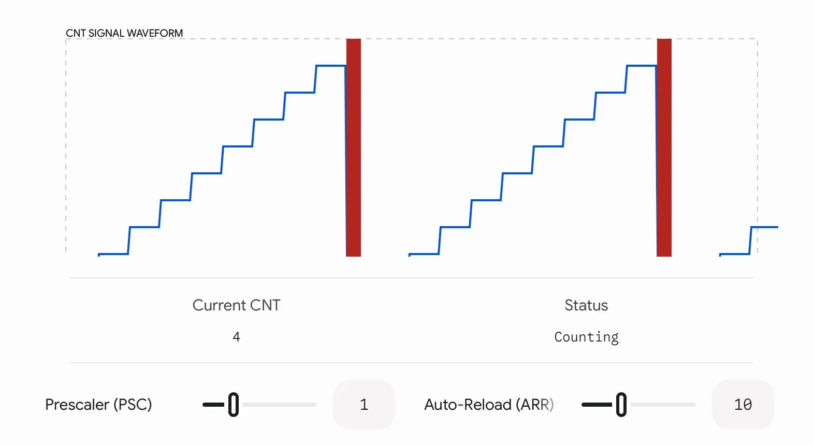
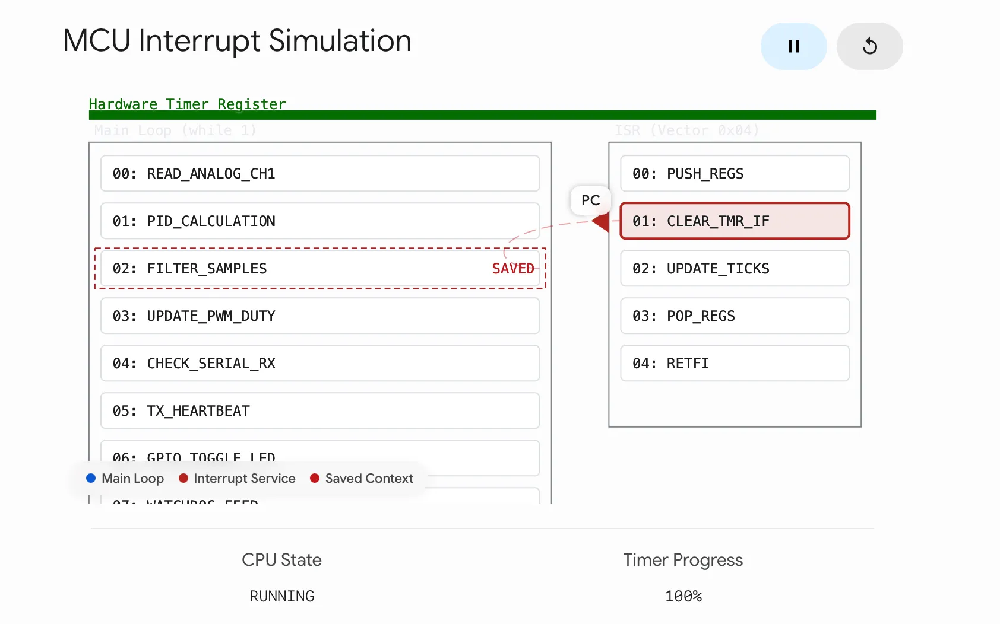
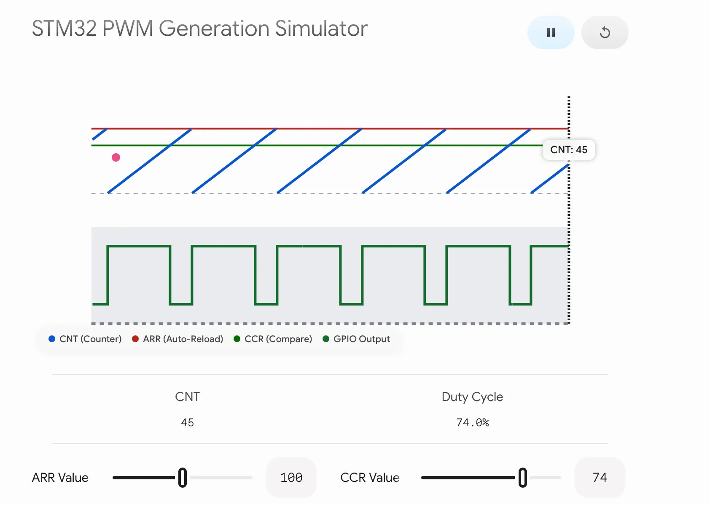
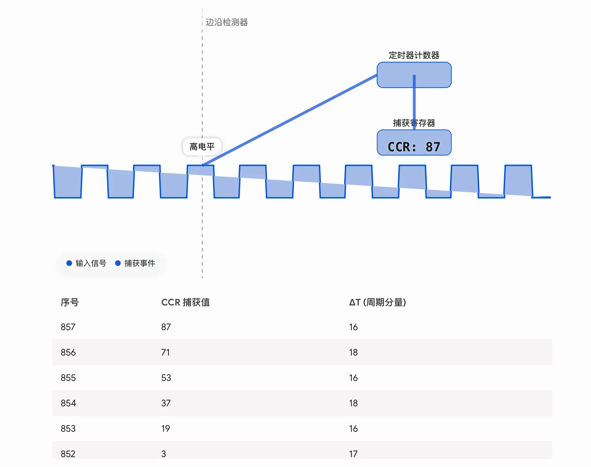

定时器作为单片机中的核心之一，其应用广泛。无论是在中断服务函数 ISR还是输出pwm中都是必不可少的，本文将详细解释其原理和具体的应用。

<!-- more -->

## 定时器原理
STM32的定时器（Timer）是其内部非常核心且功能强大的外设。简单来说，它的本质是**一个由硬件时钟驱动的计数器。**

要理解它的原理，我们可以把它的核心结构拆解为四个主要部分：**时钟源、预分频器（PSC）、计数器（CNT）和自动重装载寄存器（ARR）。**

### 1️⃣核心工作流程
这四个组件就像流水线一样协同工作：

- 时钟源 (Clock Source): 定时器的“心跳”来源，通常来自STM32的内部APB总线（例如72MHz）。每次时钟跳变，都会发送一个脉冲。

- 预分频器 (Prescaler, PSC): 因为内部系统时钟通常非常快（如72MHz），直接计数很快就会溢出。预分频器的作用是“降频”。它接收时钟源的脉冲，并按设定的比例放慢。
- 计数器 (Counter, CNT): 这是核心执行者。它根据预分频器降频后的时钟脉冲，进行加1（向上计数）或减1（向下计数）的操作。
- 自动重装载寄存器 (Auto-Reload Register, ARR): 这是你设定的“目标值”。当计数器（CNT）的值增加到与ARR的值相等时，或者从ARR减到0时，定时器就会产生一个更新事件 (Update Event, UEV) 或引发一个中断，随后计数器清零（或重装载），重新开始新一轮的计数。

用可视化观察就是如下图所示：

### 2️⃣定时时间的计算公式

根据上述机制，我们可以得出STM32定时器产生一次溢出（即一个完整定时周期）的时间公式：
$$
T=\frac{\left( P S C+1 \right) \times\left( A R R+1 \right)} {f_{C L K}}
$$

其中：

- T 是定时周期（单位：秒）
- $f_{C L K}$是定时器的输入时钟频率（例如 72,000,000 Hz）

## 定时器的应用
我们把定时器的应用分为软件和硬件两个层面。时器的硬件本质是一个计数器。它的运行是独立于CPU的主内核的。这意味着它可以在不占用CPU任何计算资源的情况下默默工作。它的主要作用可以归纳为两类：

- 软件层面的作用（涉及执行代码）：

1.定时中断： 这是你提到的情况。时间一到，通知CPU去执行一段特定的代码（称为中断服务函数 ISR）。比如：每1毫秒执行一次PID控制算法计算，或者每500毫秒翻转一次LED灯的状态。
- 硬件层面的作用（完全不打断代码，独立运行）：

1.输出PWM波： 定时器可以直接控制引脚输出高低电平交替的PWM波（比如用来控制电机转速）。在这个过程中，只要你初始化配置好了定时器，CPU就可以去干别的了，定时器硬件会全自动、精准地一直输出波形，不需要反复执行代码来翻转引脚。

2.输入捕获： 测量外部信号的频率或脉宽（比如读取编码器）。外部引脚来一个脉冲，定时器硬件自动记录当前的计数值，这也无需CPU时刻盯着引脚看。

## 中断服务函数
中断服务函数（Interrupt Service Routine，简称 ISR），是嵌入式和计算机系统中一种非常特殊的函数。

简单来说，它是硬件在紧急情况下，强制 CPU 暂停当前正在做的事情，转去执行的一段“紧急预案”代码。
当定时器满足定时条件，就可以跳转去执行中断服务函数，比如每秒钟打印一下温度传感器的值。可视化如下图：

## 输出PWM波
STM32定时器控制输出PWM（脉冲宽度调制）波的底层原理，核心在于“输出比较（Output Compare）”机制。它在基础定时器的基础上，引入了一个关键的硬件寄存器：捕获/比较寄存器（Capture/Compare Register, 简称 CCR）。

通过让定时器内部的计数器（CNT）与这个硬件寄存器（CCR）进行实时大小比较，引脚就能全自动地产生高低电平交替的PWM波，整个过程完全由硬件完成，不需要CPU的介入。

具体流程：
- 配置周期（决定PWM频率）：
计数器（CNT）从 0 开始随着时钟脉冲向上递增计数，直到达到自动重装载寄存器（ARR）的值，然后清零重新计数。**ARR 的值直接决定了PWM波的周期和频率。**

- 配置脉宽（决定占空比）：
你在 CCR 寄存器中写入一个目标值（该值必须小于或等于 ARR）。在硬件内部，比较器在每个时钟周期都会实时对比 CNT 与 CCR 的大小。

- 引脚电平的全自动翻转逻辑：

1. 前半周期（CNT<CCR）： 对应的GPIO引脚输出高电平（或配置的有效电平）。
2. 后半周期（CNT≥CCR）： 一旦计数器累加到等于或超过 CCR，硬件电路立即将引脚拉低，输出低电平。
3. 周期结束（CNT=ARR）： 计数器达到最大值后清零重头开始，引脚瞬间被重新拉高。

可视化如下：

## 输入捕获
一般用来测信号频率和占空比，如果只测信号频率，只需要上升沿触发或下降沿触发，如果要测占空比，需要双边触发。为了更好的理解策略信号频率，想象一下，用一个比喻来理解：

操场上有一个自动运行的电子秒表（定时器计数器），它从 0 开始，每隔 1 微秒自动加 1，一直往上数。

现在有一个跑步者（外部输入信号）要经过起点和终点：

- 起点打卡：当跑步者跨过起点的那一瞬间，触发了一个机关，秒表并没有停止，但机关立刻把那一瞬间秒表显示的数值（比如 1000）“啪”地一下复印在一张纸上（捕获寄存器）。

- 终点打卡：当跑步者跨过终点的那一瞬间，机关再次触发，把当前秒表的数值（比如 2500）又复印了一份。

- 计算时间：你拿到这两张纸，用 2500 - 1000 = 1500。因为秒表每微秒加 1，所以跑步者用时就是 1500 微秒

在单片机（如 STM32）中，这个过程是由专门的高效硬件电路自动完成的，不需要 CPU 实时盯着，从而保证了高精度。

### 核心硬件元件
计数器（CNT, Counter）：定时器的核心，由内部时钟驱动，按照设定的频率（比如 1MHz，即 1 微秒一步）不停地累加计数。

边沿检测器（Edge Detector）：连接到外部引脚。它可以配置为检测上升沿（电平由低变高）、下降沿（电平由高变低）或双边沿。

捕获寄存器（CCR, Capture/Compare Register）：专门用来存放“打卡数值”的寄存器。

### 测量脉宽
如何测量一个脉冲的宽度（高电平时间）？

假设定时器的计数器（CNT）一直在以 1MHz（即 1μs 计一次数）的速度向上累加：

第1步： 配置输入捕获通道为上升沿触发。

第2步： 外部信号从低变高（上升沿），触发捕获。硬件自动将此时的 CNT 值（假设是 1000）复制到 CCR 中。CPU在中断里读取出来，记录为 $t =1000$。

第3步： 紧接着，立刻通过软件将触发方向改为下降沿触发。

第4步： 外部信号从高变低（下降沿），再次触发捕获。硬件自动将此时新的 CNT 值（假设是 2500）复制到 CCR 中。CPU读取出来，记录为 $t_2=2500$
计算结果： 高电平持续的计数次数$ = t_2−t_1 =2500−1000=1500 $次。因为 $1μs $计一次数，所以脉冲宽度 $= 1500×1μs=1500μs=1.5ms$。

⚠️：(注意：如果高电平持续时间很长，期间定时器溢出了，还需要加上 溢出次数 × ARR 的补偿)

这里用可视化来看就是：

